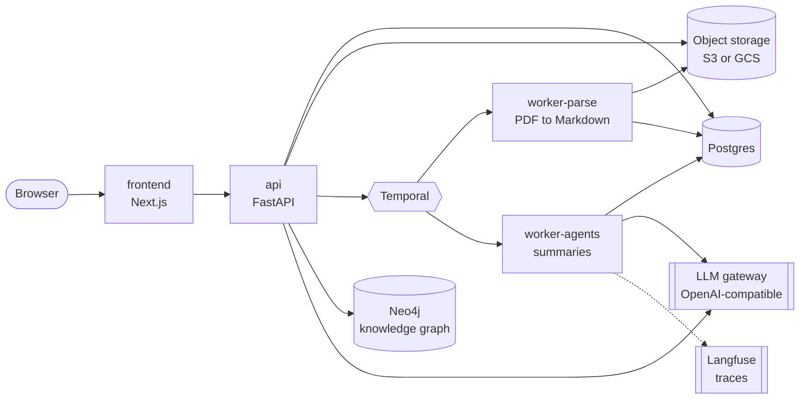

# Quick start

This guide runs SpecFlow on your machine with Docker, then shows how the parts fit
together. For every setting, see [`docs/configuration.md`](docs/configuration.md).

## What you need

| Need | Why | Notes |
|---|---|---|
| Docker with the Compose plugin | Runs the whole stack | Docker Desktop, OrbStack or Docker Engine |
| `make` and `openssl` | `make env-local` writes random local secrets | Already on macOS and most Linux systems |
| An OpenAI-compatible LLM gateway | Summaries and the knowledge-graph build | You need its URL, an API key and a model name |
| Temporal | Runs the background workflows | Use your own on `localhost:7233`, or start the bundled one (`WITH=temporal`) |
| Langfuse (optional) | Shows the agent traces | Use your own, start the bundled one (`WITH=langfuse`), or leave it off |

For development you also need [uv](https://docs.astral.sh/uv/), Python 3.12 and
Node.js 20.9 or newer.

## Run it

1. Write the local env file once. It holds random local secrets only:

   ```shell
   make env-local
   ```

2. Open `.env.local` and add your LLM settings:

   ```dotenv
   AGENT_MODEL=<model name>
   LLM_GATEWAY_URL=<https://your-gateway/v1>
   LLM_GATEWAY_API_KEY=<key>
   # The knowledge-graph build stays off until these three are set:
   GRAPH_LLM_MODEL=<model name>
   GRAPH_SMALL_MODEL=<smaller, cheaper model name>
   GRAPH_EMBEDDING_MODEL=<embedding model name>
   ```

3. Start the stack. Pick the line that fits you:

   ```shell
   make up                          # you already run Temporal on localhost:7233
   make up WITH=temporal            # start a bundled Temporal too
   make up WITH=temporal,langfuse   # bundled Temporal and Langfuse
   ```

   `make up` builds the images, starts the services and waits until they are healthy.

4. Open http://127.0.0.1:3001 and sign in. Locally the app uses a dev login
   (`dev@example.com` by default), so you need no identity provider.

5. Create a project, add a source (upload PDFs), then press the build button on the
   project page to build the knowledge graph. Google Drive folders also work as a
   source; they need a Google service identity (see `DRIVE_IDENTITY_EMAIL` in
   [`docs/configuration.md`](docs/configuration.md)).

Stop the stack with `make down`. This keeps your data. `make down-volumes` deletes
the local databases and files: use it only for a clean start.

## What runs

| Service | Port on your machine | Role |
|---|---|---|
| `frontend` | 3001 | Next.js web app |
| `api` | 8000 | FastAPI: projects, sources, uploads, workflow starts, the knowledge-graph build; runs the database migrations on start |
| `worker-parse` | - | Temporal worker: PDF to Markdown |
| `worker-agents` | - | Temporal worker: AI summaries |
| `postgres` | 5433 | Projects, documents, Markdown, summaries |
| `neo4j` | 7474 (browser), 7687 | The knowledge graph |
| `rustfs` | 19000 | Local S3-compatible object storage for uploaded files |
| `temporal` (with `WITH=temporal`) | 7233, 8233 (UI) | Bundled Temporal dev server |
| `langfuse-*` (with `WITH=langfuse`) | 3000 | Bundled Langfuse for traces |

All ports bind to `127.0.0.1` only.

## Architecture



How a document flows through the system:

1. You add a source. The `api` stores each file in object storage, write-once.
2. A Temporal workflow asks `worker-parse` to turn the PDF into Markdown. The Markdown
   goes to Postgres.
3. `worker-agents` writes a summary of each document with the LLM gateway.
4. When you build the project, the `api` reads all current documents and builds
   a typed knowledge graph in Neo4j: modules, features, capabilities and requirements,
   how they relate, and which lines of which documents state them. A later build
   changes only what the changed documents affect.

The graph follows an ontology file (`docs/graph/spec-ontology.yaml`). The design is in
[`docs/graph/`](docs/graph/INDEX.md).

## Run in the cloud

The same images run on any cloud. You need:

- Postgres, Neo4j and Temporal that the services can reach.
- An object-storage bucket. Choose the provider with a cloud profile file
  (`SPECFLOW_CONFIG_FILE`: `cloud: gcp`, `aws` or `local`) or with `STORAGE_BACKEND`.
- An OpenID Connect provider for sign-in (`AUTH_MODE=oidc`).

[`docs/configuration.md`](docs/configuration.md) lists every variable, with its
default, and the cloud profile format.

## Develop

```shell
make setup           # backend virtual environment (uv)
make frontend-setup  # frontend dependencies (npm)
```

| Command | What it does |
|---|---|
| `make up`, `make down` | Start and stop the stack |
| `make logs`, `make ps` | Follow the logs; list the services and their health |
| `make api`, `make worker` | Run the API or a worker on your machine against the local stack |
| `make check` | Backend lint and offline tests |
| `make frontend-lint frontend-build` | Frontend lint and build |
| `make e2e-production` | Offline browser tests against the built frontend |
| `make validate` | All static validation tracks that CI runs |

| Folder | What is in it |
|---|---|
| `backend/` | Python service: API, workers, graph library. See [`backend/README.md`](backend/README.md). |
| `frontend/` | Next.js web app. See [`frontend/README.md`](frontend/README.md). |
| `docs/` | Configuration reference, graph design, design system |
| `validation/` | The static checks that CI runs |

Logs go to stdout only, one JSON object per line. Never commit `.env.local` or a
real secret.
