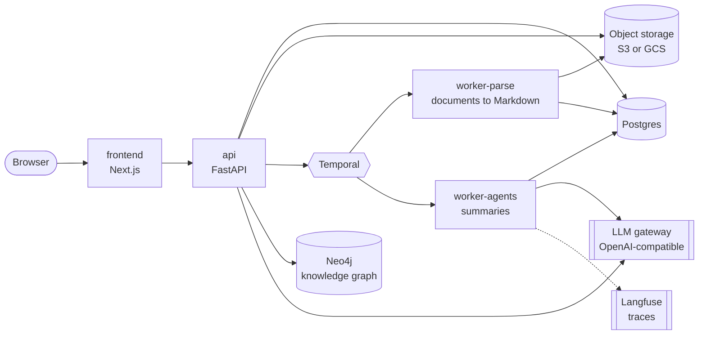

# Quick start

This guide runs SpecFlow on your machine with Docker, then shows how the parts fit
together. For every setting, see [`docs/configuration.md`](docs/configuration.md).

## What you need

| Need | Why | Notes |
|---|---|---|
| Docker with the Compose plugin | Runs the whole stack | Docker Desktop, OrbStack or Docker Engine. `worker-parse` alone is limited to 3 GiB of memory |
| `make` and `openssl` | `make env-local` writes random local secrets and asks for your sign-in email and your LLM settings | Already on macOS and most Linux systems |
| Chromium or Firefox | Sign in to the web app | Safari refuses the `Secure` cookies of the local Keycloak on `http://localhost` |
| An OpenAI-compatible LLM gateway | Summaries and the knowledge-graph build | You need its URL, an API key and a model name |
| Temporal | Runs the background workflows | Use your own on `localhost:7233`, or start the bundled one (`WITH=temporal`) |
| Langfuse (optional) | Shows the agent traces | Use your own, start the bundled one (`WITH=langfuse`), or leave it off |

For development you also need [uv](https://docs.astral.sh/uv/), Python 3.12 and
Node.js 20.9 or newer.

## Run it

1. Write the local env file. It generates the local secrets, including the password and the id of your local
   sign-in user. Then it asks for your sign-in email (Enter takes `git config user.email`; with no terminal it uses
   `dev@example.com`) and for your LLM settings: `AGENT_MODEL`, `LLM_GATEWAY_URL` and `LLM_GATEWAY_API_KEY` (the key is
   not shown as you type; Enter skips a question). It also sets `AUTH_ALLOWED_EMAIL_DOMAINS` to the domain of your
   email plus `example.com`. Run it again after every update: it adds any secret a release introduced, asks only for
   settings that are still missing, and never changes a value or prints one:

   ```shell
   make env-local
   ```

2. Optional: add the knowledge-graph settings to `.env.local`. You can also edit the LLM settings there by hand:

   ```dotenv
   # The knowledge-graph build stays off until these three are set:
   GRAPH_LLM_MODEL=<model name>
   GRAPH_SMALL_MODEL=<smaller, cheaper model name>
   GRAPH_EMBEDDING_MODEL=<embedding model name>
   ```

3. Start the stack. Pick the line that fits you:

   ```shell
   make up                          # you already run Temporal on localhost:7233
   make up WITH=temporal            # start a bundled Temporal too
   make up WITH=temporal,langfuse   # bundled Temporal and Langfuse
   ```

   `make up` builds the images, starts the services, including the local Keycloak, and waits until they are
   healthy. If `.env.local` is missing or lacks a Keycloak value, it stops at once and tells you to run `make env-local`.
   The first build is slow: the `worker-parse` image downloads PyTorch and the
   Docling models once, and then runs without network access.

4. Open http://localhost:3001 and press "Sign in". Use `localhost`, not `127.0.0.1`: the sign-in returns to
   `localhost`. The local Keycloak asks for your email and the password in `.env.local` (`LOCAL_TEST_USER_PASSWORD`).
   Read it without printing the whole file:

   ```shell
   grep '^LOCAL_TEST_USER_PASSWORD=' .env.local
   ```

   The realm also has three QA users for tests: `alice@example.com`, `bob@example.com` and `carol@other.example`, all
   with `KEYCLOAK_QA_PASSWORD` from `.env.local`. `carol` is refused on purpose, because her domain is not allowed.

5. Create a project, add a source (upload PDF, Word, PowerPoint, Excel, HTML,
   Markdown or CSV files), then press the build button on the project page to
   build the knowledge graph. Google Drive folders also work as a source; they
   need a Google service identity (see `DRIVE_IDENTITY_EMAIL` in
   [`docs/configuration.md`](docs/configuration.md)). Formats, limits and error
   codes are in [`docs/file-parsers/`](docs/file-parsers/INDEX.md).

Stop the stack with `make down`. This keeps your data. `make down-volumes` deletes
the local databases and files: use it only for a clean start.

Keycloak has no data volume, by design. Each time its container is created, it imports the realm again from
`.env.local`, so your user, its id and the QA users stay the same and your projects stay yours. Its sessions do not
survive: after `make down` and `make up` (or after you change a value that Keycloak reads), sign in again in the
browser and in Claude Code. A change to `config/keycloak/specflow-realm.json` alone does not recreate the container;
run `make down` and `make up`.

### Upgrading from the dev login

Older versions signed you in with a dev login and stored your data under the user `dev:<email>`. That user does not
exist any more, and nothing migrates its data. Once, on the upgrade:

1. Run `make down-volumes` (type `yes`). This deletes the local databases and files.
2. Run `make env-local`. It adds the new names and asks for your email.
3. Open `.env.local` and delete a line `AUTH_MODE=dev`. Containers never get it, but `make api` and `make frontend-dev` read the file and refuse to start with it. You can
   also delete `AUTH_DEV_SIGNING_KEY`: it is ignored now.
4. Run `make up`.

## What runs

| Service | Port on your machine | Role |
|---|---|---|
| `frontend` | 3001 | Next.js web app |
| `api` | 8000 | FastAPI: projects, sources, uploads, workflow starts, the knowledge-graph build; runs the database migrations on start |
| `mcp` | 8002 | MCP endpoint for coding agents such as Claude Code: read-only project tools; sign-in through the local Keycloak |
| `worker-parse` | - | Temporal worker: documents (PDF, Word, PowerPoint, Excel, HTML, Markdown, CSV) to Markdown; its own image, 3 GiB |
| `worker-agents` | - | Temporal worker: AI summaries |
| `postgres` | 5433 | Projects, documents, Markdown, summaries |
| `neo4j` | 7474 (browser), 7687 | The knowledge graph |
| `rustfs` | 19000 | Local S3-compatible object storage for uploaded files |
| `temporal` (with `WITH=temporal`) | 7233, 8233 (UI) | Bundled Temporal dev server |
| `langfuse-*` (with `WITH=langfuse`) | 3000 | Bundled Langfuse for traces |
| `keycloak` | 8180 | Local identity provider: signs you in to the web app and to Claude Code. It starts with every `make up` and keeps no data volume |

All ports bind to `127.0.0.1` only.

Connect Claude Code to the local MCP endpoint. Run this once:

```shell
claude mcp add --transport http --scope user --client-id specflow-mcp --callback-port 8765 specflow-local http://localhost:8002/mcp
```

Then run `/mcp` in Claude Code, select `specflow-local` and choose Authenticate. The browser opens the local Keycloak:
sign in with the same email and password as the web app. Claude Code then sees the same user and the same projects as
the web app. Port 8765 must be free during the sign-in. After a Keycloak container is recreated, authenticate again.

Then bind your repository to a SpecFlow project, once per repository, by running this in Claude Code:

```text
/mcp__specflow-local__select_project
```

The agent writes `.specflow/config.json`; see [Bind a repository to a project](docs/mcp-server/deployment.md#bind-a-repository-to-a-project).

The web app shows these commands with copy buttons: open Guides > MCP server at `http://localhost:3001/guides/mcp-server`.
The name `specflow-local` comes from `MCP_SERVER_NAME`, which the local stack sets.

For more detail, see [Local endpoint](docs/mcp-server/deployment.md#local-endpoint).

## Architecture



How a document flows through the system:

1. You add a source. The `api` stores each file in object storage, write-once.
2. A Temporal workflow asks `worker-parse` to turn the file (PDF, Word, PowerPoint,
   Excel, HTML, Markdown or CSV) into Markdown. The Markdown goes to Postgres. A file
   over a limit ends as `document_too_large`; one that cannot be read ends as
   `document_parse_failed` (or `pdf_parse_failed` for a PDF).
3. `worker-agents` writes a summary of each document with the LLM gateway.
4. When you build the project, the `api` reads all current documents and builds
   a typed knowledge graph in Neo4j: modules, features, capabilities and requirements,
   how they relate, and which lines of which documents state them. A later build
   changes only what the changed documents affect.

The graph follows an ontology file (`docs/graph/spec-ontology.yaml`). The design is in
[`docs/graph/`](docs/graph/INDEX.md).

## Run in the cloud

The same images run on any cloud. You need:

- Postgres, Neo4j and Temporal that the services can reach.
- An object-storage bucket. Choose the provider with a cloud profile file
  (`SPECFLOW_CONFIG_FILE`: `cloud: gcp`, `aws` or `local`) or with `STORAGE_BACKEND`.
- An OpenID Connect provider for sign-in (`OIDC_ISSUER`, and a client for the web app).

[`docs/configuration.md`](docs/configuration.md) lists every variable, with its
default, and the cloud profile format.

## Develop

```shell
make setup           # backend virtual environment (uv)
make frontend-setup  # frontend dependencies (npm)
```

| Command | What it does |
|---|---|
| `make up`, `make down` | Start and stop the stack |
| `make logs`, `make ps` | Follow the logs; list the services and their health |
| `make api`, `make worker` | Run the API or a worker on your machine against the local stack |
| `make check` | Backend lint and offline tests |
| `make frontend-lint frontend-build` | Frontend lint and build |
| `make e2e-production` | Offline browser tests against the built frontend |
| `make validate` | All static validation tracks that CI runs |

| Folder | What is in it |
|---|---|
| `backend/` | Python service: API, workers, graph library. See [`backend/README.md`](backend/README.md). |
| `frontend/` | Next.js web app. See [`frontend/README.md`](frontend/README.md). |
| `docs/` | Configuration reference, graph design, design system |
| `validation/` | The static checks that CI runs |

Logs go to stdout only, one JSON object per line. Never commit `.env.local` or a
real secret.
