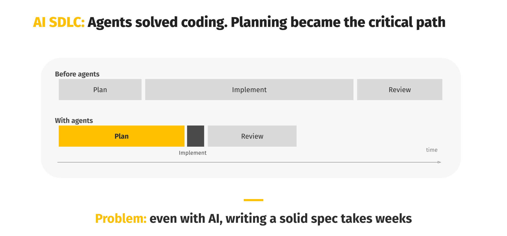
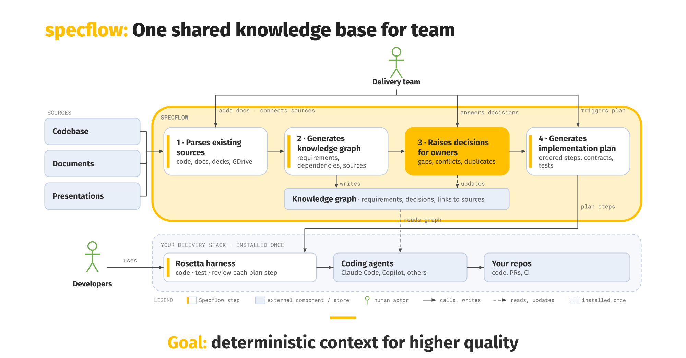
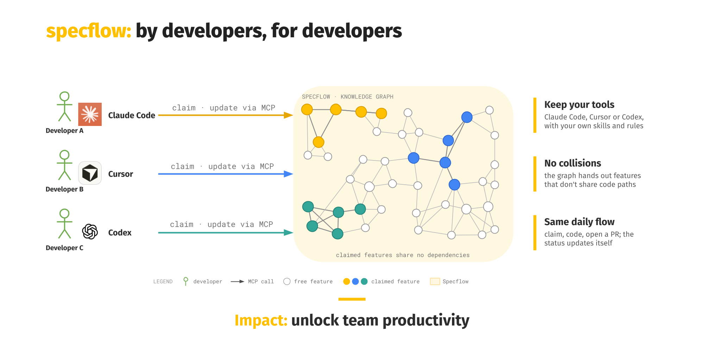

<div align="center">
<picture>
  <source media="(prefers-color-scheme: dark)" srcset="public/specflow-logo-dark.png"/>
  
</picture>

### One Shared Knowledge Base for Agentic Delivery

[](LICENSE)
[](https://www.python.org/downloads/)
[](https://nextjs.org/)
[](QUICKSTART.md)

</div>

---
Agents solved coding. Planning became the critical path.
SpecFlow turns your scattered specs into one shared knowledge graph.
People and coding agents build from the same, complete context.

<!-- TODO: product GIF (add a source -> build -> explore the graph) -->

## The problem

With AI coding agents, implementation takes a fraction of the time it used to.
Planning did not get faster. **Even with AI, writing a solid spec still takes weeks**,
and agents build exactly what an unclear spec says.

<p align="center">
  
</p>

A real spec is dozens of documents, decks and Drive folders, written by different
people at different times. Requirements repeat and contradict each other, and key
decisions are missing. Teams find out while they build, which is the most expensive
moment.

## How SpecFlow helps

<p align="center">
  
</p>

The graph stays current: when a document changes, the next build updates only what
that change affects. Its vocabulary comes from an ontology file, so you can fit it to
your domain without code changes.

## What changes for your team

<p align="center">
  
</p>

## Try it

```shell
make env-local          # writes local secrets and asks for your LLM gateway settings
make up WITH=temporal   # starts the whole stack in Docker
```

Open http://127.0.0.1:3001. Prerequisites, the architecture and the development
commands are in [**QUICKSTART.md**](QUICKSTART.md).

## Learn more

- [QUICKSTART.md](QUICKSTART.md): run it, how it fits together, develop
- [docs/configuration.md](docs/configuration.md): every setting
- [docs/graph/](docs/graph/INDEX.md): how the knowledge graph is built
- [Rosetta](https://github.com/griddynamics/rosetta): the harness that turns plan steps into reviewed code

## Contributing

Contributions are welcome. See [CONTRIBUTING.md](.github/CONTRIBUTING.md) and our
[Code of Conduct](.github/CODE_OF_CONDUCT.md). To report a vulnerability, follow
[SECURITY.md](.github/SECURITY.md).
