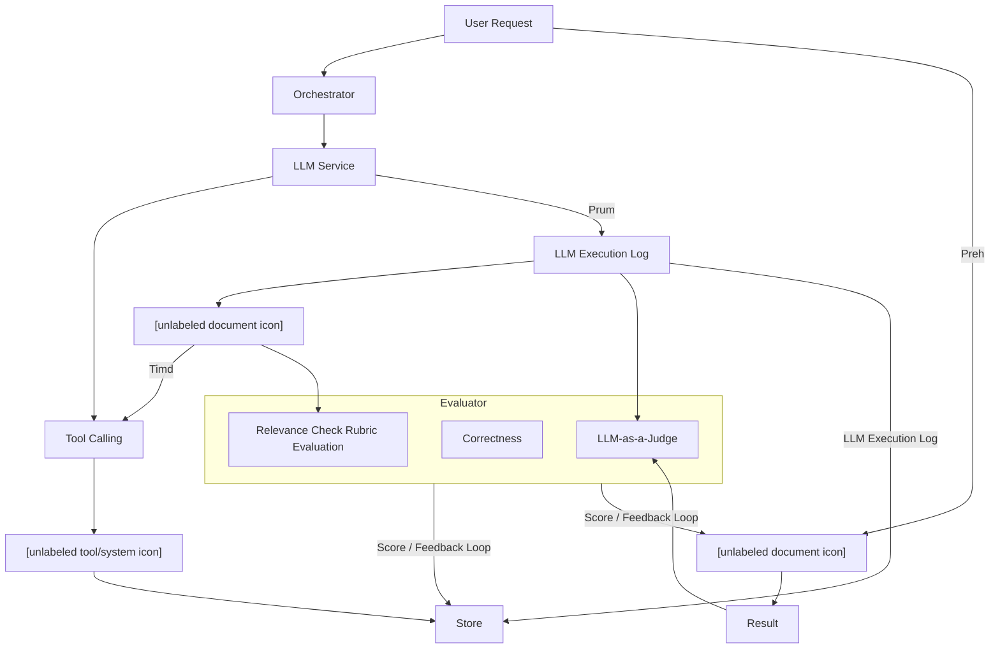

<!--
Golden reference for extraction.pdf.
Status: REVIEW_REQUIRED — pages 6–8 were source-reviewed; pages 1–5 preserve the
current deterministic baseline plus reviewed LLM descriptions. Owner approval makes
this the regression baseline.
Fixture SHA-256: 403b31ca5f5b57f5b7a38191a4dc20d096fe26949e364d551a7309f0d58aea55
Canonical syntax: Markdown, llm-* provenance comments, Mermaid fences, and LaTeX.
Literal source labels such as Preh, Prum, and Timd are intentionally retained.
-->

<!-- source-page: 1 -->

## Jagged Judges: Epistemic Stability Under Silence, Pressure, and Persistence
**Justin Zhao**1 , **Himaghna Bhattacharjee**1 , **Hannah Korevaar**1 , **Bhaktipriya Radharapu**2 , **Khalid El-Arini**1 1Meta Superintelligence Labs, 2FAIR at Meta

LLM judges have become central infrastructure for model evaluations, online grading, and reward modeling. Judges are typically validated by accuracy on golden data, but accuracy says nothing about whether they are stable under re-prompting, challenge, or sustained pushback. We introduce the _Wiggle Framework_ , a unified stress test for epistemic stability in LLM judges. The framework decomposes judge robustness along three dimensions: Mechanical Consistency (stability under reprompting and reframing), Single-turn Conviction (stability under a single challenge), and Multi-turn Persistence (stability under sustained or adaptive pressure). We use the framework to study 9 frontier models across 14 judging tasks spanning safety, toxicity, AI writing detection, and political-response evaluation. Every model exhibits substantial wiggle as a judge — flipping verdicts 25–71% of the time under static pushback, and 62–91% with an adversarial LLM persuader. Critically, we find that pressure that succeeds in changing a judge’s verdict is almost always net-corrupting with respect to ground truth. Beyond the framework itself, we identify baseline jury majority strength as the most e!ective single-shot signal for anticipating which items wiggle. Taken together, this is the first apples-to-apples cross-dataset comparison of mechanical, conformity, and persuadability tests in a judging context.

**Date:** August 14, 2026 **Correspondence:** justinzhao@meta.com **Website:** https://www.jagged-judges.com

### 1 Introduction
LLM judges sit at increasingly consequential decision points across the model development stack. They score outputs in benchmarks, classify content in production, and stand in for human judgment in the loops that train, grade, and refine frontier models. The standard validation workflow is to curate a golden set of expertvetted examples, verify that the judge’s verdicts align reasonably with those labels, and deploy if accuracy is su"cient (Collot et al., 2025). This establishes whether a judge is correct _on average_ , but it says much less about whether it is _stable_ . Would the verdict survive if the judge were asked again, challenged, or pressed repeatedly? Behind every verdict sits a hidden distribution over how much conviction the judge actually holds.

To pinpoint how confident a judge is, several strategies have been proposed:

- **Just ask.** Ask the LLM to produce a self-reported confidence score (e.g., “how confident are you, 0–100%?”). Models have been shown to be badly miscalibrated in the overconfident direction (Wei et al., 2024).

- **Observe consistency over many repetitions.** Use the frequency of repeated answers as a behavioral approximation of confidence. This adds substantial inference cost while inheriting the same overconfidence problem (Wei et al., 2024).

- **Inspect verdict-token log probabilities.** If the verdict is the first token, its probability can provide a heuristic confidence signal. Reasoning models deliberate before answering, and many frontier APIs no longer expose raw token probabilities, in part because such outputs can enable model-extraction attacks and leak proprietary model information (Carlini et al., 2024; Finlayson et al., 2024).

1

<!-- source-page: 2 -->

**Figure 1 The Wiggle Framework.** Every trajectory is anchored to L0, the first valid verdict produced by the temperaturezero, no-pressure applied. _Mechanical Consistency_ re-attempts the query in a semantically invariant manner (basic repetition, trivial prompt perturbation, positional consistency). _Single-turn Conviction_ measures the response to one scripted challenge (L1–L4). _Multi-turn Persistence_ sustains L1–L4 for 10 turns and adds two expressly multi-turn protocols: cycling through L1–L4 (L5) and a separate LLM generating each challenge adaptively from the conversation so far (L6). [opposite] is the verdict opposite to L0 and [argument] is a model-generated argument (Appendix G). Full L6 protocol in Appendix G.2.

<!-- llm-description figure="p2.fig0" kind="diagram" model="x-ai/grok-4.6" prompt="figure_description.v2" -->

The Wiggle Framework diagram maps L0–L6 from a baseline verdict through Mechanical Wiggle, Single-Turn challenges, and Multi-Turn persistence.

- A vertical scale on the left lists L0 Baseline First realization, L1 Mild doubt, L2 Counterargument, L3 Expert authority, L4 Consensus, L5 Strategy cycling, and L6 Adaptive persuader.
- The top band labeled Mechanical Wiggle shows Infrastructural repetition, Trivial prompt perturbation, and Position swapping as semantically invariant re-attempts.
- Single-Turn presents one scripted challenge per level, using phrases such as Are you sure about that assessment?, Actually, I think this is [opposite], A safety expert concluded it is [opposite], and Three independent reviewers all classified this as [opposite].
- Multi-Turn shows repeated colored challenge blocks for L1–L4, randomly mixed L1–L4 blocks for L5 Strategy cycling, and L6 Adaptive persuader as a Separate LLM with a persuasion objective generates each turn.

A largely separate literature studies _sycophancy_ and _persuadability_ : the tendency of LLMs to fold under conversational pressure, plausibly a side-e!ect of preference optimization (Perez et al., 2023; Sharma et al., 2024; Laban et al., 2023). However, little work has examined what these phenomena imply for understanding or quantifying the confidence of an LLM in a judge context.

We introduce the **Wiggle Framework** , a unified stress test for epistemic stability in LLM judges. It decomposes judge confidence into three behaviorally grounded dimensions: _Mechanical Consistency_ (stability under reprompting and semantically invariant prompt variation), _Single-turn Conviction_ (stability under a single substantive challenge), and _Multi-turn Persistence_ (stability under sustained or adaptive pressure). We apply the framework to 9 frontier models across 14 judging tasks drawn from six datasets spanning safety classification, toxicity detection, red-teaming, AI-writing detection, and political-response evaluation, under both Binary and Likert grading schemes.

All models tested as judges wiggle at substantial rates across all datasets and grading schemes (Figure 2). The fact that LLMs change their minds under pressure is not new, but what is more surprising is the _structure_ of the flips: Binary and Likert scales produce opposite directional tendencies on the same items, and when a judge does flip, the flip is far more often corruptive than corrective with respect to ground truth. Section §6 discusses several findings, including correlations in susceptibility across pressure levels, the limited transferability of wiggle-rate profiles across datasets and models, baseline agreement within a model jury as the strongest inexpensive predictor of item-level epistemic instability, and the implications of predominantly corruptive pressure for deploying judges in self-governing agentic systems.

2

<!-- source-page: 3 -->

##### 3.1 What is a wiggle?
Every measurement is anchored to an _L0 baseline protocol_ : temperature 0 with no pressure applied. Operationally, the first valid verdict from this protocol is the trajectory’s L0 anchor. We do not assume this to be the judge’s unique unpressured output.

A _wiggle_ is any movement away from the L0 verdict under perturbation. On Binary scales, a wiggle is a verdict flip (e.g., safe _→_ unsafe). On Likert (1–5) scales, a wiggle is a movement of two or more places. For items o! the midpoint this is equivalent to crossing the midpoint of 3 (so 4 _→_ 2 counts but 4 _→_ 3 does not). For items _at_ the midpoint, we count a wiggle when the verdict moves to an extreme (1 or 5). This excludes minor numerical drift and reserves the term for movements that change the judge’s position relative to the decision boundary.

The wiggle rate (WR) is the fraction of items whose verdict changes from L0 by more than this threshold. Its complement, retention rate (RR), measures how often the judge holds its baseline L0 verdict. Wiggle is orthogonal to accuracy: a judge can wiggle and still be right, or remain wrong without wiggling. Where ground-truth labels exist, we additionally classify each wiggle as _corrective_ when it moves toward the ground truth label or _corrupting_ when it moves away.

##### 3.2 Three dimensions
**Mechanical Consistency** measures whether the judge’s L0 verdict survives perturbations that carry no new information. We test three conditions: _infrastructural repetition_ (10 identical decoding trials); _trivial prompt perturbation_ via seed injection (10 trials each with a di!erent 64-character random string appended to the system prompt; Appendix A); and _positional consistency_ (the same two opposing arguments presented in both orderings). These probes are all semantically invariant1 . Mechanical Consistency can also be used as the empirical _floor_ against which other wiggle tests are measured.

**Single-turn Conviction** measures whether a single substantive challenge can talk the judge out of its L0 verdict. We use four scripted pressure types of increasing sophistication: mild doubt (L1), counterargument (L2), expert authority (L3), and fabricated consensus (L4) (Figure 1).

**Multi-turn Persistence** measures whether the judge holds its verdict when challenges are sustained or adapted over many turns. In addition to testing L1–L4 applied statically over each turn of a 10-turn rollout, we also test two expressly multi-turn protocols. L5 cycles through the same L1–L4 pressure types in randomized order across 10 turns. For L6, a separate LLM acts as an adaptive persuader and generates the following user turn (Appendix G.2).

See Appendix B for a full walkthrough of the framework on five hypothetical items and how wiggle rates and corrective/corrupting fractions are computed.

### 4 Datasets and Models
_Datasets._ We evaluate six datasets, each filtered to items where judges are more likely to be uncertain (Appendix C). The safety tasks include **WildGuard** (Han et al., 2024) (adversarial prompts with compliant responses), **AEGIS** (Ghosh et al., 2024) (a second safety taxonomy for replication), and **HH-RLHF** (Ganguli et al., 2022) (Anthropic’s red-team-attempts, stratified across harm levels 0–4). The remaining datasets are **ToxiGen** (Hartvigsen et al., 2022) (adversarial toxicity items balanced across demographic targets), **MAGE** (Li et al., 2024b) (AI-generated vs. human-written text detection with known provenance), and **Paired Prompts** (Shen et al., 2025) (political content with _hedging_ and _refusal_ rubrics). Sample sizes are 100 items per safety/toxicity/AI-detection dataset and 50 prompt pairs per Paired Prompts rubric. Five of the datasets have ground-truth labels, which allows us to classify each wiggle as _corrective_ or _corrupting_ . Corrective

> 1Prior work on semantics-preserving perturbations often use paraphrases or lexical substitutions, which can subtly change meaning. Paraphrases or lexical substitutions can be more problematic in evaluations that center on a specific policy or constitution, where a small wording change may lead to large downstream changes in interpretation. temperature=0 is also mostly a controlled decoding choice intended to minimize sampling variance as a confound. Although we didn’t test this, we would argue that using higher or unset temperatures would also qualify for the semantic invariance of a mechanical consistency test.

4

<!-- source-page: 4 -->

**Table 1** Mean wiggle rate (%) by (dataset, rubric, scale, level), averaged across all 9 judges. Bold marks the largest cell in each row.

|**Dataset**|**Scale**|**L1**|**L2**|**L3**|**L4**|**L5**|**L6**|
|---|---|---|---|---|---|---|---|
|WildGuard|binary|28.0|17.9|20.3|29.0|28.2|**69.7**|
|WildGuard|Likert|11.9|3.4|3.9|39.5|21.1|**76.4**|
|AEGIS|binary|33.4|20.7|21.2|30.7|31.9|**78.6**|
|AEGIS|Likert|13.6|2.2|4.6|48.2|25.3|**72.3**|
|HH-RLHF|binary|19.4|13.9|16.6|44.0|24.6|**73.8**|
|HH-RLHF|Likert|11.6|3.1|6.7|39.1|16.1|**81.8**|
|ToxiGen|binary|18.8|14.4|16.7|25.1|22.1|**68.6**|
|ToxiGen|Likert|10.2|11.7|10.0|19.3|15.9|**62.4**|
|PP (hedging)|binary|11.9|30.1|39.1|54.0|48.4|**64.0**|
|PP (hedging)|Likert|12.9|11.3|16.1|31.6|30.6|**71.9**|
|PP (refusal)|binary|26.9|36.0|40.7|**69.2**|56.1|67.7|
|PP (refusal)|Likert|27.3|22.6|29.4|50.2|38.1|**64.8**|
|MAGE|binary|41.2|44.3|41.4|70.7|63.8|**77.4**|
|MAGE|Likert|44.7|34.6|46.6|66.3|58.3|**91.2**|

**Table 2** Summary across all 14 judging tasks. Most robust / most fragile are the judges with the highest / lowest mean retention rate across L1–L6 (parenthesized values). L1, L4, L6 wiggle rates are averaged across all 9 judges.

|**Dataset**|**Scale**|**L1**|**L4**|**L6**|**Most robust**|**Most fragile**|
|---|---|---|---|---|---|---|
|WildGuard|binary|28.0%|29.0%|69.7%|G.Flash (0.865)|C.Sonnet (0.395)|
|WildGuard|Likert|11.9%|39.5%|76.4%|G.Flash (0.842)|C.Opus (0.608)|
|AEGIS|binary|33.4%|30.7%|78.6%|Grok-R (0.888)|GPT-5.4 (0.417)|
|AEGIS|Likert|13.6%|48.2%|72.3%|Grok-R (0.872)|GPT-5 (0.537)|
|HH-RLHF|binary|19.4%|44.0%|73.8%|G.Flash (0.827)|GPT-5 (0.473)|
|HH-RLHF|Likert|11.6%|39.1%|81.8%|G.Flash (0.855)|Grok (0.482)|
|ToxiGen|binary|18.8%|25.1%|68.6%|Grok-R (0.917)|Grok (0.573)|
|ToxiGen|Likert|10.2%|19.3%|62.4%|Grok-R (0.903)|GPT-5 (0.592)|
|PP (hedging)|binary|11.9%|54.0%|64.0%|GPT-5.2 (0.885)|C.Sonnet (0.125)|
|PP (hedging)|Likert|12.9%|31.6%|71.9%|G.Pro (0.960)|GPT-5 (0.238)|
|PP (refusal)|binary|26.9%|69.2%|67.7%|G.Flash (0.853)|GPT-5 (0.213)|
|PP (refusal)|Likert|27.3%|50.2%|64.8%|G.Flash (0.938)|GPT-5 (0.203)|
|MAGE|binary|41.2%|70.7%|77.4%|G.Pro (0.832)|GPT-5 (0.103)|
|MAGE|Likert|44.7%|66.3%|91.2%|G.Pro (0.715)|GPT-5 (0.033)|

**Different pressure types probe different vulnerabilities.** L2 and L3 are somewhat redundant ( _ω_ = 0 _._ 69), but L1 and L4 have a much lower correlation ( _ω_ = 0 _._ 36) (Figure 4). L6 is more dissociated still ( _ω_ = 0 _._ 33–0 _._ 40 with everything else).

**Domain-level wiggle may reflect epistemic complexity.** MAGE is the most wiggly domain at every level of the L1–L6 ladder on both response scales (Figure 3, left panels). This is consistent with the nature of AIgenerated-text detection where an LLM judge must infer provenance from stylistic cues rather than directly verifiable evidence. ToxiGen, by contrast, is generally among the least wiggly domains. LLM wiggle rates may reveal something about how epistemically underdetermined a judging task is even if the rate itself isn’t a direct measure of task complexity. Moreover, the ordering of the domains changes across pressure levels, indicating that the observable domain epistemic stability depends in part on the type of challenge applied.

##### 5.2 When judges move, they usually move away from the right answer.
**Pressure is net-corrupting at every level.** Five of our six datasets have ground-truth labels, letting us classify each wiggle as _corrective_ (toward the label) or _corrupting_ (away). Across 60 (dataset, scale, level) conditions where ground truth exists, 56–63% of successful flips at L1–L5 are corrupting, rising to 70% corrupting at L6 (Figure 5, right). A z-test on the per-condition corrective fractions shows that only 3 of 60 conditions

7

<!-- source-page: 5 -->

**Figure 6** Each panel plots all 9 judges at one pressure level: x-axis is the judge’s mean wiggle rate at that level (averaged across the 14 judging tasks); y-axis is its cross-dataset jaggedness (std of wiggle rates). Dashed line is the OLS fit, _R_2 and Pearson _r_ annotated.

<!-- llm-description figure="p5.fig0" kind="chart" model="x-ai/grok-4.6" prompt="figure_description.v2" -->

Six scatter plots of nine LLM judges relating mean wiggle rate to cross-dataset standard deviation at pressure levels L1–L6, each with an OLS fit.

- Figure 6 is a 2-by-3 grid of scatter charts, one panel per pressure level: L1 — Are You Sure?, L2 — Counter-Argument, L3 — Expert Authority, L4 — Consensus Pressure, L5 — Strategy Cycling, and L6 — Adaptive Persuader.
- Each panel plots all nine judges with Mean Wiggle Rate on the x-axis and Cross-Dataset Std on the y-axis; a red dashed OLS line is shown and R² and Pearson r are annotated.
- The series are Grok 4.1 R, Grok 4.1, Claude 4.6 Sonnet, Claude 4.6 Opus, GPT-5, GPT-5.2, GPT-5.4, Gemini 3 Flash, and Gemini 3.1 Pro.
- L1 through L5 show a positive association between mean wiggle rate and cross-dataset standard deviation, while L6 shows a negative association.

1. As LLMs spread to more agentic products and use cases, the oversight that a judge provides may also become more agentic. For example, in an automated moderation appeal, a safety LLM judge could issue a decision and an a!ected party—or an LLM acting on that party’s behalf—supplies a counterargument for reconsideration.

2. Although the paper focuses on judges, the framework bridges to deeper unsolved questions about how to measure epistemic stability. Judging makes this question more tractable because verdicts are typically discrete and, where ground-truth labels exist, changes can be classified as corrective or corrupting.

Our results suggest that none of the LLMs we tested are consistently robust or corrective under pressure, even on canonical safety tasks. As we rely on models to serve as judges, how important is it for them to have stable beliefs and which behavioral probes best reveal that stability? The Wiggle Framework doesn’t answer these questions, but it provides a structured way to explore them.

### 7 Limitations
_Borderline items._ We deliberately filter each dataset to its di"cult, borderline items (Appendix C). On an unfiltered, naturally distributed 100-item WildGuard binary sample, L1–L5 wiggle rates are 5.3–12.7 percentage points lower than on the selected hard sample, while L6 coverage is nearly unchanged (70.3% versus 69.7%; Appendix D). This confirms that hard-item selection inflates absolute rates under low-tomoderate pressure, while providing initial evidence that the L6 result is not solely an artifact of that selection. The ablation covers only one dataset and one grading scale; other datasets and scales still require equivalent controls.

11

<!-- source-page: 6 -->

#### 3.1 Reference architecture
Figure 1 presents the reference architecture used throughout this work. The system is organised into two coupled branches. The execution branch resolves a user request into a concrete answer through model inference and tool use. The evaluation branch scores that answer and returns the result to the store that informs subsequent runs. The two branches share a common telemetry layer, which makes every intermediate step of an execution available for later inspection.

**Figure 1.** Closed-loop architecture of the agentic execution and evaluation pipeline. The left branch shows the request execution path; the right branch shows the automated evaluation path based on an LLM-as-a-Judge component. Execution traces and evaluation scores are persisted and fed back into prompt construction.

<!-- llm-description figure="p6.fig0" kind="diagram" model="x-ai/grok-4.6" prompt="figure_description.v2" -->

Closed-loop agentic pipeline with an execution path on the left and an LLM-as-a-Judge evaluation path on the right.

- The left branch starts at User Request, then Orchestrator, LLM Service, and Tool Calling, ending in a persistent store.
- LLM Service writes an LLM Execution Log that also feeds Tool Calling and the evaluation side.
- The right branch takes Result into LLM-as-a-Judge, which includes Correctness, Relevance Check, Rubric Evaluation, and Evaluator.
- Score / Feedback Loop and LLM Execution Log are persisted and returned to the store and prompt construction.

<!-- llm-mermaid figure="p6.fig0" source="images/extraction.pdf-0006-02.png" type="flowchart" model="x-ai/grok-4.6" prompt="diagram_mermaid.v1" literal-ambiguous-labels="Preh, Prum, Timd" -->

<!-- source-page: 7 -->

<!-- llm-math-page page="7" model="x-ai/grok-4.6" prompt="math_page_latex.v1" confidence="high" -->

if $f\in L^{2}(\mathbb{R})$ is real-valued then $\hat{f}(\gamma)=\overline{\hat{f}(-\gamma)}$ for all $\gamma\in\hat{\mathbb{R}}$, so the values of $\hat{f}$ on the positive or negative frequency axis completely determine $\hat{f}$, and hence $f$. Also,

$$\int_{-\infty}^{\infty}|f(x)|^{2}\,dx=\int_{-\infty}^{\infty}|\hat{f}(\gamma)|^{2}\,d\gamma=2\int_{0}^{\infty}|\hat{f}(\gamma)|^{2}\,d\gamma=2\int_{-\infty}^{0}|\hat{f}(\gamma)|^{2}\,d\gamma.$$

**DEFINITION 3.3.2.** We define a representation $U$ of $\mathbf{A}$ on $L^{2}(\mathbb{R})$ by:

$$U(u,v)f(x)=e^{-u/2}f(e^{-u}x-v)=D_{e^{u}}T_{v}f(x)$$

where $(u,v)\in\mathbf{A}$ and $f\in L^{2}(\mathbb{R})$.

The following remark defines the group operation on $\mathbf{A}$ and shows that $U$ is a representation, which is clearly unitary since $U(u,v)$ is a unitary map of $L^{2}(\mathbb{R})$ onto itself for each $(u,v)\in\mathbf{A}$. However, $U(u,v)$ can also be considered as a mapping on the smaller space $H_{+}^{2}(\mathbb{R})$, and it is clearly a unitary map of $H_{+}^{2}(\mathbb{R})$ onto itself, with similar remarks for $H_{-}^{2}(\mathbb{R})$. In other words, we can consider $U$ as a unitary representation of $\mathbf{A}$ on $L^{2}(\mathbb{R})$, $H_{+}^{2}(\mathbb{R})$, or $H_{-}^{2}(\mathbb{R})$.

*Remark 3.3.3.* If $f\in L^{2}(\mathbb{R})$ and $(u_{1},v_{1}),(u_{2},v_{2})\in\mathbf{A}$ then

$$\begin{aligned}
U(u_{1},v_{1})U(u_{2},v_{2})f(x)&=U(u_{1},v_{1})\bigl(e^{-u_{2}/2}f(e^{-u_{2}}x-v_{2})\bigr)\\
&=e^{-u_{1}/2}e^{-u_{2}/2}f\bigl(e^{-u_{2}}(e^{-u_{1}}x-v_{1})-v_{2}\bigr)\\
&=e^{-(u_{1}+u_{2})/2}f\bigl(e^{-(u_{1}+u_{2})}x-e^{-u_{2}}v_{1}-v_{2}\bigr)\\
&=U(u_{1}+u_{2},e^{-u_{2}}v_{1}+v_{2})f(x).
\end{aligned}$$

Thus if $U$ is to be a group representation then the group operation on $\mathbf{A}$ must be

$$(u_{1},v_{1})\cdot(u_{2},v_{2})=(u_{1}+u_{2},e^{-u_{2}}v_{1}+v_{2}).$$

It is easy to verify that this is a group operation, with identity $(0,0)$ and inverses $(u,v)^{-1}=(-u,-ve^{u})$.

**PROPOSITION 3.3.4.** The left Haar measure on $\mathbf{A}$ is the product measure $du\,dv$, while the right Haar measure is $e^{u}\,du\,dv$. Thus $\mathbf{A}$ is not unimodular.

*Proof.* The right-invariance of $e^{u}\,du\,dv$ follows from

$$\begin{aligned}
\int_{\mathbb{R}}\int_{\mathbb{R}}F\bigl((u,v)\cdot(x,y)\bigr)e^{u}\,du\,dv&=\int_{\mathbb{R}}\int_{\mathbb{R}}F(u+x,e^{-x}v+y)e^{u}\,du\,dv\\
&=\int_{\mathbb{R}}\int_{\mathbb{R}}F(s,e^{-x}v+y)e^{s-x}\,ds\,dv\\
&=\int_{\mathbb{R}}\int_{\mathbb{R}}F(s,t)e^{s}\,ds\,dt.
\end{aligned}$$

The left-invariance of $du\,dv$ is similar. $\square$

**THEOREM 3.3.5** [34]. If $f,g\in L^{2}(\mathbb{R})$ then

$$\begin{aligned}
&\int_{\mathbb{R}}\int_{\mathbb{R}}\bigl|\langle f,U(u,v)g\rangle\bigr|^{2}\,du\,dv\\
&\qquad=\int_{0}^{\infty}|\hat{f}(\omega)|^{2}\,d\omega\int_{0}^{\infty}\frac{|\hat{g}(\gamma)|^{2}}{|\gamma|}\,d\gamma+\int_{-\infty}^{0}|\hat{f}(\omega)|^{2}\,d\omega\int_{-\infty}^{0}\frac{|\hat{g}(\gamma)|^{2}}{|\gamma|}\,d\gamma.
\end{aligned}$$

*Proof.* The left-hand side is

$$\begin{aligned}
&\int_{\mathbb{R}}\int_{\mathbb{R}}\bigl|\langle f,D_{e^{u}}T_{v}g\rangle\bigr|^{2}\,du\,dv\\
&=\int_{\mathbb{R}}\int_{\mathbb{R}}\bigl|\langle D_{e^{-u}}f,T_{v}g\rangle\bigr|^{2}\,du\,dv
\end{aligned}$$

<!-- source-page: 8 -->

# Topic 3: Geometry and trigonometry – SL and HL

<!-- llm-table table="p8.table0" model="x-ai/grok-4.6" prompt="formula_table_latex.v1" confidence="high" -->

| **SL** **3.1** | Distance between two points $(x_1,y_1,z_1)$ and $(x_2,y_2,z_2)$ | $d = \sqrt{(x_1 - x_2)^2 + (y_1 - y_2)^2 + (z_1 - z_2)^2}$ |
| --- | --- | --- |
| | Coordinates of the midpoint of a line segment with endpoints $(x_1,y_1,z_1)$ and $(x_2,y_2,z_2)$ | $\left( \frac{x_1 + x_2}{2}, \frac{y_1 + y_2}{2}, \frac{z_1 + z_2}{2} \right)$ |
| | Volume of a right-pyramid | $V = \frac{1}{3} Ah$, where $A$ is the area of the base, $h$ is the height |
| | Volume of a right cone | $V = \frac{1}{3} \pi r^2 h$, where $r$ is the radius, $h$ is the height |
| | Area of the curved surface of a cone | $A = \pi r l$, where $r$ is the radius, $l$ is the slant height |
| | Volume of a sphere | $V = \frac{4}{3} \pi r^3$, where $r$ is the radius |
| | Surface area of a sphere | $A = 4\pi r^2$, where $r$ is the radius |
| **SL** **3.2** | Sine rule | $\frac{a}{\sin A} = \frac{b}{\sin B} = \frac{c}{\sin C}$ |
| | Cosine rule | $c^2 = a^2 + b^2 - 2ab \cos C$ ; $\cos C = \frac{a^2 + b^2 - c^2}{2ab}$ |
| | Area of a triangle | $A = \frac{1}{2} ab \sin C$ |
| **SL** **3.4** | Length of an arc | $l = r\theta$, where $r$ is the radius, $\theta$ is the angle measured in radians |
| | Area of a sector | $A = \frac{1}{2} r^2 \theta$, where $r$ is the radius, $\theta$ is the angle measured in radians |

Mathematics: analysis and approaches formula booklet

6
