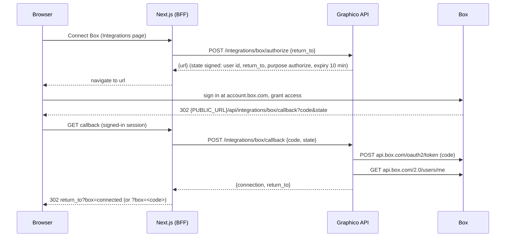

# oauth.md: per-user Box connections (Box app, OAuth 2.0 user access tokens)

Each user connects their own Box account once. Graphico then calls Box as that user with an OAuth 2.0 **user access token**.
The token reaches what the user can reach in Box. When the user loses access to a folder, the token loses it too. The facts
behind these rules, with sources: [discovery.md](discovery.md).

## App setup

One Box app per deployment (local, each shared environment). In the Box Developer Console
(`https://app.box.com/developers/console`):

| Step | Value |
|---|---|
| New App, app type | **User** (OAuth 2.0). It cannot be changed later |
| Configuration, OAuth 2.0 Redirect URIs | `{PUBLIC_URL}/api/integrations/box/callback` (exact match; HTTPS, or HTTP for localhost) |
| Configuration, Application Scopes | **Read and write all files and folders** (`root_readwrite`) only. Nothing else |
| Configuration, CORS Domains | none (all calls are made by the server) |
| Copy | the **Client ID** to `BOX_OAUTH_CLIENT_ID` and the **Client Secret** to `BOX_OAUTH_CLIENT_SECRET` (OAuth 2.0 Credentials) |

The account that opens the Client Secret needs multi-factor authentication. On the local stack the URL starts with
`http://localhost:3001`.

### The one scope

Box needs `root_readwrite` to download file content; `root_readonly` answers `403` on a download. Box shows this scope to the
user as "Read and write all files and folders". Graphico never writes to Box: its client sends `GET` requests only, and the
only `POST` calls are the two OAuth calls (`/oauth2/token`, `/oauth2/revoke`). The Box card and the **Box link** form say that
Graphico only reads. The authorize URL sends `scope=root_readwrite`, so a scope that someone adds to the app later never
widens a grant. Not requested: `manage_webhook`, `ai.readwrite`, `manage_enterprise_properties`.

### Admin enablement

An OAuth 2.0 app needs no admin authorization. If the user's enterprise turned on "Disable unpublished platform apps by
default", or disabled integrations, a Box Admin or Co-Admin must enable the app first: Admin Console, Platform Apps (older
articles: Integrations, Platform Apps Manager), add the app by its Client ID, enable it. Until then the user sees "Disabled by
administrator" on Box's page and the connection is not made. The deployment's own enterprise and other customers' enterprises
follow the same rule through their own admins. Free personal accounts have no Admin Console.

## Settings

Read by the api only. The table: [../configuration.md](../configuration.md#box-integration).

| Variable | Rule |
|---|---|
| `BOX_OAUTH_CLIENT_ID` | turns the integration on; blank or unset = off |
| `BOX_OAUTH_CLIENT_SECRET` | required when on; a secret, never logged |
| `BOX_TOKEN_KEY` | required when on; a Fernet key; encrypts the refresh tokens and derives the `state` signing key |
| `PUBLIC_URL` | required when on; the redirect URI is `{PUBLIC_URL}/api/integrations/box/callback` (`BOX_CALLBACK_PATH`) |

A partial set or a key that is not a Fernet key stops the api at start and names the variable. The api logs `api.box.mode`
(`mode` `on`) at start when the integration is on. With the integration off the Box routes answer `503 box_unavailable`.
The Box clients ignore the proxy variables and `.netrc`.

## Connect flow

- The authorize URL is `https://account.box.com/api/oauth2/authorize?response_type=code&client_id&redirect_uri&state&scope=root_readwrite`.
- `state` is the shared signed state of `integrations.state` with its own context; a state of another user or older than 10
  minutes is `box_state_invalid`; Box is not called. There is no PKCE (Box does not document it): the app is a confidential
  client and `state` is signed.
- `return_to` follows the GitHub rule (a path of this site; `integrations.return_to`).
- The code lives 30 seconds. Any refusal of the code (`400 invalid_grant`, a wrong secret) is `box_code_invalid`; `429`, `5xx`, a
  timeout or a transport error is `box_unreachable`. The browser callback is a Next route handler
  (`frontend/app/api/integrations/box/callback/route.ts`) that posts `{code, state}` to the API; a denial (`error=access_denied`)
  returns to `return_to?box=access_denied`.
- `GET /users/me?fields=id,name,enterprise` reads the account. Stored: the Box user id, the display name, the enterprise id and
  name (null for a personal account). **The Box `login` (an e-mail address) is not stored.** Connecting again replaces the row.
- The project workspace (D3) is the enterprise id and name, or `user:<box user id>` and the user's name for a personal account.

## Tokens

| Rule | Why |
|---|---|
| The refresh token is stored encrypted (Fernet) in `box_connections` with `refresh_expires_at` (now + 60 days); the access token (60 minutes) lives in the process's memory only, per user, until 60 s before `expires_in` | no plaintext token at rest |
| **Refresh tokens rotate and work once, with no grace period.** A refresh runs under a per-user lock and `FOR UPDATE` on the row; the rotated refresh token is committed before the new access token is used; callers that waited get the same token; the token call runs in its own task that a cancelled caller does not cancel (`integrations.tokens`) | Box kills the old refresh token on every refresh |
| Only the api refreshes. Worker processes never get a Box token | no second writer of the rotating token |
| A `401` from the REST API (`box_token_refused` inside) refreshes once and asks once more | an access token can end early |
| `400 invalid_grant` (60 days without use, revoked, used twice) or a refresh token that no longer decrypts (a rotated `BOX_TOKEN_KEY`) sets `status` `expired`: `box_reconnect_required`; an expired connection is never refreshed again until the user reconnects | no retry storm, a clear action |
| Any other refresh failure keeps the connection `active`: `429`, `5xx`, a timeout or a transport error is `box_unreachable`; any other refusal (a wrong client secret) is `box_auth_failed` | an outage or a bad deployment setting must not log every user out |
| Every `access_token` reads the row first. No row is `box_not_connected`; a row not `active` is `box_reconnect_required`; a row of another grant (another Box user id or `connected_at`) makes the process drop its cached token | another process or replica never sees this process's disconnect |
| **Disconnect** deletes the row, drops the cached token and calls `POST /oauth2/revoke` (best effort, `token` = the access token) | the user's grant is removed at Box too |

Known limits: a refresh can be lost when the commit of the rotated token fails after Box answered; the next refresh then gets
`invalid_grant` and the user reconnects. An access token revoked at Box only can stay cached until it ends or Box answers `401`.
A refresh token unused for 60 days is dead: a member who does not use Box for two months connects again.

## Rate limits

About 1000 calls a minute per user; a `429` carries `Retry-After` (seconds). The client waits for `Retry-After` (else 1, 2 and 4
seconds), at most four tries per read and at most 60 seconds of waiting in all per pass (`WaitBudget`); beyond that the read
ends `box_unreachable`. A download that answers `202` waits the same way. Downloads run at most four at a time per import. The
monthly API allowance of the customer's Box plan is shared with the customer's other custom apps; calls of the connect flow
count too (discovery.md "Rate limits and plans").

## Routes

| Route | Success | Errors |
|---|---|---|
| `GET /integrations/box` | 200 `BoxConnectionOut` (`enabled`, `connected`, `status`, `name`, `enterprise_name`, `connected_at`, `last_used_at`) | - |
| `POST /integrations/box/authorize` `{return_to}` | 200 `BoxUrlOut` | 503 `box_unavailable`; 422 `validation_failed` |
| `POST /integrations/box/callback` `{code, state}` | 200 `BoxCallbackOut` (`connection`, `return_to`) | 400 `box_state_invalid`, `box_code_invalid`; 502 `box_unreachable`, `box_auth_failed`; 503 `box_unavailable` |
| `DELETE /integrations/box` | 204 | 503 `box_unavailable` |

All need a signed-in user. Binding to a project is `PUT /projects/{pid}/integrations/box`
([../mission-control/integrations-api.md](../mission-control/integrations-api.md)).

## Data

`box_connections` (migration `0011_box`): `user_id` (primary key, foreign key `users.id` on delete cascade), `box_user_id`,
`name`, `enterprise_id`, `enterprise_name`, `refresh_token` (Fernet ciphertext), `refresh_expires_at`, `status`
(`active`, `expired`), `connected_at`, `last_used_at`, `expired_at`. Row-level security on, **no policy and no grant**: the
agent role reads none of it. The same migration widens `ck_project_integrations_app` (adds `box`) and `ck_connections_kind`
(adds `box`). Downgrade drops the table, deletes every `box` binding and every Box source with its items and documents.
The revision number 0011 may need to change when another branch claims it first.

## Log events

| Event | Fields |
|---|---|
| `api.box.mode` | `mode` (`on`), at every api start with the integration on |
| `box.connected` | `user_id` |
| `box.disconnected` | `user_id`, `deleted`, `revoked` |
| `box.refreshed` | `user_id` |
| `box.expired` | `user_id`, `code` |
| `api.box.refused` | `user_id`, `step` (`callback`), `code` |

They carry the user id and codes only: never a token, a code, `state`, a Box user id, a name or an e-mail address.
