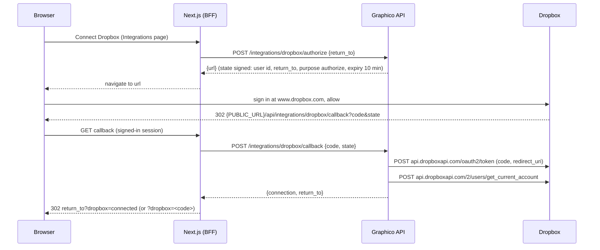

# oauth.md: per-user Dropbox connections (scoped app, OAuth 2, offline access)

Each user connects their own Dropbox account once. Graphico then calls Dropbox as that user with the user's access token. The
token reaches what the user can reach in Dropbox; when the user loses access to a folder, the token loses it too. The facts
behind these rules, with sources: [discovery.md](discovery.md). Decisions DB1 to DB6 of `plans/DROPBOX/DROPBOX-PLAN.md`.

## App setup

One Dropbox app per deployment (local, each shared environment), in the App Console (`https://www.dropbox.com/developers/apps`):

| Step | Value |
|---|---|
| Create app, API | **Scoped access** (legacy permission types cannot be chosen for new apps) |
| Type of access | **Full Dropbox** (an App folder app sees only `/Apps/<name>`). It cannot be changed later: a new app is needed |
| Name | must not contain "Dropbox", start with "drop" or use "DBX", "DB", "DfB" (branding guide) |
| Permissions tab | `account_info.read`, `files.metadata.read`, `files.content.read`, `sharing.read`. Nothing else, no team scopes |
| Settings, OAuth 2, Redirect URIs | `{PUBLIC_URL}/api/integrations/dropbox/callback` (exact match; https, or http for `localhost` only) |
| Settings, Allow public clients | **off** (Graphico uses neither PKCE nor the implicit grant) |
| Copy | the **App key** to `DROPBOX_OAUTH_CLIENT_ID` and the **App secret** to `DROPBOX_OAUTH_CLIENT_SECRET` |

A new app is in **development** status: the creator's account can link, more users under "Enable additional users", up to 500;
after 50 linked users the app must be approved for production within two weeks or linking freezes. The production app (GD-owned,
one per environment, "Apply for production" with a branding icon) and its deploy values are follow-ups.

### The four scopes

The authorize URL sends `scope=account_info.read files.metadata.read files.content.read sharing.read`, so a scope that someone
adds in the App Console later never widens a grant (DB2). All four are read scopes; the client also refuses any endpoint that is
not on its allowlist (below). Team scopes (`team_data.member`) are not requested: team-linked apps are a follow-up.

## Settings

Read by the api only. The table: [../configuration.md](../configuration.md#dropbox-integration).

| Variable | Rule |
|---|---|
| `DROPBOX_OAUTH_CLIENT_ID` | the App key; turns the integration on; blank or unset = off |
| `DROPBOX_OAUTH_CLIENT_SECRET` | required when on; a secret, never logged |
| `DROPBOX_TOKEN_KEY` | required when on; a Fernet key; encrypts the refresh tokens and derives the `state` signing key |
| `PUBLIC_URL` | required when on; the redirect URI is `{PUBLIC_URL}/api/integrations/dropbox/callback` (`DROPBOX_CALLBACK_PATH`) |

A partial set or a key that is not a Fernet key stops the api at start and names the variable. The api logs `api.dropbox.mode`
(`mode` `on`) at start when the integration is on. With the integration off the Dropbox routes answer `503 dropbox_unavailable`.
The Dropbox client ignores the proxy variables and `.netrc`.

## Connect flow

- The authorize URL is `https://www.dropbox.com/oauth2/authorize?client_id&response_type=code&token_access_type=offline&scope&redirect_uri&state`.
- `state` is the shared signed state of `integrations.state` with its own context (`specflow dropbox oauth state`); a state of
  another user or older than 10 minutes is `dropbox_state_invalid`; Dropbox is not called. No PKCE: the app is a confidential
  client (the secret stays on the server) and `state` is signed (DB2).
- `return_to` follows the GitHub rule (a path of this site; `integrations.return_to`).
- The code exchange sends `code`, `grant_type=authorization_code`, `redirect_uri`, `client_id`, `client_secret` (form fields).
  Any refusal is `dropbox_code_invalid`, and so is an answer without a refresh token; `429`, `5xx`, a timeout or a transport error
  is `dropbox_unreachable`. The browser callback is a Next route handler (`frontend/app/api/integrations/dropbox/callback/route.ts`)
  that posts `{code, state}` to the API; a denial (`error=access_denied`) returns to `return_to?dropbox=dropbox_consent_denied`.
- `users/get_current_account` reads the account. Stored: the account id, the display name (`name.display_name`), the team id and
  name (absent for a personal account). **The e-mail address is never read or stored.** The root namespace id is not stored: the
  importer reads it per check and per import (DB6). Connecting again replaces the row.
- The project workspace (D3, DB5) is `team:<team_id>` and the team name for a Business member, else `user:<account_id>` and the
  display name.

## Tokens

| Rule | Why |
|---|---|
| The refresh token is stored encrypted (Fernet) in `dropbox_connections` (`bytea`: Dropbox tokens can pass 1 KB). The access token lives in the process's memory only, per user, until 60 s before `expires_in` (about 4 hours; the field is read, not assumed) | no plaintext token at rest |
| **No rotation.** A refresh answers a new access token and no refresh token: the stored one stays. There is no `refresh_expires_at` and no `FOR UPDATE` rotate step; concurrent callers share one refresh (`integrations.tokens`) | Dropbox refresh tokens do not rotate and do not expire while the user's approval stands |
| A `401` with `expired_access_token` or `invalid_access_token` (`dropbox_token_refused` inside) refreshes once and asks once more; a second one is `dropbox_auth_failed` | an access token can end early |
| `400 invalid_grant` (the user unlinked the app, the token was revoked) or a refresh token that no longer decrypts (a rotated `DROPBOX_TOKEN_KEY`) sets `status` `expired`: `dropbox_reconnect_required`; an expired connection is never refreshed again until the user reconnects | no retry storm, a clear action |
| Any other refresh failure keeps the connection `active`: `429`, `5xx`, a timeout or a transport error is `dropbox_unreachable`; any other refusal (a wrong app secret) is `dropbox_auth_failed` | an outage or a bad deployment setting must not log every user out |
| Every `access_token` reads the row first. No row is `dropbox_not_connected`; a row not `active` is `dropbox_reconnect_required`; a row of another grant (account id or `connected_at`) makes the process drop its cached token | another process or replica never sees this process's disconnect |
| **Disconnect** deletes the row, drops the cached token and calls `auth/token/revoke` with a good access token (best effort): Dropbox then ends that token, its refresh token and every other access token of it | the user's grant is removed at Dropbox too |
| Only the api calls Dropbox. Worker processes never get a Dropbox token | `worker-parse` gets bytes only |

## Allowlist (read-only by construction, DB3)

Every Dropbox API call is a `POST`, so a method guard cannot keep the client read-only. `DropboxClient._build`, the one place a
request is made, accepts only these URLs and raises before sending for any other URL, host or method
(`tests/test_dropbox_client.py`):

| Host | Endpoint | Used for |
|---|---|---|
| `api.dropboxapi.com` | `/oauth2/token` | code exchange, refresh |
| `api.dropboxapi.com` | `/2/auth/token/revoke` | disconnect |
| `api.dropboxapi.com` | `/2/users/get_current_account` | connect; the root namespace per check and import |
| `api.dropboxapi.com` | `/2/sharing/get_shared_link_metadata` | resolve a shared link |
| `api.dropboxapi.com` | `/2/files/get_metadata` | resolve a `/home` path |
| `api.dropboxapi.com` | `/2/files/list_folder`, `/2/files/list_folder/continue` | the recursive listing |
| `content.dropboxapi.com` | `/2/files/download` | file bytes (argument in `Dropbox-API-Arg`, metadata in `Dropbox-API-Result`) |
| `content.dropboxapi.com` | `/2/files/export` | Paper as Markdown (DB10) |

`Dropbox-API-Arg` is compact JSON with every non-ASCII character and 0x7F escaped as `\uXXXX` (the Dropbox HTTP header rule).
Every call of the importer sends `Dropbox-API-Path-Root: {".tag":"root","root":"<root_namespace_id>"}` (DB6).

## Rate limits

Limits are per linked user and not published. A `429` (`too_many_requests`) and a `5xx` wait for `Retry-After` when it is
present, else 1, 2 and 4 seconds; at most four tries per call and at most 60 seconds of waiting in all per pass (one
`WaitBudget` per check or import, `integrations.pacing`, shared with Box); beyond that the call ends `dropbox_unreachable`.
Downloads run at most four at a time per import.

## Routes

| Route | Success | Errors |
|---|---|---|
| `GET /integrations/dropbox` | 200 `DropboxConnectionOut` (`enabled`, `connected`, `status`, `name`, `team_name`, `connected_at`, `last_used_at`) | - |
| `POST /integrations/dropbox/authorize` `{return_to}` | 200 `DropboxUrlOut` | 503 `dropbox_unavailable`; 422 `validation_failed` |
| `POST /integrations/dropbox/callback` `{code, state}` | 200 `DropboxCallbackOut` (`connection`, `return_to`) | 400 `dropbox_state_invalid`, `dropbox_code_invalid`; 502 `dropbox_unreachable`, `dropbox_auth_failed`; 503 `dropbox_unavailable` |
| `DELETE /integrations/dropbox` | 204 | 503 `dropbox_unavailable` |

All need a signed-in user. Binding to a project is `PUT /projects/{pid}/integrations/dropbox`
([../mission-control/integrations-api.md](../mission-control/integrations-api.md)).

## Data

`dropbox_connections` (migration `0013_dropbox`, down `0012_box`): `user_id` (primary key, foreign key `users.id` on delete
cascade), `account_id`, `name`, `team_id`, `team_name`, `refresh_token` (Fernet ciphertext, `bytea`), `status` (`active`,
`expired`), `connected_at`, `last_used_at`, `expired_at`. No `refresh_expires_at`, no e-mail. Row-level security on, **no policy
and no grant**: the agent role reads none of it. The same migration widens `ck_project_integrations_app` and `ck_connections_kind`
(adds `dropbox`). Downgrade drops the table, deletes every `dropbox` binding and every Dropbox source with its items and documents.
Other branches (Notion) may claim the same number: whoever merges later renumbers.

## Log events

| Event | Fields |
|---|---|
| `api.dropbox.mode` | `mode` (`on`), at every api start with the integration on |
| `dropbox.connected` | `user_id` |
| `dropbox.disconnected` | `user_id`, `deleted`, `revoked` |
| `dropbox.refreshed` | `user_id` |
| `dropbox.expired` | `user_id`, `code` |
| `api.dropbox.refused` | `user_id`, `step` (`callback`), `code` |

They carry the user id and codes only: never a token, a code, `state`, an account id, a name, a path or an e-mail address.
