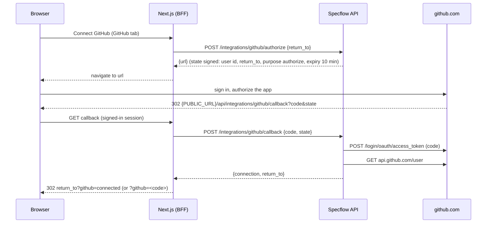

# oauth.md: per-user GitHub connections (GitHub App user access tokens)

Each user connects their own GitHub account once. Specflow then calls GitHub as that user with a GitHub App **user
access token**. Such a token reaches only what both the user and the app can reach: the repositories the user (or an
organization owner) picked when they installed the app, and of those only the ones the user can still read. When the
user loses access (leaves an organization, the repository is removed from the installation), the token loses it too.
Specflow has no private key and never acts as an installation.

## Access

| Option | Access | Chosen |
|---|---|---|
| Personal access token | everything the user can read; the user pastes a secret | no |
| OAuth App with the `repo` scope | read and write on every repository of the user and their organizations | no |
| GitHub App, user access token | the repositories picked at install time that the user can read; Contents read-only | yes |

## Settings

Read by the api and the `worker-agents` service (the worker refreshes the token before a clone). The table and the
registration of the app: [../configuration.md](../configuration.md#github-integration).

| Variable | Rule |
|---|---|
| `GITHUB_APP_CLIENT_ID` | turns the integration on; blank or unset = off |
| `GITHUB_APP_CLIENT_SECRET` | required when on; a secret, never logged |
| `GITHUB_APP_SLUG` | required when on; `[a-z0-9][a-z0-9-]{0,99}`; builds the install link |
| `GITHUB_TOKEN_KEY` | required when on; a Fernet key; encrypts the refresh tokens and derives the `state` signing key |
| `PUBLIC_URL` | required when on; the callback is `{PUBLIC_URL}/api/integrations/github/callback` |

A partial set, a slug of another shape or a key that is not a Fernet key stops the role at start and names the
variable. The api logs `api.github.mode` (`mode` `on`) at start when the integration is on.

## Connect flow

- `state` is the shared signed state of `integrations.state` (as for Atlassian) with its own context and a purpose:
  `authorize` for the sign-in, `install` for the app installation. A state of another user, another purpose or older
  than 10 minutes is `github_state_invalid`; GitHub is not called.
- `return_to` follows the Atlassian rule (a path of this site; `integrations.return_to`).
- The token endpoint answers a refusal with 200 and `{"error": ...}`: any refusal of a code is `github_code_invalid`;
  `429`, `5xx`, a timeout or a transport error is `github_unreachable`. A grant without a refresh token (the app does
  not expire user tokens) is refused and logs `github.oauth.no_refresh_token`.
- The GitHub user id and login are stored. Connecting again replaces the row (new grant, `active`).

## Install flow

The tab links to `POST /integrations/github/install {return_to}`, which answers
`https://github.com/apps/{GITHUB_APP_SLUG}/installations/new?state=…` (purpose `install`). After an install or an update
of the installation GitHub sends the browser to the setup URL `{PUBLIC_URL}/api/integrations/github/setup` with
`installation_id`, `setup_action` and the `state`. The web app forwards only `state` to `POST /integrations/github/setup`,
which checks it and answers `return_to`. The `installation_id` is never read: anyone can forge it. Specflow learns which
repositories the user can read only through the user's token (`GET /user/installations`).

## Tokens

| Rule | Why |
|---|---|
| The refresh token is stored encrypted (Fernet) in `github_connections`; the access token lives in the process's memory only, per user, until 60 s before `expires_in` (8 hours) | no plaintext token at rest |
| A refresh runs under a per-user lock and `FOR UPDATE` on the row; the rotated refresh token is committed before the new access token is used; callers that waited get the same token; the token call runs in its own task that a cancelled caller does not cancel (`integrations.tokens`) | GitHub disables the old refresh token on every refresh |
| The api and the agents worker refresh through the same `GitHubConnections` over the same rows; the row lock serializes them | no shared cache to run |
| A `401` from the REST API refreshes once and asks once more | an access token can be revoked early |
| `bad_refresh_token` (unused for 6 months, revoked) or a refresh token that no longer decrypts (a rotated `GITHUB_TOKEN_KEY`) sets `status` `expired`: `github_reconnect_required`; an expired connection is never refreshed again until the user reconnects | no retry storm, a clear action |
| Any other refresh failure keeps the connection `active`: `429`, `5xx`, a timeout or a transport error is `github_unreachable`; any other refusal (a wrong client secret) is `github_auth_failed` | an outage or a bad deployment setting must not log every user out |
| Disconnect deletes the row, drops the cached token and calls `DELETE /applications/{client_id}/grant` (best effort) | the user's grant of the app is removed on GitHub too |
| Every `access_token` reads the row first. No row is `github_not_connected`, a row not `active` is `github_reconnect_required`, and a row of another grant (another GitHub user id or `connected_at`: a reconnect) makes the process drop its cached token and refresh from the row | another process (an api replica, the agents worker) never sees this process's disconnect; one row read per use costs little |

Known limits:
- A refresh can be lost: GitHub rotates the refresh token when it answers, so if the commit of the rotated token fails,
  or the 10-second timeout fires after GitHub answered, the stored refresh token is dead. The next refresh gets
  `bad_refresh_token` and the user must reconnect (`github_reconnect_required`). Nothing worse follows.
- A revoked access token can still be cached until it expires or GitHub answers `401`; the row check above covers a
  disconnect and a reconnect made through Specflow, not a revoke made on GitHub only.

## Codes

`GitHubCode` (`github.codes`). Public: `github_not_connected`, `github_reconnect_required`, `github_state_invalid`,
`github_code_invalid`, `github_unreachable`, `github_auth_failed`, `github_repo_not_accessible`,
`github_repo_too_large`, and for the clone check `github_clone_failed`, `github_clone_timeout`, `storage_failed`. Inside
only: `github_grant_invalid` (becomes `github_reconnect_required`) and `github_refused` (becomes `github_code_invalid`
in the sign-in and `github_auth_failed` elsewhere). No GitHub text is kept or shown.

## Log events

| Event | Fields |
|---|---|
| `api.github.mode` | `mode` (`on`), at every api start with the integration on |
| `github.connected` | `user_id` |
| `github.disconnected` | `user_id`, `deleted`, `revoked` |
| `github.refreshed` | `user_id` |
| `github.expired` | `user_id`, `code` |
| `github.oauth.no_refresh_token` | - |
| `api.github.refused` | `user_id`, `step` (`callback`, `setup`, `repositories`), `code` |

They carry the user id and codes only: never a token, a code, `state`, a GitHub user id or login.
