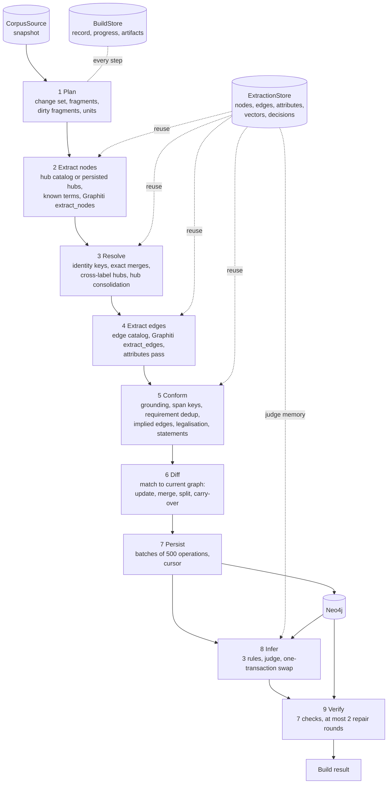

# how-it-works.md: why the ontology looks the way it does, how a build creates the graph, how duplicates are handled, and how verification works

This is an explainer for engineers and product people. It covers four things:

1. why the ontology has the types and relations it has, and why that shape suits gap detection and
   implementation planning;
2. how a build turns documents into the graph, step by step;
3. every place where duplicates are prevented or merged;
4. what verification checks, how it repairs, and the rules it follows.

The reference files hold the exact contracts: [ontology.md](ontology.md) (format),
[data-model.md](data-model.md) (Neo4j model, identity), [build.md](build.md) (steps, modes, reuse),
[analysis.md](analysis.md) (inference, verification), [api.md](api.md) (public API). The shipped
ontology is `backend/src/graph/core/ontology/spec-ontology.yaml`, version 1.3. All numbers below
are the ones the code uses.

> `graph.gap` (gaps, contradictions, findings) and `graph.plan` (implementation plans) are reserved
> submodules that do not exist yet ([overview.md](overview.md), [later.md](later.md)). Every
> statement in this document about what gap or plan will do is marked **intended use**.

---

## Why this ontology

### What the graph has to be good for

The graph answers one question: what does this specification commit the system to, where, and
on which lines does it say so? The goals in [overview.md](overview.md) set the bar: one node per
real-world thing (no duplicates, no false merges), one edge per stated relation, a thing named in
several documents is one node grounded in each of them, and unchanged nodes keep their `spec_id`
when documents change.

Two later consumers shape the design (**intended use**):

- **Gap detection** needs a graph where something *missing* shows up as a structural fact you can
  query: a requirement with no owner, a module with no requirements, an integration with one side.
  That only works if the ontology says what a complete specification looks like.
- **Implementation planning** needs work areas, deliverable slices, testable tasks, dependencies and
  traceability. It also needs ids that stay stable from one build to the next, so a plan can point
  at them.

The ontology is the contract for both. Library code holds no type or relation name. A different
ontology file works without code changes, which a renamed-ontology test checks.

### Node types

Every type has a **role**: an **anchor** is a part of the system, a **group** groups other nodes,
and an **atomic** node is one commitment. Anchor and group types are **hub nodes**: the names other
nodes link to across documents.

| Label | Role | Tier | Identity | `spec_id` prefix | Explicit-id families | What it is |
|---|---|---|---|---|---|---|
| `Module` | anchor | context | `surface` (name), per type | `MOD::` | - | A deployable or separable part: service, app tier, datastore, deployment target; or an external system (`external: yes`). Attribute `type`: frontend, backend, datastore, deployment, other |
| `Feature` | group | context | `surface`, per type | `FEAT::` | - | A named piece of functionality users recognise. Sits inside one module and groups requirements |
| `Capability` | group | context | `surface`, per type | `CAP::` | - | A cross-cutting concern no single module owns (authentication, audit logging) |
| `FunctionalRequirement` | atomic | spec | `id`, else the defining line; one scope for all requirements | `REQ::FR::` | FR, UC, US | A behaviour: "Customer can export order history as CSV" |
| `QualityRequirement` | atomic | spec | as above | `REQ::NFR::` | NFR, QR, PERF, SEC | A quality target: "Order export completes within 5 s at p95" |
| `Constraint` | atomic | spec | as above | `REQ::CON::` | CON | A boundary imposed from outside the team: "Order data must stay in the EU region, as the client contract requires" |
| `BusinessRule` | atomic | spec | as above | `REQ::BR::` | BR | A business policy: "Order over $1,000: needs manager approval" |
| `IntegrationRequirement` | atomic | spec | as above | `REQ::INT::` | INT, IR | A contract between two modules: "Checkout service sends paid orders to ERP" |
| `DataRequirement` | atomic | spec | as above | `REQ::DATA::` | DATA, DR | A stored or exchanged object and its fields: "Purchase order holds id, lines, currency, total" |

All six requirement types belong to the node group `requirement` and inherit its attributes:
`stmt`, `quote`, `acceptance_criteria`, `source_status` (`stated` or `implied`), `is_assumption`
(`yes` or `no`) and a `module` reference.

### Edge types

| Relation | Pairs | Flags | Tier | Meaning |
|---|---|---|---|---|
| `PART_OF` | requirement → feature; each requirement type → module; feature → module; feature → feature; module → module | `exclusive` on every pair except integration requirement → module and the feature → feature and module → module pairs; module → module needs a containment cue; derived from `requirement.module` and `feature.module` | spec | Containment: the source is a part of the target |
| `GROUPED_BY` | feature → capability, requirement → capability | - | spec | Grouping under a cross-cutting capability; the source keeps its own `PART_OF` parent |
| `REALIZED_BY` | capability → module | derived from `capability.module` | context | The module implements part of the capability |
| `INTEGRATES_WITH` | module → module | `default` for module pairs | context | One module calls or depends on another; stored from caller to called |
| `RELATES_TO` | requirement ↔ requirement, requirement ↔ module | `symmetric`, `id_references` | spec | A link the text itself makes (a reference, dependency or refinement), or a requirement that applies to a module without being part of it |

Every node and edge also carries provenance through built-in structure that no ontology declares.
`Document` contains `Fragment`. `REFERENCED_BY` runs from each spec node to the fragment lines
that state it. `MENTIONED_IN` runs from a hub to the fragments that name it without grounding it.

### The design decisions and their reasons

**Modules are anchors.** A module is the most stable thing in a specification: the parts that
get built, deployed and owned. Its name changes rarely, and every other node can be placed under
one. Making it the spine's root means "which module does this belong to?" always has an answer,
or the missing answer is a visible gap. Modules are named by role, never by technology ("Orders
database", not "PostgreSQL"). A technology swap must not create a new part of the system.
External systems are modules too (`external: yes`), so an integration always has two module ends.

**Features and capabilities are two kinds of group.** They group requirements differently:

- A **feature** belongs to one module. It is what users would name ("Order history export"), and
  `PART_OF` feature → module is exclusive.
- A **capability** cuts across modules ("Authentication"). It "groups; it never contains". It
  points with `REALIZED_BY` at every module that implements part of it.

A single "group" type would force a choice. It could put authentication inside one module, which
is wrong. Or it could let a feature sit in several modules, which ruins the tree that planning
needs. With two types, the module tree stays a tree, and cross-cutting work stays visible as one
node.

**Requirements are atomic and split into six types.** The unit of a specification is a single
commitment. The ontology's rule is "if it takes two test cases to prove, it is two requirements".
That makes each requirement a natural test and a natural task. The six types answer different
questions: what the system does (`FunctionalRequirement`), how well (`QualityRequirement`), what is
imposed from outside (`Constraint`), what the business decides (`BusinessRule`), what crosses
between two modules (`IntegrationRequirement`) and what data looks like (`DataRequirement`).
Coverage per type is what gap detection reads. Each type has a naming template, such as `<Actor>
can <verb> <object>` or `<subject> <measure> <comparator> <value> <unit>`. With a template, the
same commitment stated twice gets the same name, which helps deduplication. All six types share
one identity scope, so a requirement extracted under two labels is still one node.

**`PART_OF` is exclusive.** A requirement should have one place: one feature, or one module. The
exception is an integration requirement, which names two modules. Exclusivity keeps the
containment tree a tree, and that tree is what a work breakdown is. Extra targets are not
removed. Each one is counted as `exclusive_conflicts`, because a requirement the text places in two
features is a finding in itself. A requirement about the whole system (deployment, security,
operations) is `PART_OF` nothing. It `RELATES_TO` each module it concerns. Forcing it into one
module would hide that it is cross-cutting.

**There is a spine.** The spine says which paths count as "this requirement reaches a module":

- 1-3 `PART_OF` edges (requirement → module, requirement → feature → module, or through a nested
  feature);
- `GROUPED_BY` then `REALIZED_BY` (requirement → capability → module);
- one `RELATES_TO` edge (a system-wide requirement and a module it concerns). A symmetric relation
  counts in either direction.

A requirement that reaches no module by any of these paths is counted as `spine_unreachable`.
Without a declared spine, "orphan" would be a matter of opinion. With it, it is a query. The same
paths drive `GraphReader.scope`, which returns everything under a module: its features, the
capabilities that realise it, and the requirements under either.

**Evidence ties every node and edge to source lines.** Every spec node has `REFERENCED_BY` to each
fragment that states it, with line ranges. Every `stated` or `implied` edge lists its evidence
fragments and keeps the verbatim `fact` line when one matched. Every `quote`, `fact` and statement
`text` is verbatim. This is invariant D4. Verification enforces it. A finding or a plan task can always point at the
lines it rests on. A node whose only source disappears is deleted, not left as a ghost.
`statements` keep what each fragment says, without judging whether they agree. That is the raw
material for contradiction detection.

**Identities are stable.** Every node gets a `spec_id` such as `REQ::FR::USERS_EXPORT_CSV`. It is
fixed at creation and never given to a node with a different identity key. Merged nodes keep their
old ids as `spec_id_aliases`, and readers resolve aliases. An explicit id from the text (`FR-ADM-007`)
leads the slug and decides the identity, so the documents' own numbering survives. Updates,
rebuilds, merges and renames all keep `spec_id`s ([Across builds: Diff](#across-builds-diff)). That is
what lets a gap finding or a plan task outlive the next document revision.

### How the structure supports gap detection (intended use)

The library itself detects no gaps ([overview.md](overview.md) non-goal 2). Gap detection is a
read of structure that already exists. Every example below uses a type, edge, spine path,
attribute, report list or metric that the build produces today.

| Gap | How it shows in the graph | Built on |
|---|---|---|
| A requirement nobody owns | It reaches no module by any spine path. Light inference first tries to attach it (`INF-CONT-01`). What remains is counted, and the inference report lists `orphans_without_candidate` | Spine; `spine_unreachable` (before and after inference); `PART_OF` |
| A module or feature with no requirements | `scope(module)` returns no requirement; a `Feature` has no incoming `PART_OF` from any requirement | Anchor and group roles; spine paths |
| An integration with one known side | An `IntegrationRequirement` is named "<module> sends ... to <module>", so it should reach two modules. The inference report lists `integration_outliers`: integration requirements with 1 or more than 4 modules | `INF-INT-01`; `PART_OF` to the caller, `RELATES_TO` to the called module |
| Missing non-functional, data or constraint coverage | A module whose `scope` holds `FunctionalRequirement`s but no `QualityRequirement`; a `Module` with `type: datastore` and no `DataRequirement`; no `Constraint` anywhere | The six requirement types; `scope(..., labels=...)`; `Module.type` |
| Contradictions | Two requirements on one subject with different values survive as two nodes, because dedup refuses to merge "within 5 s" with "within 10 s". `statements` keep what each document says, unjudged | Dedup guards ([Conform: requirement dedup](#conform-requirement-dedup)); statements |
| Duplicates and misplacement | Near-identical restatements are already merged. A requirement with two `PART_OF` targets of one label shows in `exclusive_conflicts`. A node whose computed label differs shows in `label_disagreement` | Exclusive pairs; label rules |
| Unanswered references to explicit ids | When a quote names another requirement's id ("see FR-012") and that node exists, Conform adds `RELATES_TO` with `basis = implied`. An id in the explicit-id grammar that names no node is a dangling reference | `id_references`; explicit-id identity keys |
| Assumptions and implied requirements | `nodes(where={"is_assumption": "yes"})` or `source_status: implied` lists commitments nobody has confirmed | Requirement attributes |
| Sections that say nothing extractable | An active fragment with no spec node grounded in it | `fragments_without_nodes` |

These checks are cheap and can be explained because each is a query over typed structure, not a
model's opinion. Where a model is needed (is this a contradiction?), the graph narrows the input
to a few nodes, their statements and their source lines. Gap will declare its own types with
origins `analysis` and `human`. The ontology format already lets a gap relation end at a
requirement, or at a `Fragment` or `Document` to cite evidence ([ontology.md](ontology.md)
"Ontology files of submodules").

### How the structure supports an implementation plan (intended use)

| Plan concept | Graph element | Why it fits |
|---|---|---|
| Work areas | `Module` (anchor) and `scope(module)` | Each part of the system is built and owned by someone. `type` separates frontend, backend, datastore and deployment work; `external: yes` marks third-party systems, which need integration work rather than building |
| Deliverable slices | `Feature` `PART_OF` one module; feature → feature for nesting | A feature is what users recognise and can be shipped as a unit. Exclusivity puts it in exactly one work area |
| Tasks | Each requirement, with `acceptance_criteria` | One commitment, testable, "two test cases → two requirements". Its acceptance criteria are the done-definition |
| Dependencies and ordering | `INTEGRATES_WITH` (caller → called); an `IntegrationRequirement` `PART_OF` the caller and `RELATES_TO` the called module; `RELATES_TO` between requirements (one refers to, depends on or refines the other) | The called module's contract is needed before the caller can finish. The stored direction is a hint: analysis reads A → B and B → A as one integration |
| Cross-cutting work | `Capability` with `GROUPED_BY` and `REALIZED_BY`; `Constraint`s and `QualityRequirement`s that relate to several modules or to the whole system | Work that touches many modules stays one item instead of being copied into each |
| Traceability | `REFERENCED_BY` line ranges, `statements`, `fact` lines | Every task can cite the exact document lines it comes from |
| Tracking across revisions | Stable `spec_id`s and aliases; each build's `spec_changes` (`added`, `removed`, `modified`, `rekeyed`, `carried_over`); `impact(spec_ids, depth)` | A plan keyed by `spec_id` survives document edits, and each build says which tasks a revision touched |

Plan will declare its own types with origin `planner`, owned and written by `graph.plan` only
([architecture.md](architecture.md) "Write ownership").

### What the ontology leaves out, and why

`corpus.exclude` tells extraction what never becomes a node:

- **people** and **dates** belong to project management, not to what the system commits to; a
  deadline is not a gap in the system;
- **page headers**, **bare currency codes** and **HTTP methods** are document noise or fragments of
  other statements;
- **JSON keys**, unless they are data requirements about stored or exchanged fields: fields belong
  to the `DataRequirement` of their object;
- **technologies as entities** (languages, frameworks, libraries, runtimes, tools, infrastructure
  products): a technology the text mandates is a `Constraint`, and a running datastore is a
  `Module` named by its role. As nodes, they would split one part of the system into "the service"
  and "the Node.js server" and count its coverage twice.

The requirement definition also excludes rationale, illustrative examples, how something will be
tested, duties of people, meeting notes, open questions, TBDs and out-of-scope lists. An
out-of-scope item counts only when it is phrased as a limit the system must keep, and then it is a
`Constraint`. The rule is "when in doubt, it is not a requirement". Every false requirement would become a false
task or a false gap. Open questions are the kind of thing gap's own findings will hold.

Inference never adds relations from world knowledge (non-goal 1). It only links existing nodes
when the texts support it. A gap the text leaves open stays open.

---

## How a build creates the graph

### Input: corpus, fragments and units

**Corpus.** The host's `CorpusSource` gives one snapshot of the current revision of every active
document. Each revision has a lineage id, a version and markdown that never changes. Parser comment
lines (`<!-- ... -->`, such as page markers) are masked. They keep their line numbers but are never
part of text, hashes, prompts or quotes.

**Fragments.** Each new or revised revision is cut along its headings into fragments of 300-3,000
estimated tokens, target 2,000 (`fragment_tokens`); tokens are estimated as characters / 3.6. A
section over the range is cut at the paragraph boundary with the lowest content hash in the allowed
window, so the cut depends on the content around it and an edit elsewhere does not move it. Fenced
code blocks are never split. The fragment id is `<document_id>#<heading path slug>#<8 hex chars
from the first body line>`, so an unchanged section keeps its id across revisions. A fragment is
the unit of evidence (`:Fragment` in Neo4j).

**Change set.** Plan compares the snapshot with the persisted `Document`s: each document is new,
revised or removed. Fragments of a revised document are matched to the persisted ones: the same
content is `unchanged`, the same heading path with a line-set Jaccard of at least 0.5 is
`changed`, anything else is `new`. Unmatched old fragments, and every fragment of a removed document, become `retired`. **Dirty**
fragments are those that are new, changed or retried, plus, in an `update`, unchanged fragments
whose stored extraction no longer matches the extractor fingerprint.

**Units.** A unit is a run of consecutive fragments of one document, never of several, and at most
24,000 tokens (`unit_tokens`). A longer document is cut into balanced parts at fragment
boundaries, preferring top-level headings. Each unit gets node-extraction **windows**: at most 8
(`max_node_windows`), each about `ceil(24,000 / 8)` = 3,000 tokens. In an `update` the windows cover
only the dirty fragments. Units and windows are working data and are never stored in the graph.

### The flow

### The steps

Each step reads the earlier steps' artifacts from the `BuildStore` and stores its own artifact.
Model calls go through the core gateway in one of four call classes: `extraction` (the main model,
through Graphiti), `small`, `judge` (defaults to the main model) and `embedding`. Embeddings are
looked up in the vector store by text first; only a text not seen before is embedded.

| # | Step | Reads | Writes | Model calls |
|---|---|---|---|---|
| 1 | `plan` | Corpus snapshot; persisted documents and fragments; in `update`, the stored node results (to find stale fragments) | Plan artifact: mode, change set, fragments, retired ids, dirty ids, units with windows | None |
| 2 | `extract_nodes` | Plan; hub catalog (`first`, `rebuild`) or persisted hubs (`update`) | Raw nodes per fragment; stored node results | `small`: hub catalog, outlines in batches of up to 12,000 tokens (`first`/`rebuild` only; on failure the build goes on without known terms). `extraction`: one Graphiti `extract_nodes` call per window. `embedding`: fragment and hub vectors to rank known terms, only when some unit is extracted |
| 3 | `resolve` | Plan, raw nodes; in `update`, persisted identities; decision memory | Canonical nodes with identity keys, aliases, names, labels, `name_embedding` texts | `judge`: one hub consolidation call per block of up to 400 hubs not already decided. `embedding`: name vectors |
| 4 | `extract_edges` | Plan, canonical nodes, raw nodes; in `update`, hub aliases and last catalogs | Raw edges per unit; attribute values per node | `extraction`: one Graphiti `extract_edges` call per unit whose content or catalog changed. `small`: attributes for new and changed nodes, batches of at most 20 nodes and about 12,000 tokens of fragment text, up to 3 fragments per node |
| 5 | `conform` | Plan, canonical nodes, raw edges and attributes; dedup memory; in `update`, persisted identities | Target graph: grounded nodes, legal edges, statements, `MENTIONED_IN`, counters | `small`: one dedup verdict per candidate pair not merged directly and not remembered. `embedding`: search `embedding` |
| 6 | `diff` | Plan, target graph, current graph from Neo4j, `spec_id` registry | Diff: operations in persist order, `spec_changes`, registry rows | None |
| 7 | `persist` | Diff; persist cursor | Neo4j writes; `spec_id` registry rows (before the first batch); cursor after each batch | `embedding` only for a vector missing from the store |
| 8 | `infer` | Neo4j (`stated` and `implied` edges only); judge memory | Inferred edges (one transaction); inference report | `judge`: at most 50 subjects per rule per build |
| 9 | `verify` | Neo4j; this build's diff and target graph (to restore evidence); registry | Repairs; verification report | None |

Notes per step:

- **Extract nodes.** Each call sees the whole unit as context, one Graphiti episode per fragment.
  Each episode starts with a breadcrumb of the document title and heading path. The call extracts
  only from its window. The prompt lists at most 120 **known terms** (`known_terms_limit`): hub
  names that occur in the unit's text first, then the closest by cosine to its fragment vectors.
  Known terms make the same thing get the same name in every document. When the text clearly uses
  a different name, that name is used and Diff carries the node over as a rename. Graphiti's
  episode attribution ties each node to its fragments. A node without attribution is tied to every
  fragment of its window. A truncated answer halves the window and retries, up to 4 times.
- **Extract edges.** Each unit's catalog holds every node grounded in the unit, plus at most 150
  hubs from elsewhere (`catalog_limit`):
  - first, hubs the unit's text names;
  - then, for each fragment, the 20 nearest hubs by cosine between the hub's `name_embedding` and
    the fragment vector. A hub qualifies only at a cosine of at least max(0.40, 0.8 × that
    fragment's best foreign-hub cosine).

  This is how a requirement in document B can become `PART_OF` a feature defined in document A. In
  an `update`, a unit with no changed fragment keeps the nearness hubs it took last time and adds
  new hubs only when its text names them. An unrelated new hub elsewhere therefore leaves its
  catalog, and its stored edges, unchanged.
- **Conform** grounds everything and builds the target graph. A node's quote snaps to the source
  lines that hold at least 85% of its tokens, and those lines become its evidence; a node whose
  quote matches nowhere is still grounded in its attributed fragments, with no `quote`. Edges are
  legalised in order: keep a legal relation, flip a reversed one, use the pair's default relation,
  honour `cue_required`, else drop and count. With `locality: grounded` (the default) a cross-unit
  edge is kept when both ends are grounded. Implied edges come from `derive` rules and
  `id_references`. Then statements and `MENTIONED_IN` are built, and invariants D1-D4 are checked
  (a violation raises `ConformanceError`).
- **Diff** matches the target graph to the current one ([Across builds: Diff](#across-builds-diff)). It
  stores the diff and the build's `spec_changes` before anything is written.
- **Persist** applies the diff in batches of at most 500 operations, each one idempotent
  transaction, in this order: removed edges, merges, updates and carry-overs, node deletes,
  creates, edges and structural relationships, then documents and fragments.

### Modes

| Mode | When | What is extracted | What is reused |
|---|---|---|---|
| `first` | The project has no persisted graph (chosen by the library) | Everything | Nothing yet: the stores start empty |
| `update` | Every later build (chosen by the library) | Dirty fragments, and units whose content or catalog changed | Stored nodes, edges and attributes; persisted labels; vectors; consolidation decisions; dedup verdicts; judge memory |
| `rebuild` | Only when the host sets the flag | Everything again | Only embedding vectors and merge decisions (hub consolidation decisions, dedup verdicts), so identities stay stable. No stored extraction result and no persisted label. Matched nodes keep their `uuid` and `spec_id` |

`BuildOptions` are frozen by the last `first` or `rebuild`. An `update` raises
`ConfigurationError` before any model call when the options differ (`frozen_options_changed`), the
ontology's labels or relations differ (`ontology_changed`), the embedding model differs
(`embedding_model_changed`), the project has a persisted graph but no record of a `first` or
`rebuild` (`rebuild_required`), or that build is unfinished (`unfinished_build`).

### Reuse, and why a no-change update makes 0 calls

Every build writes its results to the `ExtractionStore`, keyed by content and including the project
id:

| Result | Reused when |
|---|---|
| Nodes of a fragment | Same lineage, content, heading path and node extractor fingerprint |
| Edges of a unit | Same unit content, same selected catalog (identity keys), same edge extractor fingerprint |
| Attributes of a node | Same identity key and label, same evidence fragment contents, same fingerprint |
| Vectors | Same text and embedding model (kind `vectors`) |
| Hub consolidation decisions and dedup verdicts | Same project and the same two identity keys, same prompt version and model (kind `decisions`) |
| Inference judgements | Same rule, subject and input hash (kind `decisions`) |

The extractor fingerprint covers whatever shapes an extraction call: the ontology parts that reach
the prompt, the build options, the prompt version, the model and, for nodes and edges, the
installed Graphiti version. Change any of these and the stored result stops matching.

An `update` over an unchanged corpus makes no model call at all, because every step finds its
inputs already decided:

1. Plan finds no dirty fragment, so no unit has a window. No node call runs, and known terms are not
   computed, so nothing is embedded for them.
2. Resolve gets the same raw nodes. Every hub was seen before, and every close pair has a stored
   decision, so every consolidation block is skipped. Name vectors come from the vector store.
3. Every unit's content and catalog are unchanged, so its stored edges are reused. Attributes are
   reused.
4. Dedup pairs that need a verdict find it stored. Search vectors come from the store.
5. Diff produces no operation and no spec change. Inference sees that the graph did not change and
   judges no subject: remembered judgements stand, and never-judged subjects stay deferred.

The real-model test tier confirms this: two no-change updates made 0 calls.

### Resumability and the build record

`start_build` stores a `BuildRecord` before anything else runs: the build id and mode, the frozen
options, the ontology fingerprint, the label and relation sets, the embedding model and per-step
progress (`running`, `done`, `failed`). Each step stores its artifact and marks itself `done`. A host can therefore run the steps one by one
through `graph.build.steps.<name>`, or resume. `run_build` with a `build_id` restarts at the first
step that is not `done`, and a finished build returns its stored result. If a step raises, the
build is finished as `failed` and the record stays resumable.

Persist records the diff's `spec_id`s in the registry before its first batch, so the ids are
reserved even when persist is interrupted. It saves a cursor after every batch, so a re-run
continues at the next batch without duplicating writes. A re-run of `diff` resets that cursor and
reopens the steps after it, so a new diff is never mixed with an old persist.

The build result reports `status` (`failed`; `partially_succeeded` when fragments were skipped;
else `succeeded`), `settled`, `spec_changes`, a verification summary and metrics (fragments by
status, units extracted and reused, calls and tokens per step, nodes and edges by type, dropped
edges, `exclusive_conflicts`, `spine_unreachable`, duration per step). Metrics are reported, never
used as gates.

### Measured results

From the evaluation runs on real models:

- Node precision 90% and edge precision 93% on a reviewed sample.
- Search over 93 queries: top-1 79, top-5 90, MRR 0.904.
- A corpus of about 157k tokens: the `first` build took 598 s, made 288 calls with 2.79M input
  tokens and produced 1,260 nodes, with no retries or errors in 552 requests.
- A one-section edit cost 3.4% of the `first` build's calls, without inference (NFR-PERF-01 asks
  for at most 10%).

---

## Dedup in detail

Duplicates are the main threat to a useful graph. Two nodes for one module split its requirements
in half, and a merged pair of different requirements hides a contradiction. The build therefore
treats the two node kinds differently. **Hubs** (modules, features, capabilities) are names:
different spellings of one name should merge, and a model may judge whether two names mean one
thing. **Requirements** are commitments: they merge only by an explicit id, by the same defining
sentence, or as a near-identical restatement that passes strict guards.

| Where | What is merged | How | Model |
|---|---|---|---|
| Resolve 1-2 | Raw nodes with the same identity key | Exact key equality per identity scope | None |
| Resolve 3 | Hubs of the same normalised name under different hub labels | Exact normalised-name equality | None |
| Resolve 4 | Hubs that are the same part or grouping | Block-wise consolidation | `judge` |
| Conform 1 | Id-less requirements with the same defining sentence | Span key equality plus "alike" check | None |
| Conform 2 | Near-identical id-less restatements | Candidates, guards, direct merge or verdict | `small` for undecided pairs |
| Conform 4 | Edges with the same edge key | Edge key equality | None |
| Diff | Target nodes and current nodes across builds | Identity keys, aliases, evidence | None |

### Resolve: identity keys and exact merges

Every raw node gets an identity key `<scope>|<kind>|<value>`:

- **`id`**: an explicit id that leads the node's name (after list, heading, table or emphasis
  markup), when its family names a type in the node's identity scope. The grammar is family letters
  in upper case, a separator (`-`, `_` or one space), optional letter segments, then digits:
  `FR-ADM-007`, `NFR_12`, `BR 3`. The id is normalised (upper case, separators as `-`), and its
  family fixes the label. An id anywhere else in a name or quote is a reference, not the node's own
  id.
- **`span`**: for a requirement without an id. It is provisional here, keyed by the normalised name,
  and Conform replaces it with the defining sentence.
- **`surface`**: the normalised name, for hubs.

The scope is the label, except for the requirement group, which shares one scope.

Hub names are normalised further before keying (**surface normalisation**): `-` and `_` read as
spaces, a leading "the", "a" or "an" is dropped, and plurals fold to the singular by light rules
(for example `-ies` → `-y`; a final `-s` is dropped unless the word ends in `-ss`, `-us` or `-is`).
Words of up to 3 letters and acronyms stay as written. So "The Orders service", "Order Service" and "order-service" all key as `surface|order service`.

Raw nodes with equal keys in one scope merge. `FR-ADM-007` extracted once as a functional and once
as a quality requirement is one node, because the six requirement types share a scope and the id
decides. A raw node whose normalised name is empty is dropped.

### Resolve: one name under several hub labels

Extraction sometimes calls the same thing a `Module` in one document and a `Feature` or
`Capability` in another, for example "Request counter". Hub clusters of **different hub labels**
that hold one normalised member name become one node. The surviving label is the one most raw
extractions chose. Ties go to role anchor over group, then to the order of the ontology file. Only
the explicit-id veto applies here. There is no size cap, because the names are equal.

### Resolve: hub consolidation

This pass replaces pairwise similarity merging. Pairwise thresholds either merge "Orders database"
with "Orders service" or miss "Backend" and "Backend service". A model that sees many hubs side by
side, with their source lines, can tell them apart.

1. **Items.** Every hub cluster left after the exact and cross-label merges is one item. It is shown with its label, its
   name and up to 2 evidence lines from fragments that name it, each at most 160 characters, all in
   untrusted blocks. Short ids `n1`, `n2`, ... stand in for real ids. An item's decision key is the
   lowest identity key in its cluster.
2. **Order.** Items of all hub labels are sorted by decision key and then chained greedily by
   nearest neighbour over `name_embedding`. Near-duplicates end up next to each other, even under
   different labels.
3. **Blocks.** The chain is cut into blocks of at most **400** items that overlap by **20**, so
   neighbours across a cut are seen together. Each block is one `judge` call, and all blocks run
   concurrently.
4. **Answers.** The model returns groups of ids that are the same part of the system or the same
   grouping, each with the label the merged node keeps (any hub label). An unknown id, or an id
   already grouped in the same answer, is dropped. A group of fewer than two ids is ignored. A
   failed call merges nothing and stores nothing.
5. **Vetoes.** A proposed group is applied member by member in decision-key order. A member stays
   out when two different explicit ids would meet (in the shipped ontology hubs are keyed by name,
   so this is a generic safeguard), when the cluster would hold more than **12** exact-merged
   groups, or when a stored `different` decision exists with a member already accepted.
6. **Label and name.** The label is an explicit id's family if there is one, else the label the
   model proposed, else the majority of the raw labels. The name is the clearest surface among the
   groups of that label (most frequent, then longest, then first). The node keeps the identity key
   of the group of that label that holds the name; the other groups' keys become
   `identity_aliases`, so known terms and mentions keep finding the node by every merged name.
7. **Decision memory.** After a judged block, every pair inside a joined subset is stored as
   `same` (with its label), every other pair in the block with `name_embedding` cosine of at least
   **0.85** as `different`, and each judged item gets a node entry listing the keys it was stored
   `same` with. Storage is the `ExtractionStore`, kind `decisions`, key
   `<project>|hubs|<key a>|<key b>` with the identity keys sorted, fingerprint `<prompt
   version>|<judge model>`. In later builds a stored decision overrides the model: a stored `same`
   pair is proposed even when the answer did not group it, and a stored `different` pair is a veto
   inside a proposed group. A block is not sent at all when all its items were seen before and
   every pair at cosine 0.85 or more is decided; its stored `same` pairs are applied directly. Hub
   identities therefore do not wobble from build to build, and a `rebuild` reuses these decisions.

Requirements never take part in the cross-label step or in consolidation.

### Resolve: persisted labels

In an `update`, a canonical node that continues a persisted node keeps the persisted label. It
continues the node when its key or an alias matches, or, for a hub, the same name under another
hub label's scope matches. The newly extracted label is stored in `label_disagreement`. A node's
label never changes after creation, so a model that wavers between `Feature` and `Capability` does
not create and delete nodes from build to build.

### Conform: span keys for id-less requirements

A requirement without an explicit id gets its final identity key from its **defining line**, the
lines its quote snapped to. When an explicit id of its scope leads that line, the key kind is
`id`. Otherwise the kind is `span`, and the value is the normalised sentence(s) of those lines that
contain the quote, or the whole lines if no sentence does; a value over 500 characters keeps its
first 500 characters, then `#`, then 12 hex characters of its sha256. Without a located quote, the
provisional key (the normalised name) stays.

Nodes with equal final keys merge. On a `span` key only **alike** nodes merge: the same label, and
name-token Jaccard of at least **0.6** or `name_embedding` cosine of at least **0.9**. When one
sentence holds several distinct commitments ("customers can cancel an unpaid order and get a
confirmation email"), each cluster keeps its own key `|<normalised name>`. On a further
clash `|<label>` is added, then `|2`, `|3`. One sentence can thus yield two requirements without
them collapsing. In a merge of equal keys, a node whose key is not provisional survives, else the
first in order.

### Conform: requirement dedup

This pass merges near-identical restatements, the same commitment written in two places in
slightly different words.

- **Eligible:** requirements keyed by `span` with no explicit id, grouped by identity scope **and
  label**. A `FunctionalRequirement` never merges with a `QualityRequirement` here.
- **Candidates:** each node's **10** nearest names by `name_embedding` cosine, at least **0.85**.
- **Guards** refuse a pair when:
  - **numbers**: both sides state a number with a unit of the same kind, and neither side's values
    contain the other's. Units compare in one base unit, so `5 s` equals `5000 ms`. Currency signs,
    time, size, percent, rate and counted things are recognised. Numbers come from the name and the
    quote separately, line by line. Unitless numbers compare only name with name and quote with
    quote. A number on one side only never refuses;
  - **negation**: one name negates its predicate and the other does not (`not`, `never`, `no`,
    `without`, `cannot`, `nor`, `none`, `n't`). Bounds and alternatives such as "no more than",
    "no later than", "not only" and "whether or not" are removed first;
  - **modality**: `must`/`shall` on one side and `should`/`may` on the other. A statement with
    neither is compatible with both, but a cluster never holds both classes;
  - **ids**: both reference explicit ids and neither set contains the other.
- **Decision:** a pair with cosine of at least **0.95** and name-token Jaccard of at least **0.7**
  merges directly. Any other candidate goes to the `small` model (`dedup_adjudicate.2`): do both
  state the same commitment, where one may be shorter or more detailed, without conflicting? Names
  and quotes go in an untrusted block, and a failed call means no merge.
- **Memory:** verdicts are stored per project (kind `decisions`) under the key
  `<project>|dedup|<key a>|<key b>` with the keys sorted. The fingerprint is `<prompt
  version>|<small model>`. A stored verdict replaces the call, and a failed call stores nothing.
- **Applying:** confirmed pairs are applied in a fixed order: direct merges first, then by cosine,
  Jaccard and key order. A merge is refused when the cluster would exceed **12** nodes or mix
  modality classes.
- **Survivor:** the node with the **lowest identity key**. The other keys become its identity
  aliases. Evidence, and with it statements (one per fragment), is joined. The survivor's quote
  stays, and missing attributes come from the others.

### Edges

Edges are keyed `<source identity key>|<RELATION>|<target identity key>`. A `symmetric` relation
(`RELATES_TO`) is put in canonical order, lower identity key first, so A → B and B → A are one key.
After legalisation, edges with equal keys merge: their evidence fragments are joined, the strongest
basis wins (`stated` over `implied`) and the first stated `fact` is kept. Inferred edges never merge into stated ones in Conform. When extraction later states an edge that
exists as inferred, Diff turns it `stated` in place, and it keeps its `uuid`.

### Across builds: Diff

Diff matches target nodes to current nodes by identity key and identity aliases, on either side.
Each current node continues as its best target, chosen in this order: the target with its identity
key, then one naming it in an alias, then the most shared evidence lines, then the lowest identity
key.

| Case | Result |
|---|---|
| One current node, one target | Update in place |
| Several current nodes, one target | **Merge.** The oldest node survives (lowest `created_at`, then `spec_id`). The others' `spec_id`s become `spec_id_aliases`. Foreign relationships move to the survivor, except one running between the merged nodes, which would become a self-loop and is dropped |
| One current node, several targets | **Split.** The node continues as its best match; the other targets are created |
| A current node without a target | **Carry-over** to an unmatched new target of the same identity scope when either (a) name-token Jaccard is at least 0.5 (plurals folded) and they share at least one evidence line in one document, or (b) for non-hub nodes, the same label and an evidence-line Jaccard of at least 0.5, whatever the name. Pairs are assigned greedily one to one, best first. The target takes the node's `uuid`, `spec_id` and relationships. The name updates, and the old key stays as an identity alias |
| Still without a target | Delete (listed as `removed`) |
| A target without a current node | Create with a new `spec_id` |

Carry-over is how renames keep their ids. A module renamed in place ("Orders service" to "Order
management service", same section) passes rule (a) and keeps its `spec_id`. A requirement whose
wording, and therefore its span key, drifted while its source lines stayed passes rule (b).

A `spec_id` is `<prefix><SLUG>`. The slug is the upper-case name with stop words dropped, at most
5 words and 80 characters, and an explicit id leads it. A taken slug gets `_2`, `_3`, and so on. The
registry remembers every `spec_id` ever issued. One issued for a different identity key, or kept as
an alias, is never handed out again. A deleted node's `spec_id` comes back only for the same key.
A `uuid` is `uuid5` of the project and the identity key at creation, and never changes.

### What is deliberately not merged

| Not merged | Why |
|---|---|
| Requirements by similarity in Resolve, with or without an id | Wording that looks alike may state different commitments ("within 5 s", "within 10 s"). Only exact keys merge there |
| Requirements with an explicit id, by similarity anywhere | The id is the document's own identity statement. Two ids are two requirements |
| Requirements of different labels in dedup | A behaviour and a quality target on one subject are different work |
| Pairs a guard refuses (numbers, negation, modality, ids) | These are exactly the differences contradiction detection needs to see (**intended use**) |
| Clusters beyond 12 | A large cluster is more likely a chain of small errors than one thing |
| Hubs with different explicit ids, or with a stored `different` decision | An explicit id is the document's own identity; a stored decision keeps hub identities stable across builds |
| Requirements that merely sound alike, by `RELATES_TO` | `RELATES_TO` links only what the text connects |
| Anything, in inference | Inference never creates, merges or relabels nodes |
| Statements that disagree | Statements are facts. The library does not judge whether they agree |

---

## Light inference and verification

Two steps run after persist, in this order: **infer**, then **verify**. Verification checks the
graph as inference left it, including the edges inference wrote.

### Light inference

Inference adds domain edges between existing nodes when the source texts state or directly imply
them. It is on unless `BuildSettings.inference` is false.

| Rule | Subject | Candidates | Writes |
|---|---|---|---|
| `INF-INT-01` (`endpoints`, `judge_endpoints.2`) | An `IntegrationRequirement` with 2-4 modules, reached by `PART_OF` or `RELATES_TO` or mentioned in its evidence fragments | Pairs of those modules not yet linked by `INTEGRATES_WITH` in either direction | `INTEGRATES_WITH`, one direction per pair, caller → called |
| `INF-CAP-01` (`realization`, `judge_realization.1`) | A `Capability` | Modules its grouped members sit in, by up to 3 `PART_OF` hops (at most 12 members and 12 candidates shown) | `REALIZED_BY` |
| `INF-CONT-01` (`attach_orphan`, `judge_attach_orphan.2`) | A requirement that reaches no module and has no target on an exclusive `PART_OF` pair | Its 3 most similar features or modules by exact cosine over `embedding` | `PART_OF` to at most one |

The rules that keep inference safe:

- **Input view.** Only `stated` and `implied` edges select subjects and candidates, so an inferred
  edge never feeds the next inference.
- **Judge.** One structured `judge` call per subject. The payload shows the subject, the
  candidates under short local ids (never `spec_id`s), and up to 8 fragment texts.
- **Acceptance.** `accepted` when the verdict names at least one candidate, its confidence is at
  least the **floor 0.7**, and every cited quote is found verbatim in the cited fragment;
  `declined` for a valid "no link"; `invalid` when it names something it was not given or links a
  pair both ways; else `rejected`. An unsure judge writes nothing.
- **Judge memory.** Each outcome is stored per rule, subject and input hash (kind `decisions`). The
  hash covers the payload, the fragment ids and content hashes, the shown nodes, the prompt
  reference and the judge model. A subject with unchanged inputs reuses its outcome without a call
  and does not count against the cap. Failed judgements are not stored.
- **Bound.** At most **50** subjects judged per rule per build. Subjects whose inputs changed come
  first, then never-judged ones, each in `spec_id` order. The rest are deferred and keep their
  edges. A build whose diff changed nothing judges no subject.
- **Single-transaction swap.** The new set of inferred edges replaces the old set in one
  transaction. Deferred and failed subjects keep their edges. A subject judged again without an
  accepted link loses its earlier ones. An edge already present as `stated` or `implied` is not
  written. Credential, infrastructure and conformance errors fail the build, and the previous
  inferred edges stay intact.
- **Inferred edges** carry `basis = inferred`, `inference_rule`, `confidence`, `evidence`
  (fragment and quote), `source_fragment_ids`, `judge_model` and `inferred_at`.

### Verification: when and why

Verify is the last step of every build. It checks that the persisted graph keeps invariants D1-D4
([data-model.md](data-model.md)) and repairs what it can. Its outcome never changes the build
status. All seven checks are blocking; the [metrics](#the-metrics-reported-never-repaired) are only reported.

### The checks

| Check | Problem (codes) | Repair |
|---|---|---|
| `node_label` | A spec node without exactly one build-owned domain label (`no_label`, `several_labels`) | Keep the label the `spec_id` prefix names, remove the other build labels, set `label_disagreement` as Diff would; delete the node when the prefix names no label |
| `spec_id` | Missing, or not `<id prefix of its label><SLUG>` (`missing`, `malformed`) | Use the `spec_id` the registry issued to this node (same `uuid` and identity key, well-formed, unused), else allocate a new one as Diff does; a malformed old value nobody else holds becomes an alias |
| `illegal_edge` | A domain edge on a pair the ontology does not allow, or with an end that is not a spec node of the project (`illegal_pair`, `endpoint_not_spec_node`) | Delete it |
| `ungrounded_node` | No `REFERENCED_BY` to an `active` or `skipped` fragment | Restore the evidence from this build's diff, else from its conform target graph, keeping only `active` and `skipped` fragments; with none left, delete the node |
| `ungrounded_edge` | A `stated` or `implied` edge (no `basis` counts as stated) whose `source_fragment_ids` name no `active` or `skipped` fragment | Restore evidence the same way; else delete it |
| `inferred_edge` | An inferred edge without `inference_rule`, a numeric `confidence` or non-empty `evidence` (`missing_rule`, `missing_confidence`, `missing_evidence`) | Delete it; the next inference re-adds it if it is still valid |
| `fragment_state` | A fragment status outside `active`, `skipped`, `retired` (`unknown_status`), or an `active` fragment whose `extracted_hash` is not its `content_hash` (`not_extracted`) | Request a follow-up build for its document; the problem stays until that build |

An edge end with a label problem is judged by the label its `spec_id` prefix names. When the prefix
names none, the edge is not judged, because the end is deleted with its edges.

### The metrics (reported, never repaired)

| Metric | Counts | Why it is not repaired |
|---|---|---|
| `spine_unreachable_before` | Requirements that reach no module over `stated` and `implied` edges only (the graph before inference) | Shows the gap in the text |
| `spine_unreachable` | Requirements that reach no module over all edges | Shows what inference closed; the remainder is a finding, not a defect |
| `exclusive_conflicts` | Every extra target on an exclusive pair (per source, relation and target label, each target past the first) | The text may really place a requirement in two features |
| `label_disagreement` | Nodes whose computed label differs from their kept label | Labels never change after creation |
| `dropped_edges` | Edges dropped by legalisation, per relation and reason | Already dropped; this measures extraction quality |
| `fragments_without_nodes` | Active fragments no spec node is grounded in | Many sections legitimately hold no commitment |

These metrics also judge changes to the ontology's prompt text. A change is accepted when a run is
no worse on them and on a reviewed sample ([ontology.md](ontology.md) "Shipped ontology").

### The repair loop and the deletion valve

1. Check the graph.
2. While blocking problems remain and fewer than **2** repair rounds have run:
   1. Plan a round: repairs for every problem, and follow-up requests for `fragment_state`.
   2. If the round has nothing to write, stop.
   3. Apply the **valve**. Let N be the project's spec nodes and E its domain edges, both counted at
      this round's check. If the round would delete more than max(1, 5% of N) nodes, or more than
      max(1, 5% of E) edges, it is **not applied** and the loop ends. Edges deleted together with
      their node count toward the edge limit.
   4. Otherwise apply the round in one transaction, then check again.
3. The run is `ok` when no blocking problem is left.

The valve exists because mass deletion is a sign of a bug, not of bad data. A fault that makes half
the graph look ungrounded must not erase half the graph. The `max(1, ...)` part means a single bad
node or edge can always be repaired, even in a tiny project. A blocked round is recorded in the
report: the planned deletes and the project totals. Nodes and inferred edges that repairs delete
appear as removed in the build's `spec_changes`.

### Follow-up lineages and `settled`

A `fragment_state` problem cannot be fixed in place, because the fragment needs extraction. Verify
lists its document in `follow_up_lineages`, which the host passes as the next build's lineages to
retry. The problem stays, so the run is not `ok`. The build result is `settled` only when no step
raised, persist completed and verification requested no follow-up. A host can treat `settled` as
"nothing more to do for now".

### Read-only `verify_project`

`verify_project(context)` runs the same checks and metrics without writes, repairs or follow-up
requests (`read_only`). A host or a later submodule can check a graph at any time. Its
`dropped_edges` come from the conform artifact of `context.build_id`, else of the project's latest
finished build.

### Foreign data and how problems are named

Verification reads only what `graph.build` owns: `SpecNode`s with their build-owned labels and
properties, build-owned relations, `REFERENCED_BY` and fragments. Nodes, labels, relationship types
and properties of `gap` or `plan` are never read, so they are never reported or changed. The later
submodules can therefore attach their own structure to spec nodes without verification touching
it.

Problems and repairs name nodes by `spec_id`, and edges as `<source spec_id>|<RELATION>|<target
spec_id>`, never by edge key. An identity key can hold document text (a `span` key is a sentence of
the document), and reports, logs and errors never carry document text (NFR-SEC-01).

---

## Where to read more

[overview.md](overview.md) (goals, key terms), [ontology.md](ontology.md) (format, shipped types),
[data-model.md](data-model.md) (properties, identity, invariants), [build.md](build.md) (steps,
modes, reuse, failures, options), [analysis.md](analysis.md) (inference, verification),
[api.md](api.md) (`run_build`, `verify_project`, `scope`, `impact`),
[requirements.md](requirements.md) (testable requirements), [later.md](later.md) (gap, plan and
other deferred features).
