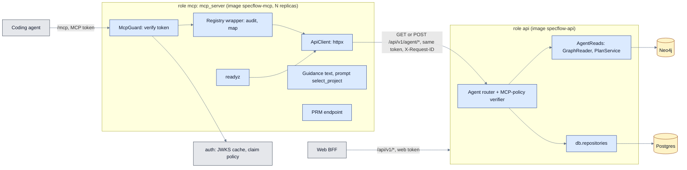

# architecture.md: process, components, package layout, API agent routes, import rules, transport, settings, errors and operations

## Process

The MCP server is a fourth backend role next to `api`, `worker` and `migrate`: `specflow mcp [--check-config]`. It is the
agent-facing backend-for-frontend, as the web app's server side is the browser's: it runs in its own container (compose
service `mcp`) from its own image `specflow-mcp` (`backend/docker/mcp/Dockerfile`, which installs only the `mcp`
dependency extra, [Package layout](#package-layout)), listens on `MCP_PORT` ([Settings](#settings)), and needs only the
API at `API_INTERNAL_URL` and the IdP's JWKS. It holds no Postgres or Neo4j credentials: every tool call becomes one
`GET` (a read tool) or `POST` (a write tool) on an [API agent route](#api-agent-routes) with the caller's own bearer token, and the API does the membership
check, the reads, the paging, the cursors and the error codes. It is the only backend service with a public route; the
`api` container stays internal. It never runs migrations and never starts a database, graph store, Temporal, storage,
Drive or LLM client. Its availability is the API's (accepted, [Operations](#operations)).



```mermaid
sequenceDiagram
    participant A as Agent
    participant G as MCP guard
    participant R as MCP registry
    participant P as API agent router
    participant D as Postgres / Neo4j
    A->>G: POST /mcp tools/call (Bearer MCP token)
    G->>G: verify (MCP policy); 401 + PRM challenge on failure
    G->>R: principal in scope
    R->>P: GET /api/v1/agent/<tool>?args (same Bearer, X-Request-ID)
    P->>P: verify (MCP policy) → upsert user → membership
    P->>D: repositories / GraphReader / PlanService
    P-->>R: 200 model JSON | error envelope; X-SpecFlow-User-Id
    R-->>A: CallToolResult (structured + text) | isError {code, fixed message}
```

## Components

In the `mcp` role (`mcp_server`):

| Component | Responsibility | Built on |
|---|---|---|
| App factory and lifespan | Build the ASGI app: the guard, `/mcp`, the PRM and the probes; the lifespan opens and closes one `ApiClient` and starts and stops the SDK session manager | Starlette (via the SDK) |
| Auth guard | Bearer parsing, token verification, MCP claim policy, 401/403 responses with the RFC 9728 challenge; puts the `Principal` on the request | `auth` package ([auth.md](auth.md)) |
| PRM endpoint | Serves the protected resource metadata document | own route |
| MCP server | Tool registry, input schemas, tool annotations, prompts, server instructions, JSON-RPC handling | `mcp` SDK `MCPServer` |
| Tool registry | One declaration per tool (name, summary, description, `agent_contracts` models, agent route); wraps every tool in one place: audit, then error mapping, then the API call ([Tool registry](#tool-registry)) | MCP SDK `MCPServer` |
| Manifest | Renders the tool and prompt summaries for the web app ([Tool registry](#tool-registry)); `render_manifest` in `registry.py`, a plain function of the declarations, no SDK types | Tool registry |
| Guidance | The server instructions and the `select_project` prompt text that tell an agent how to use the workspace binding ([tools.md](tools.md#workspace-binding)); plain functions of `MCP_RESOURCE_URL` and the optional `project` argument, with no SDK import and no data access | none |
| API client | `async call(route: str, params: Mapping[str, str], authorization: str, request_id: str, *, body: Mapping[str, Any] \| None = None) -> ApiResult`: one `GET` on an agent route of `API_INTERNAL_URL` ([API agent routes](#api-agent-routes)), or one `POST` with `body` as JSON when a body is given ([Write routes](#write-routes)); same timeout, headers and result checks | one `httpx.AsyncClient` |
| Errors and messages | `MESSAGES`, `McpToolError`, `error_body`, and `from_api(result) -> McpToolError`, which maps an API result to a tool result ([Errors](#errors)) | `agent_contracts.ErrorCode` |
| Readiness | `async check() -> ReadyzBody` from the API's `/readyz` (no token): passes through only its `database` and `graph` checks, each with its `ok`, `detail` and `duration_ms`; API unreachable makes both checks not ok with detail `api_unreachable`; `503` unless both are ok (FR-MCP-OPS-02) | API client |
| Health | `/healthz` liveness | own route |

In the `api` role, behind the agent routes:

| Component | Responsibility | Built on |
|---|---|---|
| Shared contracts | Tool argument and result models, `ErrorCode`, `AGENT_ROUTES`, `USER_ID_HEADER`, imported by both roles ([Package layout](#package-layout)) | `agent_contracts` |
| Agent router | The six `GET` routes; membership; paging; cursors; error mapping ([API agent routes](#api-agent-routes)) | `api.routers.agent` |
| Agent auth | The MCP-policy verifier on the agent routes (`AGENT_VERIFIER_STATE_ATTR`, `current_agent_principal`, `AgentUserDep`) ([auth.md](auth.md#token-validation)) | `auth.dependencies`, `api.deps` |
| Agent reads | A lazy `GraphReader` and `PlanService` over `Runtime.graph_store`, with `load_ontology()` and `load_plan_rules` ([../graph/api.md](../graph/api.md#read-and-search)) | `api.agent_reads` |
| Membership check | One function every project-scoped route calls before any read ([access-control.md](access-control.md)) | `db.repositories.get_member_project` |
| Graph read | Count and page spec nodes of given labels, ordered by `spec_id` ([tools.md](tools.md#graph-read-used-by-list_features)) | `GraphReader` methods in `graph.core` |
| Story and spec routes | The routes of the story and spec tools ([Story and spec routes](#story-and-spec-routes)): agent reads of the spec graph in `api.routers.agent_spec`, the people tools and the write tools in `api.routers.agent_stories`; same `AgentRoute`, dependency chain and error mapping as the agent router | `api.routers.agent_spec`, `api.routers.agent_stories` |
| Findings store | Writes and reads findings beside the spec graph; a field of the agent reads next to `GraphReader` and `PlanService`, built on first use the same way ([tools.md](tools.md#add_finding)) | `graph.gap` |
| Member names | Resolves the user ids of holders to display names among the project's members, one query per answer ([tools.md](tools.md#holders)) | `db.repositories.member_names` |

## HTTP surface of the role

| Path | Method | Auth | Answer |
|---|---|---|---|
| `/mcp` | `POST` | Bearer | MCP JSON-RPC; JSON responses |
| `/mcp` | `GET`, `DELETE` and any other method | Bearer | `405` with `Allow: POST` and the JSON error body `method_not_allowed`: stateless mode has no server-initiated stream and no session to delete |
| `/.well-known/oauth-protected-resource/mcp` | `GET` | none | PRM (RFC 9728 path-inserted location) |
| `/.well-known/oauth-protected-resource` | `GET` | none | the same PRM (root fallback some clients try) |
| `/healthz`, `/readyz` | `GET` | none | probes; not routed by the public ingress |
| anything else | any | none | `404` with the JSON error body `{"error": {"code": "not_found", ...}}`; a known path with another method is `405` `method_not_allowed` |

## Package layout

The code lives in the top-level package `backend/src/mcp_server/` (decision AD6). Module names are indicative; the
boundaries are not.

| Module | Holds |
|---|---|
| `mcp_server/server.py` | `run(settings)`: uvicorn on `0.0.0.0:$MCP_PORT`, central logger only; like `api/server.py`, except that SIGTERM ends with exit 0 after `mcp.shutdown.completed`; a failed startup exits 3 |
| `mcp_server/app.py` | `create_mcp_app(settings, ...)`: routes, guard, lifespan (one `ApiClient`) |
| `mcp_server/http.py` | The JSON error envelope, the probe bodies, the invariant check (`required`, `McpInvariantError`) and the per-request id middleware |
| `mcp_server/auth.py` | Guard and PRM |
| `mcp_server/registry.py` | Tool declarations (each names its `agent_contracts` models and its agent route) and their registration with the cross-cutting wrapper; the prompt declarations; the manifest renderer (`render_manifest`, plain data and stable JSON, no SDK types) |
| `mcp_server/descriptions.py` | The tool descriptions agents read, with the untrusted-content notices; plain strings, imports no SDK |
| `mcp_server/guidance.py` | The server instructions and the prompt text, as plain functions; imports no SDK |
| `mcp_server/api_client.py` | The API client and its constants ([Settings](#settings)) |
| `mcp_server/readiness.py` | The `/readyz` check over the API's `/readyz` |
| `mcp_server/errors.py` | `MESSAGES` (the fixed tool messages), `McpToolError`, `error_body` and `from_api` |
| `mcp_server/tables.py` | The Markdown tables of `list_areas`, `list_stories` and `preview_story` ([tools.md](tools.md#tables)): pure functions of the result models, standard library only, like the guidance text |

The MCP role keeps no tool handlers, no user provisioning, no membership function and no database or graph runtime:
that logic lives in the API ([API agent routes](#api-agent-routes)). The package is named `mcp_server`, so `import mcp`
always means the SDK.

The shared package `backend/src/agent_contracts/` is pure pydantic and imports only the standard library, pydantic and
the public models of `graph.plan`:

- the tool models, moved verbatim from the MCP tool modules: `ProjectArguments`, `Limit`, `DEFAULT_LIMIT`, `MAX_LIMIT`,
  `MAX_CURSOR_CHARS`, `ListProjectsArgs`, `ProjectItem`, `ProjectList`, `ListFeaturesArgs`, `FeatureItem`,
  `FeatureList`, `TaskStatusFilter`, `ListTasksArgs`, `TaskList`, `ListFeatureTasksArgs`, `FeatureTaskList`,
  `GetTaskPathArgs`, `TaskPath`, `GetTaskBriefArgs`, `TaskBriefResult`, `ErrorCode` and its constants;
- re-exported from `graph.plan.models`: `TaskItem`, `FeatureRef`, `TaskBrief`;
- `AGENT_ROUTES: Final[Mapping[str, str]]` (tool name to the path of [API agent routes](#api-agent-routes)) and
  `USER_ID_HEADER: Final = "X-SpecFlow-User-Id"`.

The MCP role keeps the tool descriptions and summaries, `MESSAGES` and the guidance text; the API keeps the cursor codec,
the paging and the error mapping.

The story and spec tools add their argument and result models, `Holder`, `ErrorDetails` and their routes to
`agent_contracts`. These are its own pydantic models: the API maps `graph.core`, `graph.plan` and `graph.gap` objects
to them, as it maps a feature node to `FeatureItem`; a `graph.plan` model is re-exported only when the API adds
nothing to it. The import rule of `agent_contracts` (M1) is unchanged.

Dependencies: one `backend/pyproject.toml` and one `uv.lock`; each image installs the shared base and its role's extras
only, and shared modules import only base libraries at module level.

| Set | Holds | Installed by |
|---|---|---|
| base `[project] dependencies` | what every role imports at startup (settings, logger, auth basics) | every image |
| extra `api` | FastAPI, uvicorn, Alembic, SQLAlchemy and asyncpg, the graph store drivers, the Temporal client, Drive, the LLM SDKs (in-process graph build and plan), tracing | api image (which also runs `migrate`) |
| extra `worker` | the Temporal worker, the agent SDK (`openai-agents`), SQLAlchemy and asyncpg, the graph store drivers, Drive, tracing | worker-agents, worker-parse |
| extra `mcp` | the `mcp` SDK, Starlette, uvicorn, httpx, PyJWT | mcp image |
| extra `parse` | Docling, torch, OpenCV, PDFium, and the `llm` libraries the parser uses (anthropic, claude-agent-sdk, langfuse, dotenv) | worker-parse |
| extras `gcp`, `aws`, `tigergraph` | unchanged | api and the workers (`gcp`, `aws`; not the mcp image); opt-in (`tigergraph`) |
| group `dev` | test and lint tools; the dev venv installs every extra | dev, CI |

## Tool registry

The tool library grows with every graph feature that ships (`graph.plan` and the tools of [later.md](later.md)), so
tools are declared, not wired one by one. A declaration names the tool and gives whether it takes a `project_id`, its
annotations, its summary and description, its `agent_contracts` argument and result models, and its agent route
(`AGENT_ROUTES`). Registration wraps every tool the same way, from the outside in:

1. the `mcp.tool.completed` audit event, written for every outcome;
2. error mapping: `from_api` turns the API result into the tool result ([Errors](#errors));
3. the API call: one `GET` on the tool's agent route ([API agent routes](#api-agent-routes)), or for a write tool one
   `POST` with the JSON body ([Write routes](#write-routes)).

User provisioning and, for a project-scoped tool, the membership check run in the API, on the agent route
([access-control.md](access-control.md)). Calls the SDK refuses on input-schema grounds never reach the wrapper and are
not audited.

Prompts are declared in the same registry, from the render functions of the guidance component. A prompt runs no
provisioning and no membership check and reads no data: it returns text, and the agent's own tool calls do the access
work. Prompt names are unique; the registry checks that, because the SDK keeps the first of two prompts with one name.
The server instructions are passed to the SDK server when the app is built.

Each tool and prompt declaration also carries a one-line `summary` for people, separate from the `description` that
agents read ([tools.md](tools.md#conventions)). The registry renders a manifest from the declarations: the name, the
summary, and for a tool whether it is read-only, for a prompt its argument. The manifest is committed as
`frontend/lib/guides/mcp-tools.json`, and the web app's guide builds its tools table from it
([deployment.md](deployment.md#guides-in-the-web-app)). A backend test fails when the committed file differs from the
registry; `make mcp-manifest` regenerates it.

The API call of a read tool sends the validated arguments as query parameters (booleans `true`/`false`, integers as decimal strings,
a list as a repeated parameter, `None` omitted), the caller's single `Authorization` header unchanged and the request id, and checks a `200` body
against the declared result model. The API route passes `str(project.id)` (the canonical lower-case UUID, the graph's
`group_id`) to the graph reader, never the `project_id` argument as given. A write tool sends `project_id` as the query
parameter and the other arguments as the JSON body ([Write routes](#write-routes)). The method follows the
annotations: a declaration whose `readOnlyHint` is false is a write tool; its annotations are the `WRITE` constant
next to `READ_ONLY` (read-only false, destructive false, idempotent true, open-world false), and the declaration has
no method field. A declaration may name a `render` function (result model to text); the result's text block is then
that text instead of the JSON ([tools.md](tools.md#tables)). The registry is the only code that uses the
SDK's tool and prompt API, so an SDK change, or a later move to another MCP framework, touches the registry and not the
API. Every project member has the same access to every tool: no scope or role distinguishes members. The structural
test of access-control.md reads the declarations and the agent routes.

## API agent routes

The API's agent route group serves the tools; it is the only place the tool data is read. All routes: prefix
`/api/v1/agent`, method `GET` (the [Write routes](#write-routes): `POST`), auth = the MCP policy ([auth.md](auth.md#token-validation)), arguments = query parameters
only (write routes: a JSON body as well), `200` body = the `agent_contracts` model as JSON, errors = the `api.errors` envelope
`{"error": {code, message, details}}`.

| Tool | Path | Query parameters | 200 body | Route errors (code → status) |
|---|---|---|---|---|
| `list_projects` | `/projects` | `limit` 1–100 (50), `cursor` ≤ 512 | `ProjectList` | `invalid_cursor` → 400 |
| `list_features` | `/features` | `project_id`, `limit`, `cursor` | `FeatureList` | `project_not_found` → 404, `invalid_cursor` → 400 |
| `list_tasks` | `/tasks` | `project_id`, `ready_only` (true), `status`?, `area_id`?, `story_id`?, `limit`, `cursor` | `TaskList` | + `no_plan` → 404 |
| `list_feature_tasks` | `/feature-tasks` | `project_id`, `feature_id`, `limit`, `cursor` | `FeatureTaskList` | + `no_plan`, `feature_not_found` → 404 |
| `get_task_path` | `/task-path` | `project_id`, `task_id`, `limit`, `cursor` | `TaskPath` | + `no_plan`, `task_not_found` → 404 |
| `get_task_brief` | `/task-brief` | `project_id`, `task_id`, `neighbours` 0–100 (30) | `TaskBriefResult` | + `no_plan`, `task_not_found` → 404 |

Common errors on every route: `401`/`403` (the auth codes of `auth.errors`), `503 agent_unavailable` (no MCP settings in
the api role), `503 graph_unavailable`, `503 database_unavailable`, `500 internal_error`, `422 validation_failed` (query
out of schema; MCP never sends one).

| Header | Direction | Rule |
|---|---|---|
| `Authorization` | MCP → API | the caller's single header, unchanged; only on tool calls |
| `X-Request-ID` | MCP → API, echoed back | MCP's own request id (32 hex); the API adopts it (`api/request_id.py`) |
| `X-SpecFlow-User-Id` | API → MCP | the provisioned user UUID on every response after provisioning, including `ApiError` responses raised by the route or the dependency chain; MCP never forwards a caller's copy. Provisioning stores the id in the request state, and the `api.errors` handlers add the header to every error response from it |

Parameters:

- Schema-bound (`422` if violated; MCP's input schema makes it unreachable): `limit`, `neighbours`, `ready_only`,
  `status`.
- Unbounded `str`, checked in the handler: `cursor` (over 512 characters or not canonical → `400 invalid_cursor`),
  `project_id` (`""`, `x/../y` or not a UUID → `404 project_not_found`, with no query and never logged), `feature_id`,
  `task_id`, `area_id`, `story_id`.

Dependency chain on every agent route: verify (MCP policy) → provision (`Runtime.transaction`; a Postgres outage →
`503 database_unavailable`) → membership → handler. Every failure in the chain ends in an `ErrorCode` envelope or an
auth error; only bugs reach the generic `500` handler.

The handlers keep the behaviour of the former MCP tool handlers: membership before any read; a malformed `project_id`
answers `project_not_found` with no query and no log; the graph and plan reads get `str(project.id)`; the feature
cursor is canonical base64url `{"v":1,"after":…}`; the task path pages by `_page`, the lists by `_after`; ordering and
`total_count` as [tools.md](tools.md) defines. Cursors issued before the split stay valid.

Error mapping on the API side, first match wins: `PlanReadError` → its own code; `InfrastructureUnavailableError` →
`graph_unavailable`; `is_database_unreachable` → `database_unavailable`; anything else → `internal_error`. A bad
ontology or bad plan rules give `internal_error` and one log event; the API start never fails on them, because the
agent reads load lazily and do not depend on the LLM settings. No exception text reaches a body. The same mapping
covers the dependency chain.

Logging: an error the mapping handles (an outage or a failed read, in the chain or the handler) logs one `api.agent.failed`
warning with `code` and `error_type` (the class name). A bug in an agent route reaches the generic handler, which logs
`api.request.failed` at error level with the class name only and no traceback or message, because exception text can hold
feature text. `agent_contracts.AGENT_ROUTES` holds the full paths (`/api/v1/agent/...`), so MCP and the API share one
spelling of each route.

### Story and spec routes

The routes of the story and spec tools ([tools.md](tools.md#story-and-spec-tools)) share the prefix, the auth, the
dependency chain, the headers and the common errors above. Read routes are `GET` with query parameters; a list
argument is a repeated parameter (`spec_ids=A&spec_ids=B`).

| Tool | Path | Query parameters | 200 body | Route errors (code → status) |
|---|---|---|---|---|
| `list_areas` | `/areas` | `project_id` | `AreaList` | `project_not_found`, `no_plan` → 404 |
| `list_stories` | `/stories` | `project_id`, `area_id`?, `view` (`open`), `limit`, `cursor` | `StoryList` | + `area_not_found` → 404, `invalid_cursor` → 400 |
| `preview_story` | `/story-preview` | `project_id`, `story_id` | `StoryPreview` | + `story_not_found` → 404 |
| `get_story_brief` | `/story-brief` | `project_id`, `story_id`, `neighbours` 0–100 (30) | `StoryBriefResult` | + `story_not_found` → 404 |
| `trace` | `/trace` | `project_id`, `story_id`?, `spec_ids`* 1–20, `direction`, `depth` 1–3 (2), `basis` (`trusted`), `include_owner` (true), `relations`*, `limit` 1–200 (100) | `SpecTrace` | `project_not_found`, `story_not_found`, `no_plan` → 404; `invalid_arguments`, `unknown_relation` → 400 |
| `get_node` | `/node` | `project_id`, `spec_id`, `include`* (all), `edge_limit` 1–50 (25) | `NodeDetail` | `project_not_found`, `node_not_found` → 404 |
| `search_spec` | `/spec-search` | `project_id`, `query` 1–500 chars, `near`?, `labels`*, `limit` 1–20 (10) | `SpecSearch` | `project_not_found` → 404; `invalid_arguments` → 400 |
| `similar` | `/similar` | `project_id`, `story_id`?, `spec_ids`* 1–20, `exclude_linked` (true), `limit` 1–20 (5), `min_score` 0–1 (0.75) | `SimilarNodes` | `project_not_found`, `story_not_found`, `no_plan` → 404; `invalid_arguments` → 400 |
| `get_evidence` | `/evidence` | `project_id`, `spec_id`, `context_lines` 0–5 (2) | `Evidence` | `project_not_found`, `node_not_found` → 404 |
| `path` | `/node-path` | `project_id`, `from`, `to`, `max_hops` 1–4 (4) | `NodePaths` | `project_not_found`, `node_not_found` → 404 |
| `expand_brief` | `/brief-expansion` | `project_id`, `story_id`, `budget_tokens` 500–8000 (3000) | `BriefExpansion` | `project_not_found`, `no_plan`, `story_not_found` → 404 |

`*` a list parameter. Schema-bound as for the earlier routes (`422` if violated; MCP's input schema makes it
unreachable): every range, length and enum above. Checked in the handler: `story_id` xor `spec_ids`, `relations`
against the ontology, `labels` against the spec labels, `near`.

### Write routes

The five write tools are the first agent routes that change data. Each is one `POST` on a fixed path:

| Rule | Value |
|---|---|
| Method, path | `POST /api/v1/agent/<path>` from the table below |
| Query | `project_id` only, checked by the membership dependency as on every agent route |
| Body | `Content-Type: application/json`; the tool's argument model without `project_id`, `None` values left out; a body out of schema is `422 validation_failed` (MCP never sends one) |
| Order | verify → provision → membership → handler; nothing is read from the graph or written before the membership check, and a refused call writes nothing |
| Answer | `200` with the result model, for the first call and for a repeat ([tools.md](tools.md#repeats)); errors in the `api.errors` envelope with typed `details` ([tools.md](tools.md#error-details)) |
| Writes | one library call per request; the graph keeps who and when (`claimed_by`, `completed_by`, `created_by`) |
| Audit | one `api.agent.written` event per call ([Logging and audit](#logging-and-audit)) |

| Tool | Path | Body fields | 200 body | Route errors (code → status) |
|---|---|---|---|---|
| `claim_story` | `/story-claim` | `story_id`, `agent_label`?, `branch`? | `StoryClaim` (`claim_token`, `story_ids`: the claim unit, `claimed_at`, `items`) | `project_not_found`, `no_plan`, `story_not_found` → 404; `invalid_arguments` → 400; `story_claimed`, `partly_claimed`, `not_available`, `plan_applying` → 409 |
| `release_story` | `/story-release` | `story_id`, `claim_token`, `note`?, `branch`? | `StoryRelease` | `project_not_found`, `no_plan`, `story_not_found` → 404; `invalid_arguments` (`branch` format) → 400; `claim_mismatch`, `plan_applying` → 409 |
| `add_finding` | `/findings` | `kind`, `text`, `about`, `refers_to` ([]), `story_id`?, `claim_token`?, `blocking` (false) | `FindingResult` | `project_not_found`, `node_not_found`, `story_not_found` → 404; `invalid_arguments` → 400; `claim_mismatch`, `finding_limit`, `plan_applying` (blocking) → 409 |
| `report_task` | `/task-progress` | `task_id`, `claim_token`, `progress`, `note`? | `TaskReport` (`task`) | `project_not_found`, `no_plan`, `task_not_found` → 404; `invalid_arguments` → 400; `claim_mismatch`, `plan_applying` → 409 |
| `complete_story` | `/story-completion` | `story_id`, `claim_token`, `merge_commit`, `pr_url`?, `done`? | `StoryCompletion` | `project_not_found`, `no_plan`, `story_not_found` → 404; `invalid_commit`, `invalid_arguments` → 400; `claim_mismatch`, `plan_applying` → 409 |

Every new code is listed with its status in the API's error-code registry (`backend/archkit.toml`, `[error_codes]`):
`*_not_found` 404; `invalid_arguments`, `invalid_commit`, `unknown_relation` 400; `story_claimed`, `not_available`,
`partly_claimed`, `plan_applying`, `claim_mismatch`, `finding_limit` 409. The MCP role maps a 409 with a known code
like any other known code: the code, its fixed message and the validated details.

## Import rules

| # | Rule |
|---|---|
| M1 | `mcp_server` may import `agent_contracts`, `auth` (not `auth.dependencies`), `logger`, `settings`, the `mcp` SDK, Starlette, uvicorn, httpx, pydantic and the standard library. `agent_contracts` imports only the standard library, pydantic and the public models of `graph.plan`. |
| M2 | `mcp_server` never imports `db`, `graph` (its models come only through `agent_contracts`), `temporal`, `storage`, `llm`, `drive`, `agent_runtime`, `health`, `api`, `auth.dependencies`, FastAPI, `sqlalchemy`, `asyncpg` or `neo4j` directly, and loads none of their libraries at runtime; the REST app never imports `mcp_server`, and never imports the `mcp` SDK directly (the agent SDKs it uses depend on it). |
| M3 | No Cypher and no `neo4j` import in the agent routes; every graph read is a `GraphReader` method, and every plan read a `PlanService` method. A route composes no plan logic of its own: it checks membership, calls one service method, pages the answer and maps `PlanReadError` to its error code. A read route calls no lifecycle method (claims, state changes); a write route calls one `PlanService` story or progress call, or the `graph.gap` findings call, after the membership check; a blocking finding is the one composed write (add the finding, block the story, withdraw the finding when the block fails: [../graph/gap.md](../graph/gap.md#blocking-link)). Write routes still run no Cypher. |
| M4 | No SQL and no ORM query in the agent routes; every Postgres read or write is a `db.repositories` function. |

Import-linter contracts in `backend/importlinter.toml` (on direct imports) enforce M1 and M2. The role import test
(`make check`, no Docker) imports each role's entrypoint with only that role's extras installed, and the image tests
check per image that a forbidden package is absent, so M2 also holds at runtime. A backend-wide contract
(`connections-in-composition-roots`) lets only the composition roots open a connection: `mcp_server` opens none, and
the agent reads take the graph store from the REST runtime (`Runtime.graph_store`). The validation tracks catch query
text in the API layer: the SQL track flags SQL text anywhere under `backend/src`, and the Cypher track scans the API
layer, the agent routes included, for inline Cypher. For that, the `[python] exclude` list of
`backend/cypher-checks.toml` holds no pattern that matches `api/**`.

## Transport

| Setting | Value | Why |
|---|---|---|
| SDK | the official MCP Python SDK (`mcp`), declared `>=2.3,<3` | the agent SDKs depend on the same package, so one version serves the whole backend; a public endpoint takes current releases; its extension mechanism (SEP-2133) carries the tasks extension for long-running tools ([later.md](later.md)) |
| Transport | Streamable HTTP, path `/mcp` | the current remote MCP transport; Claude Code's `--transport http` |
| Sessions | stateless (`stateless_http`) | any replica answers any request; no session affinity; no session store |
| Responses | JSON (`json_response`), no streaming | every version 1 tool answers at once; nothing is sent to the client during a call (no progress, no elicitation), and proxies need no streaming settings |
| Request body | at most 1 MiB (SDK `max_request_body_size`) | tool arguments are tiny |
| Host header | must be in the allowlist: the `host[:port]` of `MCP_RESOURCE_URL` exactly as clients send it in `Host` (for example `localhost:8002` locally), plus `MCP_ALLOWED_HOSTS` (SDK transport security, exact match) | DNS-rebinding protection |
| Origin header | refused unless in `MCP_ALLOWED_ORIGINS` (empty by default) | no browser clients |
| Cookies, CORS | none | bearer tokens only |

## Settings

Role `mcp` reads the shared auth settings ([../configuration.md](../configuration.md)) and these; it reads no database
or graph store setting:

| Variable | Default | Rule |
|---|---|---|
| `API_INTERNAL_URL` | required | Base URL of the API, with the same name and forms as the web app's: a bare `host[:port]` becomes `http://host[:port]`, a trailing `/` is trimmed; userinfo, a query, a fragment or a scheme other than `http`/`https` is refused. TLS is not required inside the cluster (AD8); `https` works with publicly trusted certificates only |
| `MCP_RESOURCE_URL` | required | Absolute URL whose path is exactly `/mcp`, no query or fragment; `https` unless `APP_ENV=local`. Published as the PRM `resource`; never derived from request headers |
| `MCP_AUDIENCE` | `MCP_RESOURCE_URL` | The required token audience; set it when the IdP needs an API identifier (for example `api://specflow-mcp`) |
| `MCP_CLIENT_IDS` | `specflow-mcp` | Comma-separated allowed client ids; at least one |
| `MCP_ALLOWED_HOSTS` | empty | Extra `host[:port]` values accepted besides the resource URL's `host[:port]` |
| `MCP_ALLOWED_ORIGINS` | empty | Origins accepted on `/mcp` |
| `MCP_PORT` | `8002` | Listen port |

Shared settings the role requires: `APP_ENV`, `AUTH_ALLOWED_EMAIL_DOMAINS`; `OIDC_ISSUER`
(`https` unless `APP_ENV=local`). Optional: `AUTH_JWKS_URL` (identical in both roles when set), `AUTH_API_AUDIENCE` (default `specflow-api`, read for the audience
refusals) and the claim profile variables of [auth.md](auth.md). Startup refuses, naming every bad variable:
`AUTH_MODE=dev` (removed; the message carries a hint to delete it); a missing issuer; a missing or invalid
`API_INTERNAL_URL`; an
invalid resource URL, an empty client list (outside `APP_ENV=local` also one holding the QA client `specflow-smoke`), the audience mix-ups that the refusal table of [auth.md](auth.md#token-validation) lists, and the
token-type settings that the [claim profile](auth.md#claim-profile-for-any-oidc-provider) rules out.
`specflow mcp --check-config` passes without any `DATABASE_*` or `GRAPH_STORE_*` variable.

The agent routes make the `api` role read some MCP settings too. Settings by role:

| Variable | api role | mcp role |
|---|---|---|
| `OIDC_ISSUER`, the `AUTH_*` claim profile (`AUTH_TOKEN_TYPE`, the claim names, the email domains) | required, **identical to mcp's** | required |
| `AUTH_JWKS_URL` | optional, **identical to mcp's when set** | optional |
| `MCP_RESOURCE_URL` | optional; set → the agent routes are on and the MCP startup guards run; unset → every agent route answers `503 agent_unavailable` | required |
| `MCP_AUDIENCE`, `MCP_CLIENT_IDS` | optional; must equal mcp's | optional |
| `API_INTERNAL_URL` | — | required |
| `DATABASE_*`, `GRAPH_STORE_*` | required | not read |
| `MCP_PORT`, `MCP_ALLOWED_HOSTS`, `MCP_ALLOWED_ORIGINS` | parsed (not used) once `MCP_RESOURCE_URL` is set; a bad value refuses the api start | as above |

A claim profile or MCP audience that differs between the two roles passes every MCP guard check and then fails every
tool with `internal_error` ([Operations](#operations), [deployment.md](deployment.md#troubleshooting)).

Constants (not settings): the page size limits of [tools.md](tools.md#conventions), the request body cap of
[Transport](#transport) (1 MiB), and for the API client `API_TIMEOUT_SECONDS = 25` (one total timeout per call, below
the ingress timeout of 30 s), no retries, `trust_env=False` and `follow_redirects=False`.

## Errors

| Layer | Failure | Answer |
|---|---|---|
| HTTP | missing, malformed, expired or wrong-audience token | `401`, `WWW-Authenticate: Bearer` with `resource_metadata` ([auth.md](auth.md#failure-responses)) |
| HTTP | valid token, email not verified or domain not allowed | `403`, JSON error body, no challenge |
| HTTP | Host or Origin not allowed, body too large, non-JSON content type | SDK transport answer: `421` (Host), `403` (Origin), `413` (body), `400` (content type); checked after the guard, so without a valid token the answer is `401` |
| HTTP | unexpected error outside a tool | `500`, JSON error body `internal_error`, `mcp.request.failed` logged |
| Tool | argument, membership or dependency failure, or a failed API call | tool result with `isError: true` and a fixed code ([tools.md](tools.md)), mapped by `from_api` (below) |
| Startup | bad settings, or a `MCP_RESOURCE_URL` so long that the binding instructions would reach 2,048 characters; the JWKS and IdP discovery are fetched on the first request, and the API on the first call or probe, not at startup | exit non-zero with `config.validation.failed` or `mcp.startup.failed` |

`from_api` maps the result of an API call to the tool result and names the failure in the audit event's error type:

| API result | Tool result | `error_type` in the audit |
|---|---|---|
| 2xx, body validates against the model, `X-SpecFlow-User-Id` present | success | — |
| 2xx without `X-SpecFlow-User-Id` | `internal_error` | `ApiProtocolError` |
| 4xx/5xx with a code in `ErrorCode` | that code, with the fixed `MESSAGES` text | `ApiError:<code>` |
| 401 / 403 | `internal_error` | `ApiAuthRejected` |
| 503 `agent_unavailable` | `internal_error` | `ApiAgentUnavailable` |
| any other status or code; non-JSON; 2xx not matching the model | `internal_error` | `ApiProtocolError` |
| connect error | `internal_error` | `ApiUnreachable` |
| timeout | `internal_error` | `ApiTimeout` |

The API-side mapping is in [API agent routes](#api-agent-routes). A token that expires between the MCP guard and the
API gives `internal_error` (`ApiAuthRejected`), not a 401 challenge; the client refreshes on its next call (accepted).

Messages are fixed strings. No error carries Cypher, SQL, driver text, token content, API message text or another
project's existence.

## Logging and audit

Central logger only (`logger.get_logger`, `log_event`), dotted event names, no `print`, no stdlib logging setup. Events:

| Event | Fields |
|---|---|
| `mcp.startup.completed` | port |
| `mcp.startup.failed` | error type and the central logger's exception fields |
| `mcp.shutdown.completed` | port |
| `mcp.auth.rejected` | reason, status, code |
| `mcp.request.failed` | method, path, error type and the exception fields |
| `mcp.tool.completed` | tool, user id (from the API's `X-SpecFlow-User-Id`; omitted when absent), project id when given as a valid UUID (canonical form), outcome (`ok` or the error code), item count, duration ms; error type when the outcome is not `ok`: the named API failure of [Errors](#errors) (for example `ApiUnreachable`, `ApiError:<code>`), or the exception class name, never its text |

The API logs one more event for the write routes: `api.agent.written` with the route, project id, user id, the
target ids (story, task, finding), the outcome (`ok` or the error code) and `repeat` (true when the call changed
nothing, [tools.md](tools.md#repeats)); never a note, finding text, agent label, branch, holder name or claim token.
The same request id joins it to `mcp.tool.completed`.

A fresh `request_id` is bound for each HTTP request by an ASGI wrapper outside `McpGuard`; every event of the request carries it (the guard's `mcp.auth.rejected`, the tool's `mcp.tool.completed`). The server never adopts a caller-supplied `X-Request-ID`. It sends its own id to the API as `X-Request-ID`, and the API adopts it, so one id follows a tool call through both services. Startup and shutdown events keep the process id.

Logs follow rule S2 of [auth.md](auth.md#security-rules) and carry no feature text or cursors. `mcp.tool.completed` is the access audit trail: it answers
which user read which project and when. There is no audit table; the log pipeline holds the record.

## Operations

| Failure | Behavior | Recovery |
|---|---|---|
| Neo4j down | the graph and plan tools answer `graph_unavailable` (from the API); `/readyz` not ready (the API's `graph` check) | automatic when Neo4j returns |
| Postgres down | every tool answers `database_unavailable` (from the API, also during provisioning); `/readyz` not ready (the API's `database` check) | automatic |
| API down | every tool answers `internal_error` (`error_type` `ApiUnreachable`, or `ApiTimeout` after 25 s); `/readyz` answers `503` with both checks not ok, detail `api_unreachable` | automatic when the API returns |
| MCP audience or claim profile differs between api and mcp | the MCP guard accepts the token, the API refuses it: every tool answers `internal_error` (`ApiAuthRejected`) | set the same values in both roles ([deployment.md](deployment.md#troubleshooting)) |
| `MCP_RESOURCE_URL` unset in the api role | every tool answers `internal_error` (`ApiAgentUnavailable`) | set the MCP variables in the api role |
| IdP JWKS unreachable | known keys keep working for up to 10 minutes; a new `kid` fails with `401` | automatic; the JWKS cache backs off |
| IdP signing-key rotation | the new `kid` triggers one throttled JWKS refetch | none |
| Bad ontology or plan rules | the affected agent routes answer `internal_error` and log one event; the API keeps running | fix the ontology or the rules |
| Replica crash | stateless: the next request goes to another replica | none |

Accepted: MCP availability is the API's availability (the API start needs Temporal), and agent reads share the one
API replica with the web app. One extra internal hop per call is budgeted: the p95 of a tool call stays within 50 ms
of the p95 before the split ([testing.md](testing.md#stack-gate)).

## Decisions

| # | Decision | Rejected alternatives and why |
|---|---|---|
| AD1 (revised) | A separate role in its own container (compose service `mcp`) with its own image `specflow-mcp`, built from the one `backend/pyproject.toml` with only the `mcp` extra; every role image installs only its own extras | Revised when MCP became a router over the API (AD8): the role no longer needs the data access, the ORM or the graph drivers of the `api` image, and the public process should carry nothing it does not run. A uv workspace per service: moves every shared module; revisited if the services diverge. The original decision follows as history: built from the same image as `api`. Serving `/mcp` from the API process: MCP must be public, so the API process would sit behind a public route with only ingress path rules keeping `/api/v1` internal (one wrong rule exposes every REST method), and that process holds the storage, Temporal, Drive and LLM credentials. Its start also fails while Temporal is unreachable, and mounting needs extra wiring (a mounted app's lifespan never runs; a catch-all mount changes the API's 404). A separate repository or image: duplicates settings, auth and data access for no gain |
| AD2 | The official `mcp` SDK, in the range of [Transport](#transport), with a thin tool registry of our own | FastMCP 3 (Rosetta's choice, [overview.md](overview.md#key-terms)): richer tool management (transforms, versioning, per-session visibility) and Redis-backed background tasks, but it requires `mcp` below 2, which moves the agent SDKs' (`claude-agent-sdk`, `openai-agents`) `mcp` dependency from 2.x back to 1.x; its task workers would be a second job system next to Temporal; its OAuth proxy is not used ([auth.md](auth.md)). Revisited when FastMCP supports `mcp` 2.x ([later.md](later.md)) |
| AD3 | Stateless sessions, JSON responses | Streamed (SSE) responses: progress and elicitation during a call, which no planned tool needs yet; they are one SDK setting plus streaming-friendly ingress away ([later.md](later.md)). Stateful sessions: need affinity or a shared event store across replicas, for server messages outside a call that nothing uses |
| AD4 | The paged read is a `GraphReader` method in `graph.core` | MCP-owned Cypher: a second Cypher home outside the validated query folders, against the graph library's rule that every query lives in its query modules ([../graph/architecture.md](../graph/architecture.md#import-rules), rule I3) |
| AD5 (revised) | Membership, provisioning and every Postgres read go through the API: the agent routes call `db.repositories` (`list_projects`, `get_member_project`, `upsert_user`); the MCP role has no database access | Revised with AD8: the MCP role holds no data-store credentials, so the access decision moved with the reads into the API, next to the REST one. The original decision follows as history: Postgres access from the MCP role through `db.repositories`. MCP-owned SQL: a second membership query that can drift from the REST one, which is the access decision itself |
| AD6 (revised) | Code in the top-level package `mcp_server` | Revised with AD8: the role imports neither FastAPI nor the ORM any more, so a top-level package needs no new import-linter exception (its own contracts confine it, M1 and M2), and the `api` package stops carrying a second process. The original decision follows as history: code in `api/mcp/`; a top-level package would have needed new import-linter exceptions, because the web framework is confined to `api` and `auth`, and the ORM to `api`, `db` and `temporal` |
| AD7 | The workspace binding is a file in the user's repository that the agent reads and writes; the server guides with instructions and a prompt ([tools.md](tools.md#workspace-binding)). The server stays stateless, every call keeps an explicit `project_id`, and it works with any client that loads server instructions and can write files | A server-side "current project": the server never sees the workspace, and the stateless JSON transport rules out roots and elicitation. A request header from `.mcp.json` with an optional `project_id`: it changes the tool contract and repeats the binding in each agent's own config; it is the fallback in [later.md](later.md). Only a section in `CLAUDE.md` or `AGENTS.md`: it mixes data into the user's own instruction files and needs a different file per agent. A `select_project` tool: it cannot write the file either, and the model could call it on its own, while choosing a project is the user's decision |
| AD8 | MCP is a second backend-for-frontend, like the web app's server side: each tool maps to one [API agent route](#api-agent-routes) (`GET` for a read, `POST` for a write) whose response equals the tool output; MCP forwards the caller's MCP token unchanged, and the API accepts the MCP audience only on that route group ([auth.md](auth.md#decisions), AA9). The hop is plain HTTP inside the cluster, as for the web app; a NetworkPolicy lets only the frontend and mcp pods reach the API | The status quo with its own image (MCP keeps direct database and graph reads): the smallest change and MCP stays available without the API, but the public process keeps the data-store credentials, and write tools and Temporal tasks would need a second path later. MCP served from the API process (mounting `/mcp`): refused by AD1, the API process with its storage, Temporal, Drive and LLM credentials would sit behind a public route. For the auth of the hop: a token exchange (RFC 8693) puts a confidential client and its secret in the public process, and production IdP support is unverified; a service token plus an asserted user lets a leaked MCP credential act as any user. TLS on the internal hop: decided later for both backends-for-frontends together. Costs accepted: one extra hop, MCP availability = API availability, agent load on the one API replica, tool shapes carried by the API |
| AD9 | Write tools are `POST` agent routes on fixed noun paths, `project_id` in the query and the other arguments as a JSON body; the method follows the annotations, so a declaration gets no method field | REST resource paths (`/stories/{id}/claim`, `DELETE` for a release): new path parameters and dependency shapes for no gain. A `GET` with query parameters: a write on a safe method |
| AD10 | Writes are idempotent by state: a repeat with the same arguments changes nothing and answers as the first call did; the story keeps its last claim token until the next claim; no request id argument and no request store | A Postgres store keyed by a request id: a table, retention, a row that is not atomic with the graph write, and a stale replay when an agent reuses an id such as `1`. A request id for audit only: an argument the agent must invent while MCP already joins both logs by `X-Request-ID` |
| AD11 | Error results may carry typed `details` beside the fixed message, validated against `ErrorDetails` | No details: the agent needs one or two more calls per refusal. Refusals as success results: breaks `isError` |
| AD12 | The MCP role renders the Markdown tables of the people tools from the structured content; the API stays JSON only | Two text blocks, JSON then Markdown: doubles the tokens and the agent may relay the JSON. The API renders: the API would carry presentation for one client |

## What would invalidate this design

- A need for server-initiated messages (progress, elicitation, sampling): revisit AD3.
- Agent load or availability needs that the one API replica cannot meet: scale the API, or revisit AD8.
- An IdP that cannot put the MCP audience into an access token: the OAuth proxy of [later.md](later.md).
- Agents that ignore the server instructions: move to the header binding of [later.md](later.md) (AD7).
- A need for several projects in one workspace: the single-project file of version 1 would need a new format version (AD7).
- More than one IdP per deployment: users would need the issuer in their key (constraint C1 of
  [overview.md](overview.md)).
