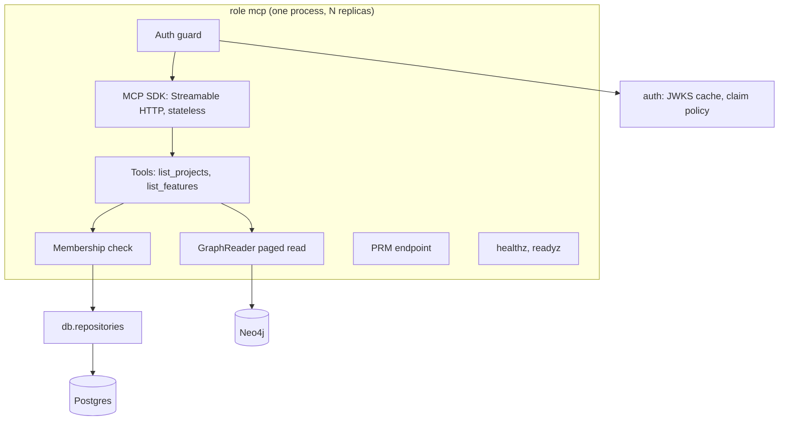

# architecture.md: process, components, package layout, import rules, transport, settings, errors and operations

## Process

The MCP server is a fourth backend role next to `api`, `worker` and `migrate`: `specflow mcp [--check-config]`. It runs
in its own container (compose service `mcp`), built from the same image as `api` with its own command, listens on
`MCP_PORT` (default `8002`), and needs only Postgres, Neo4j and the IdP's JWKS. It is the only backend service with a
public route; the `api` container stays internal. It never runs migrations (the `api` container runs `specflow migrate`
before `specflow api`) and never starts Temporal, storage, Drive or LLM clients.

## Components

| Component | Responsibility | Built on |
|---|---|---|
| App factory and lifespan | Build the ASGI app; open and close the runtime; start and stop the SDK session manager | Starlette (via the SDK) |
| Runtime | DB engine and session factory, Neo4j driver, the ontology from `load_ontology()` (the one the graph build uses, loaded at startup, [../graph/api.md](../graph/api.md#core-setup)), one `GraphReader` without a gateway ([../graph/api.md](../graph/api.md#read-and-search)), readiness probes | `db.session`, `graph.core`, `health` |
| Auth guard | Bearer parsing, token verification, MCP claim policy, 401/403 responses with the RFC 9728 challenge; puts the `Principal` on the request | `auth` package ([auth.md](auth.md)) |
| PRM endpoint | Serves the protected resource metadata document | own route |
| MCP server | Tool registry, input schemas, tool annotations, JSON-RPC handling | `mcp` SDK `MCPServer` |
| Tool registry | One declaration per tool; applies the audit event, error mapping, user provisioning and membership check to every tool in one place ([Tool registry](#tool-registry)) | MCP SDK `MCPServer` |
| Tools | Validate arguments, read, shape the result; one module per domain ([tools.md](tools.md)) | access, reader |
| Membership check | One function every project-scoped tool calls before any read ([access-control.md](access-control.md)) | `db.repositories.get_member_project` |
| Graph read | Count and page spec nodes of given labels, ordered by `spec_id` ([tools.md](tools.md#graph-read-used-by-list_features)) | new `GraphReader` methods in `graph.core` |
| Health | `/healthz` liveness; `/readyz` database and Neo4j probes | `health.Readiness` |

## HTTP surface of the role

| Path | Method | Auth | Answer |
|---|---|---|---|
| `/mcp` | `POST` | Bearer | MCP JSON-RPC; JSON responses |
| `/mcp` | `GET`, `DELETE` | Bearer | `405`: stateless mode has no server-initiated stream and no session to delete |
| `/.well-known/oauth-protected-resource/mcp` | `GET` | none | PRM (RFC 9728 path-inserted location); 404 in local dev mode |
| `/.well-known/oauth-protected-resource` | `GET` | none | the same PRM (root fallback some clients try); 404 in local dev mode |
| `/healthz`, `/readyz` | `GET` | none | probes; not routed by the public ingress |
| anything else | any | none | `404` with the JSON error body `{"error": {"code": "not_found", ...}}` |

## Package layout

The code lives in a subpackage of the HTTP layer: `backend/src/api/mcp/`. Module names are indicative; the boundaries are not.

| Module | Holds |
|---|---|
| `api/mcp/server.py` | `run(settings)`: uvicorn on `0.0.0.0:$MCP_PORT`, central logger only (mirrors `api/server.py`) |
| `api/mcp/app.py` | `create_mcp_app(settings, *, runtime_factory=...)`: routes, guard, lifespan |
| `api/mcp/runtime.py` | The slim runtime and its factory |
| `api/mcp/auth.py` | Guard and PRM |
| `api/mcp/registry.py` | Tool declarations and their registration with the cross-cutting checks |
| `api/mcp/tools/` | Tool handlers, one module per domain (`projects`, `graph`; later `plan`) |
| `api/mcp/errors.py` | Tool error codes and the sanitizing mapper |

The SDK package is also named `mcp`; absolute imports keep `import mcp` pointing at the SDK.

## Tool registry

The tool library grows with every graph feature that ships (`graph.plan` and the tools of [later.md](later.md)), so
tools are declared, not wired one by one. A declaration names the tool and gives whether it takes a `project_id`, its
annotations, its description and its handler. Registration wraps every handler the same way, from the outside in:

1. the `mcp.tool.completed` audit event, written for every outcome;
2. error mapping ([tools.md](tools.md)), which also maps failures of the two steps below;
3. user provisioning (`upsert_user`);
4. for a project-scoped tool, the membership check ([access-control.md](access-control.md));
5. the handler.

Calls the SDK refuses on input-schema grounds never reach the wrapper and are not audited.

Handlers are plain async functions of the `Principal`, the runtime, the validated arguments and, for a project-scoped
tool, the `Project` the membership check returned; they pass `str(project.id)` (the canonical lower-case UUID, the
graph's `group_id`) to the graph reader, never the `project_id` argument as given. Handlers import nothing from the
SDK. The registry is the only code that uses the SDK's tool API, so an SDK change, or a later move to another MCP
framework, touches the registry and not the tools. Every project member has the same access to every tool: no scope or
role distinguishes members. The structural test of access-control.md reads the declarations.

## Import rules

| # | Rule |
|---|---|
| M1 | `api.mcp` may import `auth` (not `auth.dependencies`), `db`, `graph` (public names of `graph.core` only), `health`, `logger`, `settings`, the `mcp` SDK, Starlette, uvicorn, pydantic and the standard library. |
| M2 | `api.mcp` never imports `api.routers`, `api.deps`, `api.app`, `api.runtime`, `auth.dependencies` or FastAPI; the REST app never imports `api.mcp`, and never imports the `mcp` SDK directly (the agent SDKs it uses depend on it). |
| M3 | No Cypher and no `neo4j` import in `api.mcp`; every graph read is a `GraphReader` method. |
| M4 | No SQL and no ORM query in `api.mcp`; every Postgres read or write is a `db.repositories` function. |

Import-linter contracts in `backend/importlinter.toml` (on direct imports) enforce M2, and one more forbids direct
`sqlalchemy`, `asyncpg` and `neo4j` imports in `api.mcp` (M3, M4). The validation tracks catch query text in `api.mcp`:
the SQL track flags SQL text anywhere under `backend/src`, and the Cypher track scans the API layer for inline Cypher.
For that, the `[python] exclude` list of `backend/cypher-checks.toml` holds no pattern that matches `api/mcp/**`; in
particular it does not hold `api/**`.

## Transport

| Setting | Value | Why |
|---|---|---|
| SDK | the official MCP Python SDK (`mcp`), declared `>=2.3,<3` | the agent SDKs depend on the same package, so one version serves the whole backend; a public endpoint takes current releases; its extension mechanism (SEP-2133) carries the tasks extension for long-running tools ([later.md](later.md)) |
| Transport | Streamable HTTP, path `/mcp` | the current remote MCP transport; Claude Code's `--transport http` |
| Sessions | stateless (`stateless_http`) | any replica answers any request; no session affinity; no session store |
| Responses | JSON (`json_response`), no streaming | every version 1 tool answers at once; nothing is sent to the client during a call (no progress, no elicitation), and proxies need no streaming settings |
| Request body | at most 1 MiB (SDK `max_request_body_size`) | tool arguments are tiny |
| Host header | must be in the allowlist: the `host[:port]` of `MCP_RESOURCE_URL` exactly as clients send it in `Host` (for example `localhost:8002` locally), plus `MCP_ALLOWED_HOSTS` (SDK transport security, exact match) | DNS-rebinding protection |
| Origin header | refused unless in `MCP_ALLOWED_ORIGINS` (empty by default) | no browser clients |
| Cookies, CORS | none | bearer tokens only |

## Settings

Role `mcp` reads the shared database, Neo4j and auth settings ([../configuration.md](../configuration.md)) and these:

| Variable | Default | Rule |
|---|---|---|
| `MCP_RESOURCE_URL` | required | Absolute URL whose path is exactly `/mcp`, no query or fragment; `https` unless `APP_ENV=local`. Published as the PRM `resource`; never derived from request headers |
| `MCP_AUDIENCE` | `MCP_RESOURCE_URL` | The required token audience; set it when the IdP needs an API identifier (for example `api://specflow-mcp`) |
| `MCP_CLIENT_IDS` | `specflow-mcp` | Comma-separated allowed client ids; at least one |
| `MCP_ALLOWED_HOSTS` | empty | Extra `host[:port]` values accepted besides the resource URL's `host[:port]` |
| `MCP_ALLOWED_ORIGINS` | empty | Origins accepted on `/mcp` |
| `MCP_PORT` | `8002` | Listen port |

Shared settings the role requires: `APP_ENV`, `DATABASE_*`, `NEO4J_*`, `AUTH_ALLOWED_EMAIL_DOMAINS`; `OIDC_ISSUER`
under `AUTH_MODE=oidc` (`https` unless `APP_ENV=local`); `AUTH_DEV_SIGNING_KEY` under `AUTH_MODE=dev`. Optional:
`AUTH_MODE` (default `oidc`), `AUTH_JWKS_URL`, `AUTH_API_AUDIENCE` (default `specflow-api`, read for the audience
refusals) and the claim profile variables of [auth.md](auth.md). Startup refuses, naming every bad variable:
`AUTH_MODE=dev` outside `APP_ENV=local` or inside Kubernetes; under `oidc`, a dev signing key or a missing issuer; an
invalid resource URL, an empty client list, an `MCP_AUDIENCE` equal to an allowed client id or to
`AUTH_API_AUDIENCE`, and `AUTH_IGNORED_AUDIENCES` holding either surface's audience.

Constants (not settings): page size default 50 and maximum 100; request body cap 1 MiB.

## Errors

| Layer | Failure | Answer |
|---|---|---|
| HTTP | missing, malformed, expired or wrong-audience token | `401`, `WWW-Authenticate: Bearer` with `resource_metadata` ([auth.md](auth.md)) |
| HTTP | valid token, email not verified or domain not allowed | `403`, JSON error body, no challenge |
| HTTP | Host or Origin not allowed, body too large | SDK transport answer (`421`/`403`/`413` family); checked after the guard, so without a valid token the answer is `401` |
| Tool | argument, membership or dependency failure | tool result with `isError: true` and a fixed code ([tools.md](tools.md)) |
| Startup | bad settings, or an invalid or missing ontology (including one without a `feature` type); the JWKS and IdP discovery are fetched on the first request, not at startup | exit non-zero with `config.validation.failed` or `mcp.startup.failed` |

Messages are fixed strings. No error carries Cypher, SQL, driver text, token content or another project's existence.

## Logging and audit

Central logger only (`logger.get_logger`, `log_event`), dotted event names, no `print`, no stdlib logging setup. Events:

| Event | Fields |
|---|---|
| `mcp.startup.completed`, `mcp.startup.failed`, `mcp.shutdown.completed` | port, error type |
| `mcp.auth.rejected` | reason, status, code |
| `mcp.tool.completed` | tool, user id, project id when given, outcome (`ok` or the error code), item count, duration ms |

Logs never carry tokens, emails, feature text or cursors. `mcp.tool.completed` is the access audit trail: it answers
which user read which project and when. There is no audit table; the log pipeline holds the record.

## Operations

| Failure | Behavior | Recovery |
|---|---|---|
| Neo4j down | `list_features` answers `graph_unavailable`; `/readyz` not ready | automatic when Neo4j returns |
| Postgres down | every tool answers `database_unavailable`; `/readyz` not ready | automatic |
| IdP JWKS unreachable | known keys keep working for up to 10 minutes; a new `kid` fails with `401` | automatic; the JWKS cache backs off |
| IdP signing-key rotation | the new `kid` triggers one throttled JWKS refetch | none |
| Bad ontology | startup fails | fix the ontology |
| Replica crash | stateless: the next request goes to another replica | none |

## Decisions

| # | Decision | Rejected alternatives and why |
|---|---|---|
| AD1 | A separate role in its own container (compose service `mcp`), built from the same image as `api` | Serving `/mcp` from the API process: MCP must be public, so the API process would sit behind a public route with only ingress path rules keeping `/api/v1` internal (one wrong rule exposes every REST method), and that process holds the storage, Temporal, Drive and LLM credentials. Its start also fails while Temporal is unreachable, and mounting needs extra wiring (a mounted app's lifespan never runs; a catch-all mount changes the API's 404). A separate repository or image: duplicates settings, auth and data access for no gain |
| AD2 | The official `mcp` SDK, `>=2.3,<3`, with a thin tool registry of our own | FastMCP 3 (Rosetta's choice, [overview.md](overview.md#key-terms)): richer tool management (transforms, versioning, per-session visibility) and Redis-backed background tasks, but it requires `mcp` below 2, which moves the agent SDKs' (`claude-agent-sdk`, `openai-agents`) `mcp` dependency from 2.x back to 1.x; its task workers would be a second job system next to Temporal; its OAuth proxy is not used ([auth.md](auth.md)). Revisited when FastMCP supports `mcp` 2.x ([later.md](later.md)) |
| AD3 | Stateless sessions, JSON responses | Streamed (SSE) responses: progress and elicitation during a call, which no planned tool needs yet; they are one SDK setting plus streaming-friendly ingress away ([later.md](later.md)). Stateful sessions: need affinity or a shared event store across replicas, for server messages outside a call that nothing uses |
| AD4 | The paged read is a `GraphReader` method in `graph.core` | MCP-owned Cypher: a second Cypher home outside the validated query folders, against the graph library's rule that every query lives in its query modules ([../graph/architecture.md](../graph/architecture.md#import-rules), rule I3) |
| AD5 | Postgres access through `db.repositories` (`list_projects`, `get_member_project`, `upsert_user`) | MCP-owned SQL: a second membership query that can drift from the REST one, which is the access decision itself |
| AD6 | Code in `api/mcp/` | A top-level package: needs new import-linter exceptions, because the web framework is confined to `api` and `auth`, and the ORM to `api`, `db` and `temporal` |

## What would invalidate this design

- A need for server-initiated messages (progress, elicitation, sampling): revisit AD3.
- An IdP that cannot put the MCP audience into an access token: the OAuth proxy of [later.md](later.md).
- More than one IdP per deployment: users would need the issuer in their key (constraint C1 of
  [overview.md](overview.md)).
