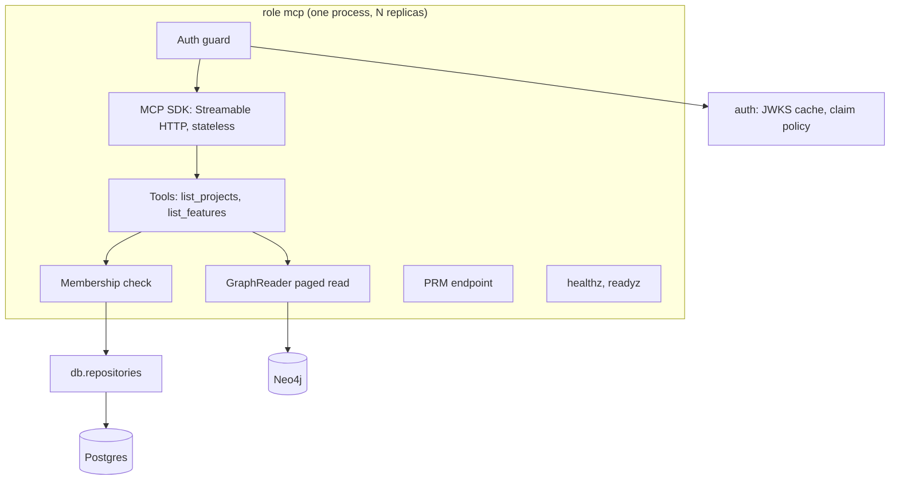

# architecture.md: process, components, package layout, import rules, transport, settings, errors and operations

## Process

The MCP server is a fourth backend role next to `api`, `worker` and `migrate`: `specflow mcp [--check-config]`. It runs
from the same backend image with its own command, listens on `MCP_PORT` (default `8002`), and needs only Postgres,
Neo4j and the IdP's JWKS. It never runs migrations (the `api` role owns them) and never starts Temporal, storage, Drive
or LLM clients.

## Components

| Component | Responsibility | Built on |
|---|---|---|
| App factory and lifespan | Build the ASGI app; open and close the runtime; start and stop the SDK session manager | Starlette (via the SDK) |
| Runtime | DB engine and session factory, Neo4j driver, ontology (loaded at startup), one `GraphReader` (no gateway), readiness probes | `db.session`, `graph.core`, `health` |
| Auth guard | Bearer parsing, token verification, MCP claim policy, 401/403 responses with the RFC 9728 challenge; puts the `Principal` on the request | `auth` package ([auth.md](auth.md)) |
| PRM endpoint | Serves the protected resource metadata document | own route |
| MCP server | Tool registry, input schemas, tool annotations, JSON-RPC handling | `mcp` SDK `MCPServer` |
| Tools | Validate arguments, provision the user, check membership, read, shape the result ([tools.md](tools.md)) | access, reader |
| Membership check | One function every project-scoped tool calls before any read ([access-control.md](access-control.md)) | `db.repositories.get_member_project` |
| Graph read | Count and page spec nodes of given labels, ordered by `spec_id` | new `GraphReader` methods in `graph.core` |
| Health | `/healthz` liveness; `/readyz` database and Neo4j probes | `health.Readiness` |

## HTTP surface of the role

| Path | Method | Auth | Answer |
|---|---|---|---|
| `/mcp` | `POST` | Bearer | MCP JSON-RPC; JSON responses |
| `/mcp` | `GET`, `DELETE` | Bearer | whatever the SDK answers in stateless mode (no server-initiated stream, no session to delete) |
| `/.well-known/oauth-protected-resource/mcp` | `GET` | none | PRM (RFC 9728 path-inserted location) |
| `/.well-known/oauth-protected-resource` | `GET` | none | the same PRM (root fallback some clients try) |
| `/healthz`, `/readyz` | `GET` | none | probes; not routed by the public ingress |
| anything else | any | none | `404` with the JSON error body `{"error": {"code": "not_found", ...}}` |

## Package layout

The code lives in a subpackage of the HTTP layer: `backend/src/api/mcp/`. Module names are indicative; the boundaries are not.

| Module | Holds |
|---|---|
| `api/mcp/server.py` | `run(settings)`: uvicorn on `0.0.0.0:$MCP_PORT`, central logger only (mirrors `api/server.py`) |
| `api/mcp/app.py` | `create_mcp_app(settings, *, runtime_factory=...)`: routes, guard, lifespan |
| `api/mcp/runtime.py` | The slim runtime and its factory |
| `api/mcp/auth.py` | Guard and PRM |
| `api/mcp/tools.py` | Tool functions and their registration |
| `api/mcp/errors.py` | Tool error codes and the sanitizing mapper |

The SDK package is also named `mcp`; absolute imports keep `import mcp` pointing at the SDK.

## Import rules

| # | Rule |
|---|---|
| M1 | `api.mcp` may import `auth`, `db`, `graph` (public names of `graph.core` only), `health`, `logger`, `settings`, the `mcp` SDK and Starlette. |
| M2 | `api.mcp` never imports `api.routers`, `api.deps`, `api.app`, `api.runtime` or FastAPI; the REST app never imports `api.mcp` or the `mcp` SDK. |
| M3 | No Cypher and no `neo4j` import in `api.mcp`; every graph read is a `GraphReader` method. |
| M4 | No SQL in `api.mcp`; every Postgres read or write is a `db.repositories` function. |

M2 becomes import-linter contracts in `backend/importlinter.toml`. The `neo4j` part of M3 is already the existing
`graph-sdk-confined` contract. Cypher and SQL text cannot be an import rule: a static test scans `api.mcp` for them.

## Transport

| Setting | Value | Why |
|---|---|---|
| Transport | Streamable HTTP, path `/mcp` | the current remote MCP transport; Claude Code's `--transport http` |
| Sessions | stateless (`stateless_http`) | any replica answers any request; no session affinity; no session store |
| Responses | JSON (`json_response`), no SSE | read tools answer at once; no stream buffering issues at proxies |
| Request body | at most 1 MiB (SDK `max_request_body_size`) | tool arguments are tiny |
| Host header | must be in the allowlist: the host of `MCP_RESOURCE_URL` plus `MCP_ALLOWED_HOSTS` (SDK transport security) | DNS-rebinding protection |
| Origin header | refused unless in `MCP_ALLOWED_ORIGINS` (empty by default) | no browser clients |
| Cookies, CORS | none | bearer tokens only |

## Settings

Role `mcp` reads the shared database, Neo4j and auth settings ([../configuration.md](../configuration.md)) and these:

| Variable | Default | Rule |
|---|---|---|
| `MCP_RESOURCE_URL` | required | Absolute URL whose path is exactly `/mcp`, no query or fragment; `https` unless `APP_ENV=local`. Published as the PRM `resource`; never derived from request headers |
| `MCP_AUDIENCE` | `MCP_RESOURCE_URL` | The required token audience; set it when the IdP needs an API identifier (for example `api://specflow-mcp`) |
| `MCP_CLIENT_IDS` | `specflow-mcp` | Comma-separated allowed client ids; at least one |
| `MCP_REQUIRED_SCOPES` | `specflow:read` | Comma-separated scopes every token must carry |
| `MCP_SCOPES_SUPPORTED` | `MCP_REQUIRED_SCOPES` | Comma-separated scopes the PRM advertises (what clients request); differs only for IdPs that prefix scopes |
| `MCP_ALLOWED_HOSTS` | empty | Extra `host[:port]` values accepted besides the resource URL's host |
| `MCP_ALLOWED_ORIGINS` | empty | Origins accepted on `/mcp` |
| `MCP_PORT` | `8002` | Listen port |

Shared settings the role requires: `APP_ENV`, `DATABASE_*`, `NEO4J_*`, `OIDC_ISSUER`, `AUTH_ALLOWED_EMAIL_DOMAINS`;
optional: `AUTH_JWKS_URL` and the claim profile variables of [auth.md](auth.md). Startup refuses, naming every bad
variable: `AUTH_MODE=dev`, a dev signing key, a missing issuer, an invalid resource URL, an empty client list or scope
list, an `MCP_AUDIENCE` equal to an allowed client id or to `AUTH_API_AUDIENCE`, and `AUTH_IGNORED_AUDIENCES` holding
either surface's audience.

Constants (not settings): page size default 50 and maximum 100; request body cap 1 MiB.

## Errors

| Layer | Failure | Answer |
|---|---|---|
| HTTP | missing, malformed, expired or wrong-audience token | `401`, `WWW-Authenticate: Bearer` with `resource_metadata` ([auth.md](auth.md)) |
| HTTP | valid token without the required scope | `403`, `WWW-Authenticate: Bearer error="insufficient_scope"` |
| HTTP | valid token, email not verified or domain not allowed | `403`, JSON error body, no scope challenge |
| HTTP | Host or Origin not allowed, body too large | SDK transport answer (`421`/`403`/`413` family) |
| Tool | argument, membership or dependency failure | tool result with `isError: true` and a fixed code ([tools.md](tools.md)) |
| Startup | bad settings, unreachable configuration, invalid ontology | exit non-zero with `config.validation.failed` or `mcp.startup.failed` |

Messages are fixed strings. No error carries Cypher, SQL, driver text, token content or another project's existence.

## Logging and audit

Central logger only (`logger.get_logger`, `log_event`), dotted event names, no `print`, no stdlib logging setup. Events:

| Event | Fields |
|---|---|
| `mcp.startup.completed`, `mcp.startup.failed`, `mcp.shutdown.completed` | port, error type |
| `mcp.auth.rejected` | reason, status, code, client id when known |
| `mcp.tool.completed` | tool, user id, project id when given, outcome (`ok` or the error code), item count, duration ms |

Logs never carry tokens, emails, feature text or cursors. `mcp.tool.completed` is the access audit trail: it answers
which user read which project and when.

## Operations

| Failure | Behavior | Recovery |
|---|---|---|
| Neo4j down | `list_features` answers `graph_unavailable`; `/readyz` not ready | automatic when Neo4j returns |
| Postgres down | every tool answers `database_unavailable`; `/readyz` not ready | automatic |
| IdP JWKS unreachable | known keys keep working for up to 10 minutes; a new `kid` fails with `401` | automatic; the JWKS cache backs off |
| IdP signing-key rotation | the new `kid` triggers one throttled JWKS refetch | none |
| Bad ontology | startup fails | fix the ontology |
| Replica crash | stateless: the next request goes to another replica | none |

## Decisions

| # | Decision | Rejected alternatives and why |
|---|---|---|
| AD1 | A separate role and process | Mounting the SDK app in the FastAPI process: the API is internal and would have to be exposed publicly; its start depends on Temporal and storage, so MCP would fail with them; a catch-all mount changes the API's 404 behavior; a mounted app's lifespan never runs. A separate repository or service image: duplicates settings, auth and data access for no gain |
| AD2 | The official `mcp` SDK, pinned `>=2.3,<3` | `fastmcp` 3 (Rosetta's choice): its value is the OAuth proxy, which this design does not use ([auth.md](auth.md)); one more framework on top of an SDK already in the lock |
| AD3 | Stateless sessions, JSON responses | Stateful sessions need affinity or a shared event store across replicas and buy nothing for read tools without notifications |
| AD4 | The paged read is a `GraphReader` method in `graph.core` | MCP-owned Cypher: a second Cypher home outside the validated query folders, and the graph library's rule that every query lives in its query modules |
| AD5 | Postgres access through `db.repositories` (`list_projects`, `get_member_project`, `upsert_user`) | MCP-owned SQL: a second membership query that can drift from the REST one, which is the access decision itself |
| AD6 | Code in `api/mcp/` | A top-level package: needs new import-linter exceptions for the web framework and ORM, which are confined to `api` |

## What would invalidate this design

- A need for server-initiated messages (progress, elicitation, sampling): revisit AD3.
- An IdP that cannot put the MCP audience into an access token: the OAuth proxy of [later.md](later.md).
- More than one IdP per deployment: users would need the issuer in their key (constraint C1 of [overview.md](overview.md)).
