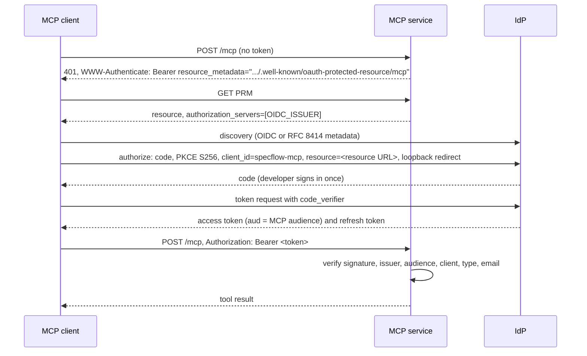

# auth.md: OAuth resource server, discovery, client registration, token validation, claim profile and revocation

## Model

The MCP service is an OAuth 2.1 resource server. The organization's OIDC provider (the IdP the web app already uses) is
the authorization server. The MCP client signs the developer in at the IdP with the authorization code flow and PKCE,
and calls `/mcp` with the access token. SpecFlow issues no tokens (apart from local dev tokens, below), stores no tokens
and holds no client secret.

A deployment has exactly one IdP: tokens must come from `OIDC_ISSUER`, the issuer the web app signs people in with.
Users are keyed by the token subject alone, so the same person reaches the same user row from the web app and from MCP.
The web app and the MCP server therefore change providers together; an MCP-only provider would split each person
into two users ([later.md](later.md), several IdPs).

Standards in play: OAuth Protected Resource Metadata (RFC 9728), bearer tokens (RFC 6750), resource indicators
(RFC 8707, sent by the client), JWT access tokens (RFC 9068 where the IdP supports it), PKCE (RFC 7636), loopback
redirects for native apps (RFC 8252), the MCP authorization specification.

## Sign-in flow



Observed with Claude Code against Keycloak: the authorize request carries `offline_access` in `scope` (plus any scope the PRM
advertises), `prompt=consent`, `resource=<MCP_RESOURCE_URL>`, PKCE S256 and `redirect_uri=http://localhost:<callbackPort>/callback`.

## Protected resource metadata

Served at `/.well-known/oauth-protected-resource/mcp` (the RFC 9728 location for a resource whose path is `/mcp`) and,
identically, at `/.well-known/oauth-protected-resource`.

```json
{
  "resource": "https://specflow.example.com/mcp",
  "authorization_servers": ["https://idp.example.com/realms/specflow"],
  "bearer_methods_supported": ["header"],
  "resource_name": "SpecFlow"
}
```

`resource` is `MCP_RESOURCE_URL` and `authorization_servers` is `[OIDC_ISSUER]`; the document advertises no scopes.
Both values come from configuration, never from request headers. The document is public.

## Client registration

One pre-registered public client per deployment, `specflow-mcp` by default, shared by every developer:

| Property | Value |
|---|---|
| Type | public (no secret), authorization code flow only, PKCE S256 required |
| Redirect URIs | `http://localhost:8765/callback`, `http://127.0.0.1:8765/callback` |
| Access token audience | `MCP_AUDIENCE` (default `MCP_RESOURCE_URL`), and no SpecFlow API audience |
| Scopes | none of its own; `offline_access` per the revocation policy below |
| Not allowed | implicit flow, password grant, client credentials, device flow |

Claude Code takes the client id and fixed callback port at registration:
`claude mcp add --transport http --client-id specflow-mcp --callback-port 8765 specflow https://specflow.example.com/mcp`,
or the same in a committed `.mcp.json` (`"oauth": {"clientId": "specflow-mcp", "callbackPort": 8765}`). Another MCP
client works when it supports a pre-registered public client with a fixed loopback redirect.

## Token validation

Under `AUTH_MODE=oidc`; dev mode is [below](#local-and-development-mode). The guard runs on every request to `/mcp`, in
this order; the first failure decides the answer.

| # | Check | Failure |
|---|---|---|
| 1 | `Authorization: Bearer <token>`; at most 16 KiB; token68 characters | 401 |
| 2 | JOSE header: `alg` is `RS256` or `ES256`; `kid` present | 401 |
| 3 | Signature against the issuer's JWKS (`AUTH_JWKS_URL`, or `jwks_uri` from `OIDC_ISSUER` discovery on the issuer's host) | 401 |
| 4 | `iss` equals `OIDC_ISSUER` exactly | 401 |
| 5 | `aud` (string or list), minus `AUTH_IGNORED_AUDIENCES`, is exactly `[MCP_AUDIENCE]` | 401 |
| 6 | `exp`, `iat`, `nbf` within 60 s leeway | 401 |
| 7 | Subject: the `AUTH_SUBJECT_CLAIM` claim is a non-blank string | 401 |
| 8 | Client: the first claim of `AUTH_CLIENT_ID_CLAIM` present in the token is in `MCP_CLIENT_IDS` | 401 |
| 9 | Token type per `AUTH_TOKEN_TYPE` | 401 |
| 10 | Email: the `AUTH_EMAIL_VERIFIED_CLAIM` claim is `true` (skipped when that setting is empty), then the `AUTH_EMAIL_CLAIM` claim is a valid address, then its domain is in `AUTH_ALLOWED_EMAIL_DOMAINS` | 403 |

Checks 1 to 10 run in this order through the `auth` package (`bearer_token`, `OidcJwtVerifier`, `JwksCache`,
`claims.validate`) with an MCP `ClaimPolicy`, the same path the REST API uses with its own policy. Scopes are not
checked: the audience decides whether a token is for the MCP server, and project membership decides what its holder
may read ([access-control.md](access-control.md)). `bearer_token` is in a framework-free module of `auth` (for example
`auth.bearer`); `auth.dependencies`, which imports FastAPI, re-exports it for the REST API, and the role never imports
`auth.dependencies`, so it never loads FastAPI. The result is a `Principal` the tools read from the request.

The audience rule (check 5) is the REST API's rule with the MCP audience: a token is valid on exactly one surface. A
provider that adds an audience of its own lists it in `AUTH_IGNORED_AUDIENCES`, as Keycloak's `account` is by default.

Startup refuses these audience mix-ups, each of which would let one token pass where it must not:

| Refused | Role | Why |
|---|---|---|
| `MCP_AUDIENCE` equal to one of `MCP_CLIENT_IDS` | `mcp` | an ID token's audience is its client id; the audience rule alone then keeps ID tokens out, whatever `AUTH_TOKEN_TYPE` says |
| `AUTH_API_AUDIENCE` equal to one of `AUTH_API_CLIENT_IDS` | `api` | the same ID-token rule for the REST surface |
| `MCP_AUDIENCE` equal to `AUTH_API_AUDIENCE` | `mcp` | REST and MCP tokens would be interchangeable (rule S5) |
| `AUTH_IGNORED_AUDIENCES` holding `MCP_AUDIENCE` or `AUTH_API_AUDIENCE` | `mcp` | a token for `[MCP URL, specflow-api]` would pass on both surfaces |
| `AUTH_IGNORED_AUDIENCES` holding `AUTH_API_AUDIENCE` | `api` | the REST audience rule would be emptied |

The two `api` rows guard the REST API's startup: with the provider-neutral default `AUTH_TOKEN_TYPE=none`, they are
what keeps ID tokens off the REST surface.

## Claim profile for any OIDC provider

The claim profile names the claims that carry each part of the identity, so the same checks fit any OIDC provider. The
settings are shared by the `api` and `mcp` roles, because the subject must be read the same way on both surfaces (one
person, one user row). The defaults follow the OIDC and JWT access-token standards rather than one provider's habits:
Keycloak works with them unchanged, and a provider with other claim names is configured, not coded for.

| Variable | Default | Meaning |
|---|---|---|
| `AUTH_SUBJECT_CLAIM` | `sub` | Claim holding the stable user id stored in `users.auth_subject` |
| `AUTH_CLIENT_ID_CLAIM` | `azp,client_id` | Comma-separated claims that may hold the OAuth client id; the first one present in the token is used (`azp`: OIDC, Keycloak, Auth0, Entra ID; `client_id`: RFC 9068) |
| `AUTH_EMAIL_CLAIM` | `email` | Claim holding the email address |
| `AUTH_EMAIL_VERIFIED_CLAIM` | `email_verified` | Claim that must be `true`; empty = not checked (directory-managed emails) |
| `AUTH_TOKEN_TYPE` | `none` | `none`: no type check, because the audience rule already keeps ID tokens out (startup of both roles refuses an audience equal to one of that surface's client ids); `keycloak`: claim `typ` is `Bearer`, an optional extra check for Keycloak; `rfc9068`: JOSE header `typ` is `at+jwt` or `application/at+jwt` |
| `AUTH_IGNORED_AUDIENCES` | `account` | Comma-separated audiences removed before the audience rule |

The subject claim is chosen once per deployment, before the first sign-in: changing it later re-keys every user and
needs a data migration (not provided).

## Provider recipes

Only the Keycloak recipe has been run (Keycloak 26.4, this repository's QA realm). The others follow the providers'
documentation and are checked at deployment time with the QA harness of [testing.md](testing.md).

| Provider | Audience | Client claim | Subject claim | Email | Token type | Scopes to request | Run here |
|---|---|---|---|---|---|---|---|
| Keycloak (reference) | audience mapper on `specflow-mcp` with the value of `MCP_AUDIENCE` (default `MCP_RESOURCE_URL`) | `azp` | `sub` | `email`, `email_verified` (the `email` scope) | `none` (default) or `keycloak` | none | yes |
| Auth0 | an API whose identifier is `MCP_RESOURCE_URL`; tenant default audience if the tenant ignores `resource`; `https://<tenant>/userinfo` (added when `openid` is requested) in `AUTH_IGNORED_AUDIENCES` | `azp` | `sub` | `email`, `email_verified` added by a post-login Action | `rfc9068` when the API uses that profile, else `none` | none | no |
| Okta (custom authorization server) | authorization server audience `MCP_RESOURCE_URL` | `cid` | `uid` | custom claim `email`; a custom verified claim where available, else empty (see below) | `none` | none | no |
| Microsoft Entra ID | two app registrations (the API and the public client); v2 tokens carry the API registration's application id in `aud`: set `MCP_AUDIENCE` to that id | `azp` | `oid` (`sub` differs per application) | optional claim `email`; verified claim `xms_edov` (optional claim) | `none` | `api://<API app id URI>/.default`, advertised by the PRM: not usable in version 1, whose PRM advertises no scopes (the advertised-scopes setting of [later.md](later.md)) | no |
| Amazon Cognito | not supported: access tokens carry no `aud` and no email | | | | | | no |
| Google, GitHub sign-in | not supported: no JWT access token for a third-party API | | | | | | no |

Logins brokered through Keycloak are supported: Google, GitHub or a corporate SAML or OIDC provider can authenticate
the person while Keycloak issues the tokens, so the server sees only the Keycloak recipe. The unsupported rows mean
using those providers directly as `OIDC_ISSUER`. When brokering, the upstream email must reach Keycloak as verified
(the identity provider's "Trust Email" setting), or check 10 answers 403.

With `AUTH_EMAIL_VERIFIED_CLAIM` empty, the email domain allowlist trusts whatever address the IdP puts in the token.
Leave it empty only when the IdP issues nothing but verified addresses on domains the organization owns; otherwise a
user who can set their own email could claim an allowed domain.

The same claim profile applies to the web app's tokens; a non-Keycloak web deployment may also need the frontend to
request the API audience or scope (outside this design, see [later.md](later.md)).

## Token lifetimes and revocation

| Event | Effect on MCP access | Latency |
|---|---|---|
| Developer removed from a project, or project deleted | that project answers `project_not_found` | next tool call |
| Developer disabled at the IdP | refresh fails; the current access token works until it expires | access token lifetime (set 5 to 10 minutes) |
| Email domain removed from `AUTH_ALLOWED_EMAIL_DOMAINS` | 403 | next call after the role restarts |
| Client id removed from `MCP_CLIENT_IDS` | 401 | next call after the role restarts |
| Offline refresh token (`offline_access`) | lives at most 30 days; ends at once when the user is disabled or the session is revoked | 30 days at most |

Claude Code always asks for `offline_access`, and the `specflow-mcp` client grants it with offline sessions limited to
30 days: developers sign in about once a month, and a lost laptop's refresh token stops working when the user is
disabled or the session is revoked. The limit is IdP configuration, not SpecFlow code; an IdP used directly (without
Keycloak) is set up to the same 30 days. The local QA realm keeps the same setting. Keycloak may answer
`refresh_expires_in: 0` for offline tokens; the server never sees refresh tokens, so this is a client concern only.

## Failure responses

| Case | Status | `WWW-Authenticate` | Body `error.code` |
|---|---|---|---|
| No token | 401 | `Bearer resource_metadata="<PRM URL>"` | `invalid_token` |
| Invalid token (checks 1 to 9) | 401 | `Bearer error="invalid_token", resource_metadata="<PRM URL>"` | `invalid_token` |
| Email policy (check 10) | 403 | none | `email_not_verified`, `email_invalid` or `domain_not_allowed` |

The email-policy 403 carries no challenge, so a client does not loop through sign-in for a person who will never
be allowed. Every rejection logs `mcp.auth.rejected` with the fixed reason and no token content.

## Local and development mode

Locally the role runs in dev mode like the web app; `make up WITH=keycloak` switches only the `mcp` role to `oidc`,
while the web app and API keep dev login ([deployment.md](deployment.md#local-stack)). With `AUTH_MODE=dev` (refused
outside `APP_ENV=local` and inside Kubernetes, as for the API) it accepts HS256 dev tokens signed with
`AUTH_DEV_SIGNING_KEY`: issuer `specflow-dev-login`, audience `MCP_AUDIENCE`, client `specflow-mcp`, lifetime 8 hours
like the web app's. Their subject is `dev:<email>`, the subject the web app's dev login uses, so the local UI and Claude
Code act as the same user and see the same projects. A web dev token (audience `specflow-api`) fails on MCP, and an MCP
dev token fails on the REST API. In dev mode there is no authorization server: the role publishes no protected resource
metadata, and its 401 carries no `resource_metadata`.

A dev token comes from a QA helper command (`examples/mcp_qa.py dev-token`). Claude Code receives it through
`headersHelper` in `.mcp.json` (a command whose output gives the request headers; Claude Code runs it only in a trusted
workspace) or through `--header "Authorization: Bearer ..."`.

The real sign-in flow runs locally with `AUTH_MODE=oidc` against the bundled Keycloak ([deployment.md](deployment.md));
the end-to-end and agent QA tiers use it. An `http` issuer and resource URL are accepted only when `APP_ENV=local`.

## Security rules

| # | Rule |
|---|---|
| S1 | No token passthrough: the MCP token is never sent anywhere; Postgres and Neo4j are reached with service credentials after the membership check. |
| S2 | Tokens, `Authorization` headers and claims other than ids never reach logs or error bodies. |
| S3 | JWKS only from the issuer's host (enforced outside local). |
| S4 | Issuer, resource URL and audience are configuration, never derived from `Host` or `X-Forwarded-*`. |
| S5 | One audience per token: a REST token fails on `/mcp`, an MCP token fails on `/api/v1`. |
| S6 | The client is public: no client secret exists in SpecFlow or on developer machines. |

## Decisions

| # | Decision | Rejected alternatives and why |
|---|---|---|
| AA1 | Resource server only; the IdP is the authorization server | OAuth proxy (the Rosetta pattern: the server registers clients, shows consent, issues its own tokens and keeps upstream tokens encrypted in Redis): token storage, signing keys, consent UI, registration endpoint hardening and refresh-token edge cases (Rosetta patched Keycloak's `refresh_expires_in: 0`), all to support IdPs the web app cannot use anyway; logins brokered through Keycloak (Google, GitHub, corporate SAML or OIDC) need none of it. Built only if a confirmed need appears (constraint C6 of [overview.md](overview.md); [later.md](later.md)) |
| AA2 | One pre-registered public client | Dynamic client registration at the IdP: a policy decision of the IdP owner, often unavailable, and registered clients would bypass the client allowlist. Client ID Metadata Documents: support across clients and IdPs is uneven; can be enabled at the IdP later with only an allowlist change here |
| AA3 | Own guard on top of the `auth` package | The SDK's `TokenVerifier` and auth middleware: a verifier can only return a token or nothing, so every policy failure becomes a 401 and an email-policy failure becomes a sign-in loop; tools get no `Principal`; a second validation path beside `auth`; and the SDK's auth needs an issuer URL, which local dev tokens (issuer `specflow-dev-login`) do not have. Re-evaluated when local dev login is replaced by Keycloak ([later.md](later.md)) |
| AA4 | A separate MCP audience | Reusing `specflow-api`: a token stolen from one surface would work on the other; least privilege |
| AA5 | Locally, dev tokens on MCP as on the web app | Keycloak for MCP only: the local UI (dev login) and MCP would know the same person as two users, and projects made in the UI would be invisible to Claude Code. Keycloak for every local service: a separate change that also reworks the frontend's test sign-in ([later.md](later.md), local Keycloak everywhere). The real sign-in flow is still exercised locally by the QA tiers against the bundled Keycloak |
| AA6 | Claim profile as shared `AUTH_*` settings with provider-neutral defaults | MCP-only claim settings: the subject must be read the same way on both surfaces or users split. Keycloak-shaped defaults (a required `typ: Bearer` claim, `azp` only): the first non-Keycloak provider, likely the production one, would fail on them |
| AA7 | No scopes: the audience and project membership decide, and every member of a project has the same access | Read and write scopes (`specflow:read`, `specflow:write`): every provider would need a custom scope, and they add nothing while all members have equal access; the Rosetta MCP server likewise checks no permission scope |
