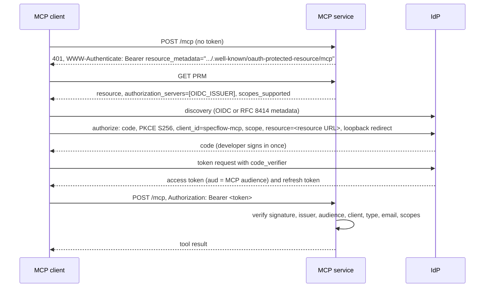

# auth.md: OAuth resource server, discovery, client registration, token validation, claim profile and revocation

## Model

The MCP service is an OAuth 2.1 resource server. The organization's OIDC provider (the IdP the web app already uses)
is the authorization server. The MCP client signs the developer in at the IdP with the authorization code flow and
PKCE, and calls `/mcp` with the access token. SpecFlow issues no tokens, stores no tokens and holds no client secret.

Standards in play: OAuth Protected Resource Metadata (RFC 9728), bearer tokens (RFC 6750), resource indicators
(RFC 8707, sent by the client), JWT access tokens (RFC 9068 where the IdP supports it), PKCE (RFC 7636), loopback
redirects for native apps (RFC 8252), the MCP authorization specification.

## Sign-in flow



Observed with Claude Code against Keycloak: the authorize request carries `scope=<scopes_supported> offline_access`,
`prompt=consent`, `resource=<MCP_RESOURCE_URL>`, PKCE S256 and `redirect_uri=http://localhost:<callbackPort>/callback`.

## Protected resource metadata

Served at `/.well-known/oauth-protected-resource/mcp` (the RFC 9728 location for a resource whose path is `/mcp`) and,
identically, at `/.well-known/oauth-protected-resource`.

```json
{
  "resource": "https://specflow.example.com/mcp",
  "authorization_servers": ["https://idp.example.com/realms/specflow"],
  "scopes_supported": ["specflow:read"],
  "bearer_methods_supported": ["header"],
  "resource_name": "SpecFlow"
}
```

`resource` is `MCP_RESOURCE_URL`, `authorization_servers` is `[OIDC_ISSUER]`, `scopes_supported` is
`MCP_SCOPES_SUPPORTED`. Every value comes from configuration, never from request headers. The document is public.

## Client registration

One pre-registered public client per deployment, `specflow-mcp` by default, shared by every developer:

| Property | Value |
|---|---|
| Type | public (no secret), authorization code flow only, PKCE S256 required |
| Redirect URIs | `http://localhost:8765/callback`, `http://127.0.0.1:8765/callback` |
| Access token audience | `MCP_AUDIENCE` (default `MCP_RESOURCE_URL`), and no SpecFlow API audience |
| Scopes | `specflow:read` (optional client scope); `offline_access` per the revocation policy below |
| Not allowed | implicit flow, password grant, client credentials, device flow |

Claude Code takes the client id and fixed callback port at registration:
`claude mcp add --transport http --client-id specflow-mcp --callback-port 8765 specflow https://specflow.example.com/mcp`,
or the same in a committed `.mcp.json` (`"oauth": {"clientId": "specflow-mcp", "callbackPort": 8765}`). Another MCP
client works when it supports a pre-registered public client with a fixed loopback redirect.

## Token validation

The guard runs on every request to `/mcp`, in this order; the first failure decides the answer.

| # | Check | Failure |
|---|---|---|
| 1 | `Authorization: Bearer <token>`; at most 16 KiB; token68 characters | 401 |
| 2 | JOSE header: `alg` is `RS256` or `ES256`; `kid` present | 401 |
| 3 | Signature against the issuer's JWKS (`AUTH_JWKS_URL`, or `jwks_uri` from `OIDC_ISSUER` discovery on the issuer's host) | 401 |
| 4 | `iss` equals `OIDC_ISSUER` exactly | 401 |
| 5 | `aud` (string or list), minus `AUTH_IGNORED_AUDIENCES`, is exactly `[MCP_AUDIENCE]` | 401 |
| 6 | `exp`, `iat`, `nbf` within 60 s leeway | 401 |
| 7 | Token type per `AUTH_TOKEN_TYPE` | 401 |
| 8 | Subject: the `AUTH_SUBJECT_CLAIM` claim is a non-blank string | 401 |
| 9 | Client: the `AUTH_CLIENT_ID_CLAIM` claim is in `MCP_CLIENT_IDS` | 401 |
| 10 | Email: the `AUTH_EMAIL_CLAIM` claim is a valid address; the `AUTH_EMAIL_VERIFIED_CLAIM` claim is `true` (skipped when that setting is empty); the domain is in `AUTH_ALLOWED_EMAIL_DOMAINS` | 403 |
| 11 | Scopes: the union of `scope` (space-delimited) and `scp` (string or list) contains every `MCP_REQUIRED_SCOPES` value | 403 `insufficient_scope` |

Checks 1 to 10 are the existing `auth` path (`bearer_token`, `OidcJwtVerifier`, `JwksCache`, `claims.validate`) run
with an MCP `ClaimPolicy`; check 11 is new (`ClaimPolicy.required_scopes`, `Principal.scopes`). The REST policy
requires no scopes, so REST behavior does not change. The result is a `Principal` the tools read from the request.

Startup refuses an `MCP_AUDIENCE` that equals one of `MCP_CLIENT_IDS`: an ID token's audience is the client id, so
the audience rule alone then keeps ID tokens out, whatever `AUTH_TOKEN_TYPE` says.

## Claim profile for any OIDC provider

Today's checks assume Keycloak's access-token shape. The claim profile names the claims instead. The settings are
shared by the `api` and `mcp` roles, because the subject must be read the same way on both surfaces (one person, one
user row). Every default equals today's behavior.

| Variable | Default | Meaning |
|---|---|---|
| `AUTH_SUBJECT_CLAIM` | `sub` | Claim holding the stable user id stored in `users.auth_subject` |
| `AUTH_CLIENT_ID_CLAIM` | `azp` | Claim holding the OAuth client id |
| `AUTH_EMAIL_CLAIM` | `email` | Claim holding the email address |
| `AUTH_EMAIL_VERIFIED_CLAIM` | `email_verified` | Claim that must be `true`; empty = not checked (directory-managed emails) |
| `AUTH_TOKEN_TYPE` | `keycloak` | `keycloak`: claim `typ` is `Bearer`; `rfc9068`: JOSE header `typ` is `at+jwt` or `application/at+jwt`; `none`: no type check |
| `AUTH_IGNORED_AUDIENCES` | `account` | Comma-separated audiences removed before the audience rule |

The subject claim is chosen once per deployment, before the first sign-in: changing it later re-keys every user and
needs a data migration (not provided).

## Provider recipes

Only the Keycloak recipe has been run (Keycloak 26.4, this repository's QA realm). The others follow the providers'
documentation and are checked at deployment time with the QA harness of [testing.md](testing.md).

| Provider | Audience | Client claim | Subject claim | Email | Token type | Scopes | Run here |
|---|---|---|---|---|---|---|---|
| Keycloak (reference) | audience mapper on `specflow-mcp` with `MCP_RESOURCE_URL` | `azp` | `sub` | `email`, `email_verified` (the `email` scope) | `keycloak` | client scope `specflow:read` | yes |
| Auth0 | an API whose identifier is `MCP_RESOURCE_URL`; tenant default audience if the tenant ignores `resource` | `azp` | `sub` | `email`, `email_verified` added by a post-login Action | `rfc9068` when the API uses that profile, else `none` | API permission `specflow:read` | no |
| Okta (custom authorization server) | authorization server audience `MCP_RESOURCE_URL` | `cid` | `uid` | custom claim `email`; verified claim empty | `none` | custom scope `specflow:read` | no |
| Microsoft Entra ID | App ID URI as `MCP_AUDIENCE` (for example `api://specflow-mcp`), v2 tokens | `azp` | `oid` (`sub` differs per application) | optional claim `email`; verified claim empty | `none` | supported `api://specflow-mcp/specflow.read`, required `specflow.read` | no |
| Amazon Cognito | not supported: access tokens carry no `aud` and no email | | | | | | no |
| Google, GitHub sign-in | not supported: no JWT access token for a third-party API | | | | | | no |

The same claim profile applies to the web app's tokens; a non-Keycloak web deployment may also need the frontend to
request the API audience or scope (outside this design, see [later.md](later.md)).

## Token lifetimes and revocation

| Event | Effect on MCP access | Latency |
|---|---|---|
| Developer removed from a project, or project deleted | that project answers `project_not_found` | next tool call |
| Developer disabled at the IdP | refresh fails; the current access token works until it expires | access token lifetime (set 5 to 10 minutes) |
| Email domain removed from `AUTH_ALLOWED_EMAIL_DOMAINS` | 403 | next call after the role restarts |
| Client id removed from `MCP_CLIENT_IDS` | 401 | next call after the role restarts |
| Offline refresh token (`offline_access`) | lives until the IdP's offline session limit; ends when the user is disabled or the session is revoked | IdP setting |

Claude Code always asks for `offline_access`; advertising fewer scopes does not stop it. Whether offline tokens are
issued is decided at the IdP, on the `specflow-mcp` client: production either removes `offline_access` from the
client (developers sign in again when the SSO session ends) or keeps it with a limited offline session (30 days). The
local QA realm keeps it. Keycloak may answer `refresh_expires_in: 0` for offline tokens; the server never sees refresh
tokens, so this is a client concern only.

## Failure responses

| Case | Status | `WWW-Authenticate` | Body `error.code` |
|---|---|---|---|
| No token | 401 | `Bearer resource_metadata="<PRM URL>", scope="<scopes_supported>"` | `invalid_token` |
| Invalid token (checks 1 to 9) | 401 | `Bearer error="invalid_token", resource_metadata="<PRM URL>"` | `invalid_token` |
| Missing scope (check 11) | 403 | `Bearer error="insufficient_scope", scope="<required>", resource_metadata="<PRM URL>"` | `insufficient_scope` |
| Email policy (check 10) | 403 | none | `email_not_verified`, `email_invalid` or `domain_not_allowed` |

The email-policy 403 carries no scope challenge, so a client does not loop through sign-in for a person who will never
be allowed. Every rejection logs `mcp.auth.rejected` with the fixed reason and no token content.

## Local and development mode

The role refuses `AUTH_MODE=dev`: dev tokens are HS256 tokens minted by the web app for `specflow-api` and never valid
for MCP. Local development and QA use the bundled Keycloak profile ([deployment.md](deployment.md)); an `http`
issuer and resource URL are accepted only when `APP_ENV=local`.

## Security rules

| # | Rule |
|---|---|
| S1 | No token passthrough: the MCP token is never sent anywhere; Postgres and Neo4j are reached with service credentials after the membership check. |
| S2 | Tokens, `Authorization` headers and claims other than ids never reach logs or error bodies. |
| S3 | JWKS only from the issuer's host (existing rule outside local). |
| S4 | Issuer, resource URL and audience are configuration, never derived from `Host` or `X-Forwarded-*`. |
| S5 | One audience per token: a REST token fails on `/mcp`, an MCP token fails on `/api/v1`. |
| S6 | The client is public: no client secret exists in SpecFlow or on developer machines. |

## Decisions

| # | Decision | Rejected alternatives and why |
|---|---|---|
| AA1 | Resource server only; the IdP is the authorization server | OAuth proxy (the Rosetta pattern: the server registers clients, shows consent, issues its own tokens and keeps upstream tokens encrypted in Redis): token storage, signing keys, consent UI, registration endpoint hardening and refresh-token edge cases (Rosetta patched Keycloak's `refresh_expires_in: 0`), all to support IdPs the web app cannot use anyway. Kept for later ([later.md](later.md)) |
| AA2 | One pre-registered public client | Dynamic client registration at the IdP: a policy decision of the IdP owner, often unavailable, and registered clients would bypass the client allowlist. Client ID Metadata Documents: support across clients and IdPs is uneven; can be enabled at the IdP later with only an allowlist change here |
| AA3 | Own guard on top of the `auth` package | The SDK's `TokenVerifier` and auth middleware: a verifier can only return a token or nothing, so every policy failure becomes a 401 and an email-policy failure becomes a sign-in loop; tools get no `Principal`; a second validation path beside `auth` |
| AA4 | A separate MCP audience | Reusing `specflow-api`: a token stolen from one surface would work on the other; least privilege |
| AA5 | No dev tokens on MCP | They would bypass the flow being tested and invite long-lived tokens in local configs |
| AA6 | Claim profile as shared `AUTH_*` settings | MCP-only claim settings: the subject must be read the same way on both surfaces or users split |
