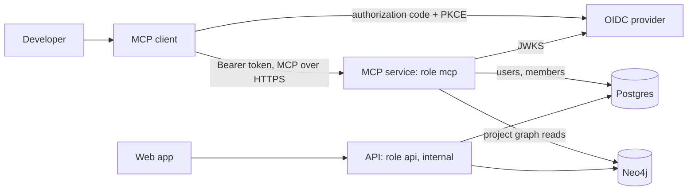

# overview.md: purpose, scope, goals, non-goals, actors, boundaries, constraints and key terms of the MCP server

## Purpose

Developers work in coding agents. The MCP server gives those agents read access to what SpecFlow knows about a
project: which projects the developer belongs to, and which features the project's specification graph holds. It is
an OAuth-protected remote MCP endpoint (Streamable HTTP) served by a dedicated backend role.

The MCP server is an integral part of SpecFlow, not an add-on: it is how coding agents reach a project's
specification, and later its implementation plan. Every deployment and every local stack runs it.

| Version | Tools | Status |
|---|---|---|
| 1 | `list_projects`, `list_features` | specified here |
| later | feature detail, search, impact, plan tasks, writes | [later.md](later.md) |

## Goals

| # | Goal |
|---|---|
| G1 | No shared secret on a developer machine: a public OAuth client with PKCE, tokens from the organization's IdP. |
| G2 | One identity: the MCP caller is the same user row the web app creates for that person. |
| G3 | A caller sees only projects they are a member of, and only those projects' graph data. |
| G4 | Works with any OIDC provider that issues signed JWT access tokens with a configurable audience. |
| G5 | The public endpoint is its own process: it holds only Postgres and Neo4j credentials, and the internal API stays off the public network. |
| G6 | Proven end to end with a real client (Claude Code and the MCP Python SDK) against a real OIDC provider. |

## Non-goals

- Write tools, or any tool that changes SpecFlow data.
- Acting as an OAuth authorization server: no dynamic client registration, consent screen or token issuance here.
- More than one identity provider at a time.
- Providers whose access tokens are opaque or not OIDC (Google sign-in, GitHub); see [later.md](later.md).
- The stdio transport, and the deleted v1 local MCP server.
- Browser clients (cross-origin requests are refused).

## Actors

| Actor | Role |
|---|---|
| Developer | A SpecFlow user who is a member of zero or more projects |
| MCP client | Claude Code, or another MCP client that supports a pre-registered public OAuth client |
| Identity provider (IdP) | The OIDC provider the web app already uses; the OAuth authorization server for MCP tokens. Keycloak is the reference |
| MCP service | The backend role `mcp`: resource server, MCP tools, membership checks, graph reads |
| Postgres | Users, projects, project members |
| Neo4j | The project graphs (`group_id` = project id) |
| Operator | Deploys the role, registers the client at the IdP, routes the public endpoint |

## Boundaries

The API and the MCP service share the `auth` package, including the claim profile of [auth.md](auth.md). The paged
graph read that `list_features` uses belongs to the graph library ([../graph/api.md](../graph/api.md)).

## Constraints

| # | Constraint | Source |
|---|---|---|
| C1 | Users are keyed by the token subject alone, without the issuer: MCP tokens must come from the web app's issuer and carry the same subject for the same person. | `users.auth_subject` |
| C2 | The API is internal (the browser talks only to the web app's server); it is never exposed for MCP. | API design |
| C3 | Neo4j access and Cypher stay in the graph library; the web framework stays in `api` and `auth`; the ORM stays in `api`, `db` and `temporal`. | `backend/importlinter.toml`, [../graph/architecture.md](../graph/architecture.md) |
| C4 | Settings are environment variables validated per role at startup; secrets are never logged. | [../configuration.md](../configuration.md) |
| C5 | The MCP Python SDK is already a transitive dependency of the agent SDKs; the server pins the version it uses. | `backend/uv.lock` |
| C6 | Only confirmed needs are built. A capability that only a possible future tool needs is listed in [later.md](later.md) with what it would take, not built ahead. | product direction |

## Assumed numbers

| Quantity | Assumption | Effect |
|---|---|---|
| Developers per deployment | up to a few hundred | one or two replicas suffice |
| Tool calls | bursts of up to 10 per second per developer while an agent works | stateless requests, short transactions |
| Projects per developer | under 100 | one page in the common case |
| Features per project | tens to a few hundred | pages of 50, two Neo4j queries per page |
| Access token lifetime | 5 to 10 minutes (IdP setting) | bounds revocation latency for disabled users |
| Tool call latency | p95 under 500 ms | one Postgres transaction and two indexed Neo4j reads |

## Key terms

| Term | Meaning |
|---|---|
| Resource URL | The canonical public URL of the MCP endpoint, for example `https://specflow.example.com/mcp`; the token audience by default |
| PRM | OAuth Protected Resource Metadata (RFC 9728): the document that tells a client which authorization server to use |
| Public client | An OAuth client without a secret (a CLI on a laptop); it proves possession with PKCE |
| Claim profile | The settings that say which token claims carry the subject, client, email and token type for a given IdP |
| Member project | A project with a `project_members` row for the caller |
| Feature | A graph node of the ontology node type `feature` (label `Feature`, id `FEAT::...`) |
