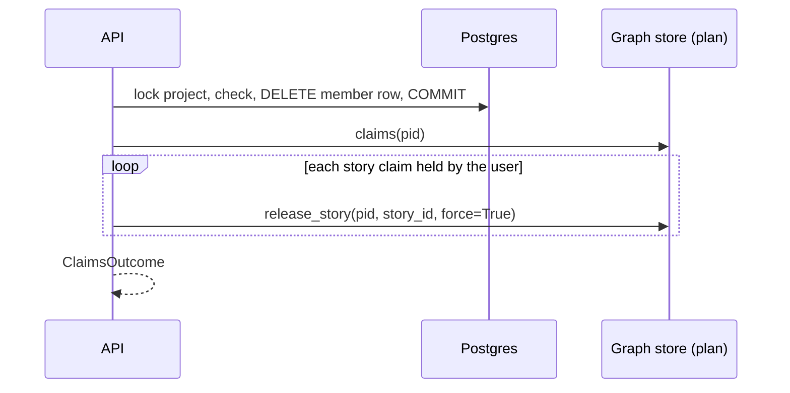

# api.md: member, invite, leave, rename and suggestion routes, Create Project with collaborators, email rules, claims release, events

All routes are under `/api/v1`, take the web audience (API policy) and answer the error envelope
`{"error": {code, message, details}}`; messages are fixed sentences and never echo a submitted value. Every route resolves
the caller with `upsert_user` first ([data-model.md](data-model.md#invite-adoption)).

## Access

| Check | Answer |
|---|---|
| Caller is not a member, the project does not exist, or `pid` is malformed | 404 `project_not_found` (unchanged rule) |
| Route needs the owner and the caller is a collaborator | 403 `owner_required` |

One membership query decides both: `get_membership(session, user_id, pid) -> (Project, role) | None`. The FastAPI
dependencies `project_member` and `project_owner` wrap it.

## Routes

| Method, path | Who | Body | Success |
|---|---|---|---|
| `GET /projects/{pid}/members` | member | - | 200 `MembersOut` |
| `POST /projects/{pid}/members` | owner | `{email}` | 201 `MemberAdded` |
| `DELETE /projects/{pid}/members/{user_id}` | owner | - | 200 `ClaimsOutcome` |
| `DELETE /projects/{pid}/invites/{invite_id}` | owner | - | 204 |
| `POST /projects/{pid}/leave` | collaborator | - | 200 `ClaimsOutcome` |
| `PATCH /projects/{pid}` | owner | `{name}` | 200 `ProjectOut` (unchanged shape) |
| `POST /users/suggestions` | any signed-in user | `{q, project_id?}` | 200 `SuggestionsOut` |
| `POST /projects` | any signed-in user | `{name, collaborators?}` | 201 `ProjectOut` (unchanged shape) |

Every body model forbids extra fields.

## Shapes

| Model | Fields |
|---|---|
| `MembersOut` | `role` (`owner` or `collaborator`: the caller's), `limit` (50), `members: MemberOut[]`, `invites: InviteOut[]` |
| `MemberOut` | `user_id`, `name` (null when the display name is an address, the `member_names` rule), `email`, `role`, `joined_at`, `is_you` |
| `InviteOut` | `id`, `email` (normalised), `invited_at` |
| `MemberAdded` | `{kind: "member", member: MemberOut}` or `{kind: "invite", invite: InviteOut}` |
| `ClaimsOutcome` | `claims_released` (int), `claims_release_failed` (bool) |
| `SuggestionsOut` | `items: [{name, email}]`, no user ids |

Order: the owner first, then members by `joined_at`; invites by `created_at`.

## Errors

| Status, code | Routes | When |
|---|---|---|
| 422 `invalid_email` | add | the email fails the format rule |
| 422 `email_domain_not_allowed` | add | its domain is not in `AUTH_ALLOWED_EMAIL_DOMAINS` |
| 409 `already_member` | add | a user with that email is a member (the owner's own email included) |
| 409 `already_invited` | add | the project has an invite for that email |
| 409 `member_limit` | add | the project is at the [limit](data-model.md#limit) |
| 404 `member_not_found` | remove | no member row for `user_id` in the project, or `user_id` is not a UUID |
| 409 `cannot_remove_owner` | remove | `user_id` is the owner |
| 404 `invite_not_found` | cancel | no such invite in the project, or `invite_id` is not a UUID |
| 409 `owner_cannot_leave` | leave | the caller is the owner |
| 422 `validation_failed` | rename, suggestions, create | body rule; `details.errors[{loc, type}]` as every route |

## Email rules

`auth.emails` (framework-free) holds the one rule, shared with sign-in (`auth.claims`):

- `normalise_email(raw) -> str | None`: strip, lower-case; exactly one `@`; non-empty local part and domain; no whitespace
  or control character; at most 254 characters; else `None`.
- `domain_allowed(email, domains) -> bool`: the domain equals one of the allowed domains (exact, no subdomains), the
  sign-in rule.

## Add a member or invite

In one transaction, with the project row locked: normalise and check the email (format, then domain); look up users by
normalised email (newest when several); 409 `already_member` when that user is already a member (also the owner's own
email); then check the [limit](data-model.md#limit), so a full project still answers `already_member` for a member's
email. A user found: insert a `collaborator` row (`kind: "member"`). None found: 409 when invited, else insert an invite
(`kind: "invite"`); the unique constraint turns a concurrent duplicate into 409 `already_invited`.

## Remove, leave and claims

- Access ends first: after the commit the person's next request, web or MCP, answers 404.
- `no_plan`: nothing to release, `claims_released: 0`, not a failure.
- Any graph error (listing or a release): `claims_release_failed: true`; the removal stands, and the claim stays on the
  board. Release is agent-side now (`release_story`, `POST /agent/story-release`, the holder's claim token;
  [../mcp-server/tools.md](../mcp-server/tools.md) "release_story"); the force-release route went with the V1 screens.
- Claims of a task claimed on its own (`kind: "task"`) are not released (the plan service has no forced task release);
  they are counted in the log event.
- Findings, documents and history of the person stay; their holder name shows as null ([../mcp-server/tools.md](../mcp-server/tools.md#holders)).

## Rename

`PATCH /projects/{pid}` `{name}`: the `POST /projects` name rule (trimmed, 1-200 code points). Updates `projects.name`
and `updated_at`. MCP workspace bindings keep working: they bind by id.

## Suggestions

`POST /users/suggestions` `{q, project_id?}`; POST so the typed text stays out of URLs and access logs.

| Rule | Value |
|---|---|
| `q` | normalised (strip, lower); 3 to 254 characters, else 422 |
| Match | `lower(email)` starts with `q`, or `lower(display_name)` or one of its words starts with `q`; LIKE wildcards escaped |
| Excluded | the caller; emails outside the allowed domains; with `project_id`: its members and invited emails |
| `project_id` | the caller must be a member, else 404 `project_not_found` |
| Result | at most 8, ordered by name then email |

## Create with collaborators

`POST /projects` `{name, collaborators?: [email]}`, at most 49 emails. All-or-nothing: every email is normalised and
checked first; duplicates (case-insensitive) and the creator's own email are dropped; any failure answers 422
`validation_failed` with `details.errors[{loc: ["body", "collaborators", "i"], type}]` (every `loc` part is a string,
as in every 422 of the API: the index is `"0"`, `"1"`, ...), `type` one of `invalid_email`,
`email_domain_not_allowed`, and nothing is written. More than 49 emails is `type: "too_long"` at
`loc: ["body", "collaborators"]`. The [limit](data-model.md#limit) cannot be reached at creation (at most 49 + the owner). Then one transaction inserts the project, the owner
row, a `collaborator` row per signed-in email and an invite per other email. Without `collaborators` (or with `[]`) the
route behaves as before.

## Log events

Ids, counts and outcomes only: never an email, a name or the suggestion text.

| Event | Fields |
|---|---|
| `api.project.renamed` | `user_id`, `project_id` |
| `api.member.added` | `user_id`, `project_id`, `kind`, `member_user_id` or `invite_id` |
| `api.member.removed` / `api.member.left` | `user_id`, `project_id`, `member_user_id` |
| `api.invite.cancelled` | `user_id`, `project_id`, `invite_id` |
| `api.member.claims_released` | `project_id`, `member_user_id`, `released`, `failed`, `task_claims_left` |
| `api.users.suggested` | `user_id`, `count` |
| `db.invite.adopted` | `user_id`, `project_id` |

## Threats

| STRIDE | Example | Mitigation |
|---|---|---|
| Spoofing | someone signs in with an email they do not own and adopts its invite | the deployment's email rules decide (D27); a company-controlled email claim ([../mcp-server/auth.md](../mcp-server/auth.md#claim-profile-for-any-oidc-provider)) |
| Tampering | a collaborator renames, adds or removes | 403 `owner_required` before any write |
| Repudiation | who added or removed whom | log events with actor and target ids |
| Information disclosure | a non-member learns a project or its members exist | 404 `project_not_found` for every non-member answer |
| Information disclosure | directory lookup through suggestions | accepted (D26): allowed domains only, at most 8, name and email only, query never logged, no ids; no rate limit in this feature (prefix walking is possible) |
| Information disclosure | the owner learns whether an email has signed in (`kind` of an add) | accepted: the owner chose to add that person; the list shows it anyway |
| Information disclosure | emails in URLs or logs | POST for suggestions, ids in paths, ids-only events |
| Denial of service | flooding a project with invites | the [limit](data-model.md#limit) |
| Elevation of privilege | a second owner | unique index `ux_project_members_one_owner`; no route sets `owner` |
